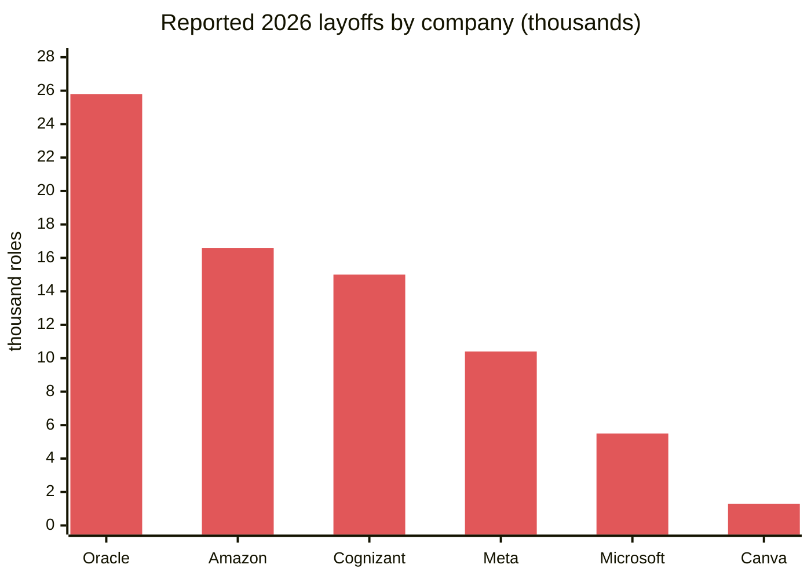
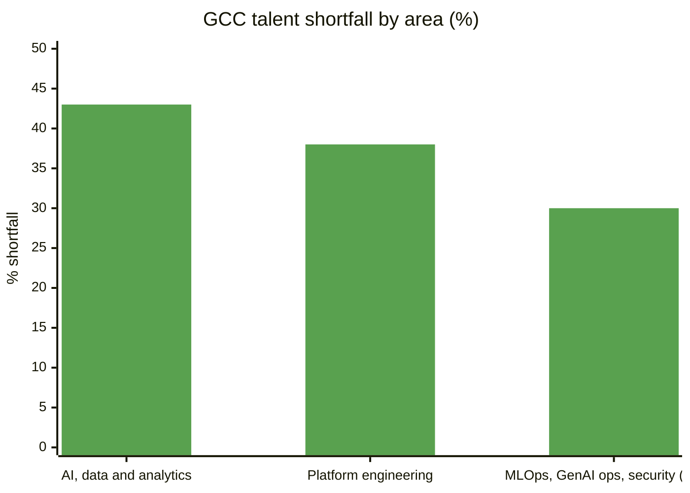
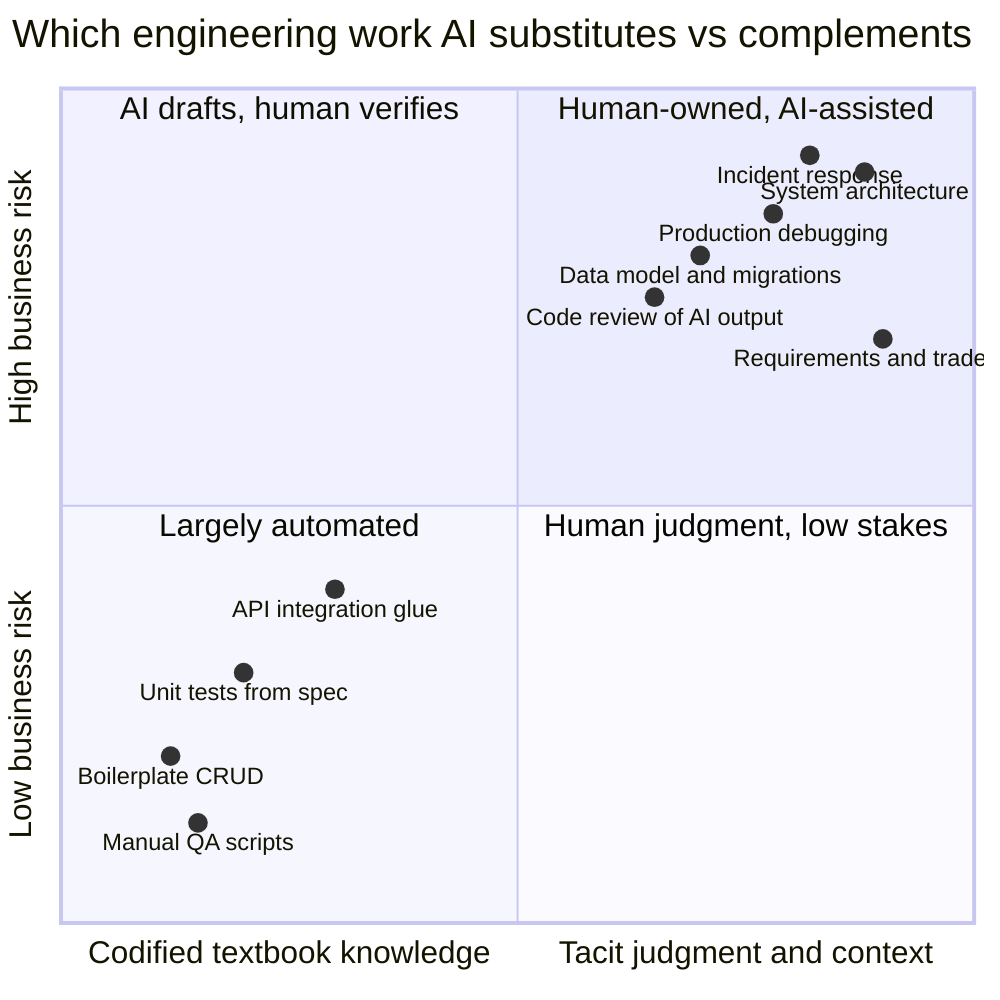
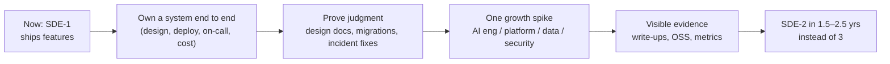

# 📉📈 Market Research 2026 — What's Actually Happening

> [!abstract] The one-paragraph version
> Layoffs are real but they're a **reshuffle, not a collapse**. Big companies are cutting management layers, sales, consulting and roles AI makes cheaper, while India's GCCs report an **18–43% shortfall of mid-to-senior engineers** in AI, data, platform and security. The squeeze lands hardest on **entry level**, and laid-off seniors now compete for mid roles. The way out for a fresher is to **look like an SDE-2 early**. That means owning systems end to end, verifying AI-written code, and having depth in one growth area: AI engineering, platform, data or security.

Researched November 2026. Sources at the bottom. Treat blog-sourced numbers as directional.

---

## 1. Layoffs — the numbers

| Company / period | Cuts | Stated reason |
|---|---|---|
| Tech sector, H1 2026 | ~154,000 (on pace to pass 2025's ~246,000) | Mixed: AI repricing + restructuring framed as AI |
| Oracle | ~25,754 | Restructuring |
| Amazon | ~16,600 (Jan 2026), after 14,000 in Oct 2025 | Removing management layers, not AI headcount |
| Cognizant | ~15,000 ("Project Leap"), mostly India | Shift to AI-augmented delivery |
| Meta | ~10,400 across 2026 rounds | Explicitly tied to AI |
| Microsoft | ~5,500 (~2.5%, unconfirmed), after ~15,000 in 2025 | Sales, consulting, Xbox |
| Canva (Nov 2026) | 1,271 (~22%) | Growth slowed; "refound" around small teams; says it is **not** replacing people with AI |
| India | Reported 2nd-worst hit after the US in AI-linked layoffs (H1 2026) | — |

**My reading as a senior engineer:** the roles being cut are mostly (a) layers of coordination, (b) work AI made cheap: boilerplate CRUD, manual QA, support, and (c) bets that didn't pay. Engineers who **own outcomes and can be trusted with production systems** are not who companies are cutting.

## 2. Where the demand is (India)

| Signal | Number | Source |
|---|---|---|
| Tech job market growth 2026 | +12–15%, ~1.25 lakh new roles | Adecco India |
| AI, data and cybersecurity role demand | +51% | Adecco India |
| ML engineers, data engineers, full-stack devs with AI integration skills | ~+45% | Adecco India |
| AI + cloud + cybersecurity share of tech hiring demand | ~65% | foundit |
| AI/ML engineers | 13% share, +28% growth | foundit |
| GenAI/LLM skills | +26% YoY | foundit |
| QA/test automation, IT support | −2%, −3% | foundit |
| GCC talent shortfall | 18–43% (AI/data 43%, platform eng 38%) concentrated in **mid-to-senior** | Quess Corp |
| GCC share of IT hiring | 41% → 44% | foundit |

> [!note] The third bar is the midpoint of the reported 18–43% range. The report gives no separate figure.

**Named skills in the shortfall:** GenAI engineering, MLOps pipelines, **AI observability**, Terraform, Kubernetes, hybrid-cloud reliability, **FinOps** and cloud-native governance. These map one-to-one to [[Future-Engineering-MOC]].

## 3. The entry-level squeeze

- Stanford Digital Economy Lab (Brynjolfsson & Chandar, Aug 2025): in the most AI-exposed occupations, including software engineering, **employment of 22–25-year-olds fell 16% (relative) since late 2022**, while workers 30+ in the same jobs **grew 6–12%**.
- Interpretation: AI substitutes for *codified, textbook* knowledge, which juniors are hired for. It complements *tacit* knowledge: judgment, context, debugging production, knowing what to build. That tacit knowledge is what seniors have.
- Laid-off experienced engineers now apply for SDE-2 roles, so the SDE-2 bar rises and freshers compete with 4–6-year engineers.

## 4. How the job itself is changing (next 1–3 years)

| Shift | Evidence | What to learn |
|---|---|---|
| AI writes more code; **humans verify** | 84% of devs use AI tools; 46% don't trust the output (Stack Overflow 2025). Round-tables of researchers and industry say verification and validation matter more as agents implement (Roychoudhury, Kang, Ray 2026) | [[Verification-Engineering]] · [[AI-Native-SDLC]] |
| "AI-native" engineering becomes the default | Gartner: ~80% of engineers need to upskill through 2027; most code AI-generated in the medium term; **more** engineers needed long term | [[AI-Native-SDLC]] · [[Context-Engineering-and-Agent-Protocols]] |
| AI engineer interviews test production evidence | Evals, cost-per-conversation, OWASP LLM risks (excessive agency) as the senior differentiator; MCP literacy | [[LLM-Evals-and-AI-Observability]] · [[AI-Security-Engineering]] · [[AI-Cost-and-Small-Models]] |
| Platform engineering everywhere | 38% shortfall in GCCs; golden paths and internal developer platforms | [[Platform-Engineering]] |
| Cost is an architecture concern | FinOps named in GCC shortfall; LLM costs dominate some products | [[Cost-Aware-Architecture]] |
| Interviews test AI collaboration | Karat: moving to human-led, "AI-native" interviews; gap between high and low performers widening | [[AI-Native-SDLC]] · [[Interview-Framework]] |

## 5. What this means for me (SDE-1 → SDE-2 fast)

**My plan, in priority order:**
1. **Core system design (this vault, modules 01–07 + case studies).** Still the entry ticket for SDE-2 interviews.
2. **[[Senior-Engineering-MOC]]**: the things SDE-2/3s do daily. Migrations, schema evolution, design docs, testing, ops, cost.
3. **One spike from [[Future-Engineering-MOC]]**: with my stack (Node/Next/Python + Gemini integrations), the natural spike is **AI engineering**: evals, agents, RAG, AI security, cost.
4. **Evidence**: every learning sprint ends with something shippable: a design doc, an eval report, an OSS PR, a blog post.

→ Full ladder with topics per level: [[SDE-Career-Ladder]]

---

## 📚 Sources

- [Tech Sector Hits 154,000 Layoffs in H1 2026 as Microsoft Cuts 5,500 Roles — Compare the Cloud](https://www.comparethecloud.net/news/tech-sector-hits-154000-layoffs-in-h1-2026-as-microsoft-cuts-5500-roles)
- [Canva restructures 22% of its workforce, 1,271 roles — Dealroom (Nov 2026)](https://dealroom.co/news/169408-canva-restructures-22-of-its-workforce-1-271-roles-as-growth-slows-for)
- [Tech layoffs in H1 2026 outpace entire 2025; India second worst hit — Ground News](https://ground.news/article/tech-layoffs-in-1st-half-of-2026-outpace-entire-2025-india-second-worst-hit_ca532d)
- [India's tech job market set to grow 12–15% in 2026 (Adecco India) — Free Press Journal](https://www.freepressjournal.in/amp/tech/indias-tech-job-market-set-to-grow-1215-in-2026-add-125-lakh-roles-report)
- [AI, cloud and cybersecurity driving IT jobs demand (foundit) — YourStory](https://www.yourstory.com/2026/05/ai-cloud-and-cybersecurity-driving-it-jobs-demand-says-foundit-report)
- [India's GCCs face 18–43% talent shortfall in key tech roles (Quess Corp) — Storyboard18](https://www.storyboard18.com/how-it-works/indias-1900-gccs-face-18-43-talent-shortfall-in-key-tech-roles-quess-corp-90866.htm)
- [A new Stanford analysis reveals who's losing jobs to AI — TIME](https://tollbit.time.com/7312205/ai-jobs-stanford/)
- [Stack Overflow 2025 Developer Survey — press release](https://stackoverflow.co/company/press/archive/stack-overflow-2025-developer-survey/)
- [Gartner: AI will reshape software engineering by 2027 — IndiaAI](https://indiaai.gov.in/article/gartner-research-says-ai-will-reshape-the-software-engineering-landscape-by-2027)
- [Skills for the future software profession: beyond agentic AI! — arXiv 2606.21894](https://arxiv.org/abs/2606.21894)
- [State of software engineer hiring in India — Karat](https://karat.com/resource/state-of-software-engineer-hiring-india/)
- [AI developer hiring: skills that matter in 2026 — Digital Applied](https://www.digitalapplied.com/blog/ai-developer-hiring-skills-that-matter-2026)
- [SDE-1 vs SDE-2 vs SDE-3 — Scaler](https://www.scaler.com/blog/sde-1-vs-sde-2-vs-sde-3/)

---
**Next:** [[SDE-Career-Ladder]] · **Up:** [[System-Design-MOC]]
