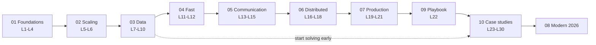
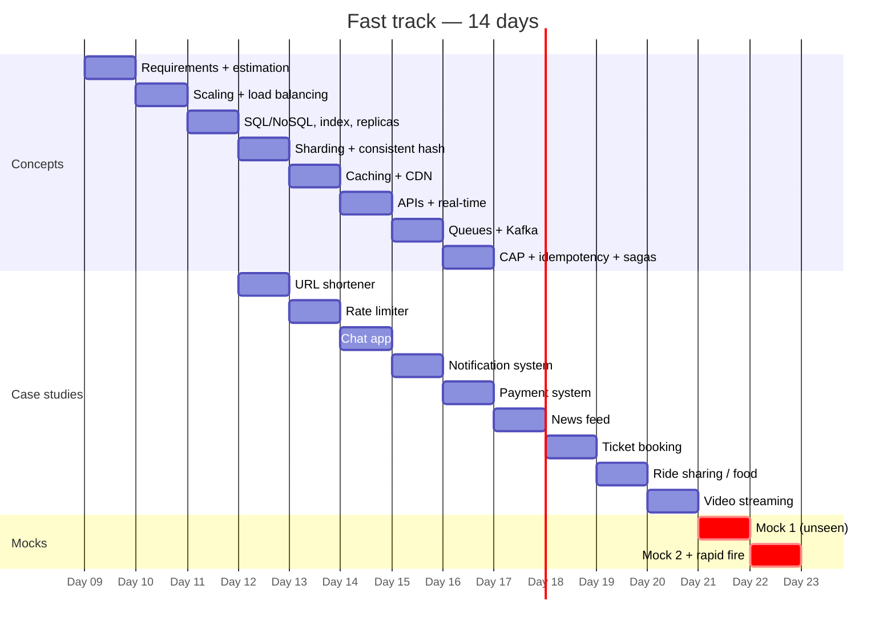

# 🛣️ Learning Roadmap

## The dependency chain

**Rule:** start solving the easy case studies ([[Design-URL-Shortener]], [[Design-Rate-Limiter]]) as soon as you finish Module 04. Don't wait until all theory is "done" — it never is.

---

## Plan A — Fast track (interview in ~2 weeks)

The 80/20. These lectures cover ~80% of what gets asked.

| Day | Study | Solve |
|---|---|---|
| 1 | [[What-is-System-Design]] · [[Estimation-and-Latency-Numbers]] | — |
| 2 | [[Scaling-Servers-Stateless-and-SPOF]] · [[Load-Balancing]] | — |
| 3 | [[SQL-vs-NoSQL]] · [[Indexing]] · [[Replication]] | — |
| 4 | [[Sharding-and-Partitioning]] · [[Consistent-Hashing]] | [[Design-URL-Shortener]] |
| 5 | [[Caching]] · [[Cache-Pitfalls]] · [[CDN]] | [[Design-Rate-Limiter]] |
| 6 | [[API-Design]] · [[Real-Time-Communication]] | [[Design-Chat-App]] |
| 7 | [[Message-Queues]] · [[Kafka-Deep-Dive]] | [[Design-Notification-System]] |
| 8 | [[CAP-and-PACELC]] · [[Idempotency]] · [[Distributed-Transactions]] | [[Design-Payment-System]] |
| 9 | [[Interview-Framework]] · [[Common-Mistakes-and-Mock-Interview]] | [[Design-News-Feed]] |
| 10 | [[Resilience-Patterns]] | [[Design-Ticket-Booking]] |
| 11 | [[Geospatial-Indexing]] | [[Design-Ride-Sharing]] or [[Design-Food-Delivery]] |
| 12 | [[Object-Storage]] | [[Design-Video-Streaming]] |
| 13 | [[Tricky-Questions]] · [[Trade-off-Questions]] | 1 timed mock (unseen problem) |
| 14 | [[Rapid-Fire-Revision]] | 1 timed mock + review |

### 📅 Plan A as a Gantt chart

## Plan B — Solid (6 weeks, ~1.5 h/day on weekdays + weekends)

| Week | Modules | Case studies |
|---|---|---|
| 1 | 01 + 02 | — |
| 2 | 03 (all) | URL shortener |
| 3 | 04 + 05 | Rate limiter, Chat, Notification |
| 4 | 06 | Payment, Ticket booking, KV store |
| 5 | 07 + 09 | News feed, Video, File sync, Typeahead |
| 6 | 08 + question banks | Ride-sharing, Food delivery, Flash sale, LLM chat · 3 mocks |

## Plan C — Deep (12 weeks, aiming SDE-2 / product companies)

Plan B, then weeks 7–12: one module re-read per week (spaced), two unseen case studies per week under a timer, one peer mock per week, and all of [[Modern-Topics-MOC]]. Read one engineering-blog post-mortem per week (list in [[SD-Resources]]).

## Plan D — SDE-2 → SDE-3 + future-proofing (6 months, alongside the job) ➕

| Month | Senior engineering ([[Senior-Engineering-MOC]]) | Future track ([[Future-Engineering-MOC]]) | Evidence to produce |
|---|---|---|---|
| 1 | [[Data-Modeling-and-Schema-Evolution]] · [[Zero-Downtime-Migrations-and-Deployments]] | [[AI-Native-SDLC]] | Ship one expand–contract migration at work |
| 2 | [[Testing-Distributed-Systems]] · [[Concurrency-and-Async-Models]] | [[Verification-Engineering]] | Add contract + property tests to a service |
| 3 | [[Operational-Excellence-and-Incidents]] · [[Design-Docs-and-ADRs]] | [[LLM-Evals-and-AI-Observability]] | Write a design doc; build an eval suite |
| 4 | [[Domain-Driven-Design]] · [[Workflow-Orchestration-and-Durable-Execution]] | [[Context-Engineering-and-Agent-Protocols]] | Build an MCP server with tests |
| 5 | [[Capacity-Planning-and-Performance-Engineering]] · [[Cost-Aware-Architecture]] | [[AI-Security-Engineering]] · [[AI-Cost-and-Small-Models]] | Cost-per-task dashboard + red-team report |
| 6 | [[Multi-Tenancy-and-SaaS-Architecture]] · [[Large-Scale-Migrations]] · [[Technical-Leadership-for-Engineers]] | Awareness: [[Platform-Engineering]], [[Data-Engineering-for-AI]], [[Supply-Chain-Security-and-Post-Quantum]], [[Privacy-and-AI-Regulation]] | Write-up / talk / OSS PR |

Why this plan: [[Market-Research-2026]] · Levels: [[SDE-Career-Ladder]]

---

## Where the syllabus maps to the vault

| Lecture | Note(s) |
|---|---|
| L1 | [[What-is-System-Design]] |
| L2 | [[How-an-App-Works]] |
| L3 | [[Network-Protocols]] |
| L4 | [[Estimation-and-Latency-Numbers]] |
| L5 | [[App-Growth-Story]] |
| L6 | [[Scaling-Servers-Stateless-and-SPOF]] · [[Load-Balancing]] |
| L7 | [[SQL-vs-NoSQL]] · [[Transactions-and-Isolation-Levels]] |
| L8 | [[Indexing]] |
| L9 | [[Replication]] |
| L10 | [[Sharding-and-Partitioning]] · [[Consistent-Hashing]] |
| L11 | [[Caching]] · [[Cache-Pitfalls]] · [[Redis-Deep-Dive]] |
| L12 | [[Object-Storage]] · [[CDN]] |
| L13 | [[API-Design]] · [[REST-vs-gRPC-vs-GraphQL]] · [[Real-Time-Communication]] |
| L14 | [[Message-Queues]] · [[Kafka-Deep-Dive]] · [[Event-Driven-Architecture]] |
| L15 | [[Microservices-vs-Monolith]] · [[Proxies-and-API-Gateways]] |
| L16 | [[Why-Distributed-Systems-Are-Hard]] · [[CAP-and-PACELC]] · [[Consistency-Models]] |
| L17 | [[Consensus-and-Leader-Election]] · [[Clocks-and-Ordering]] · [[Unique-ID-Generation]] |
| L18 | [[Distributed-Transactions]] · [[Idempotency]] |
| L19 | [[Resilience-Patterns]] · [[Multi-Region-and-Disaster-Recovery]] · [[Observability-and-SLOs]] |
| L20 | [[Authentication-and-Authorization]] · [[Security-Essentials]] |
| L21 | [[Search-Systems]] · [[Batch-and-Stream-Processing]] |
| L22 | [[Interview-Framework]] · [[Level-Expectations]] · [[Common-Mistakes-and-Mock-Interview]] |
| L23–L30 | [[Case-Studies-MOC]] |

---
**Next:** [[Where-to-Focus]] · **Up:** [[System-Design-MOC]]
