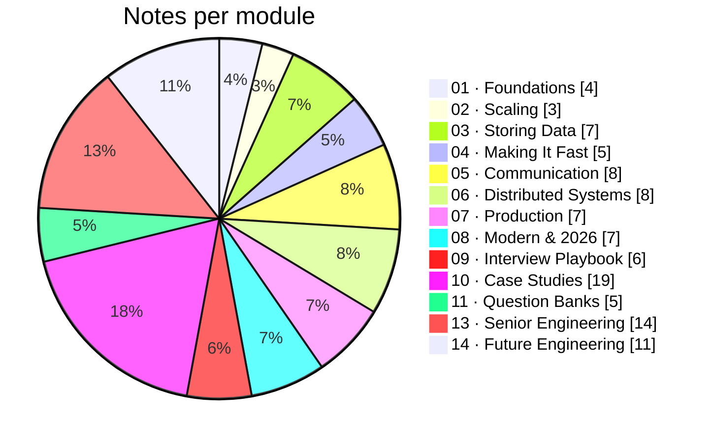

# 📊 Progress Tracker

**Started:** `YYYY-MM-DD` · **Target interview-ready:** `YYYY-MM-DD`

## Live dashboard (native Obsidian Bases — no plugin needed)

Update the `status` property at the top of any note (Not Started → Learning → Practicing → Comfortable → Mastered) and these tables update themselves.

![[SD-Dashboard.base]]

## Status legend

`⬜ Not Started` → `🟡 Learning` → `🔵 Practicing` → `🟢 Comfortable` → `✅ Mastered`

**🟢 Comfortable** = you can explain it out loud for 3 minutes without notes.
**✅ Mastered** = you used it in a timed mock and defended it under follow-ups.

Columns: **T** = theory read · **D** = drew the diagram from memory · **M** = used in a timed mock · **C** = confidence · **R** = needs revision

## 01 · Foundations

| Note | Lecture | Priority | T | D | M | C | R |
|---|---|---|---|---|---|---|---|
| [[What-is-System-Design]] | L1 | 🔥 Must | ⬜ | ⬜ | ⬜ | ⬜ | ☐ |
| [[How-an-App-Works]] | L2 | 🔥 Must | ⬜ | ⬜ | ⬜ | ⬜ | ☐ |
| [[Network-Protocols]] | L3 | 🔥 Must | ⬜ | ⬜ | ⬜ | ⬜ | ☐ |
| [[Estimation-and-Latency-Numbers]] | L4 | 🔥 Must | ⬜ | ⬜ | ⬜ | ⬜ | ☐ |

## 02 · Scaling

| Note | Lecture | Priority | T | D | M | C | R |
|---|---|---|---|---|---|---|---|
| [[App-Growth-Story]] | L5 | 🔥 Must | ⬜ | ⬜ | ⬜ | ⬜ | ☐ |
| [[Load-Balancing]] | L6 | 🔥 Must | ⬜ | ⬜ | ⬜ | ⬜ | ☐ |
| [[Scaling-Servers-Stateless-and-SPOF]] | L6 | 🔥 Must | ⬜ | ⬜ | ⬜ | ⬜ | ☐ |

## 03 · Storing Data

| Note | Lecture | Priority | T | D | M | C | R |
|---|---|---|---|---|---|---|---|
| [[SQL-vs-NoSQL]] | L7 | 🔥 Must | ⬜ | ⬜ | ⬜ | ⬜ | ☐ |
| [[Transactions-and-Isolation-Levels]] | L7 (extended) | ⭐ Should | ⬜ | ⬜ | ⬜ | ⬜ | ☐ |
| [[Indexing]] | L8 | 🔥 Must | ⬜ | ⬜ | ⬜ | ⬜ | ☐ |
| [[Replication]] | L9 | 🔥 Must | ⬜ | ⬜ | ⬜ | ⬜ | ☐ |
| [[Consistent-Hashing]] | L10 | ⭐ Should | ⬜ | ⬜ | ⬜ | ⬜ | ☐ |
| [[Sharding-and-Partitioning]] | L10 | 🔥 Must | ⬜ | ⬜ | ⬜ | ⬜ | ☐ |
| [[Choosing-a-Database]] | — (added) | 🔥 Must | ⬜ | ⬜ | ⬜ | ⬜ | ☐ |

## 04 · Making It Fast

| Note | Lecture | Priority | T | D | M | C | R |
|---|---|---|---|---|---|---|---|
| [[Cache-Pitfalls]] | L11 | 🔥 Must | ⬜ | ⬜ | ⬜ | ⬜ | ☐ |
| [[Caching]] | L11 | 🔥 Must | ⬜ | ⬜ | ⬜ | ⬜ | ☐ |
| [[Redis-Deep-Dive]] | L11 (extended) | ⭐ Should | ⬜ | ⬜ | ⬜ | ⬜ | ☐ |
| [[CDN]] | L12 | 🔥 Must | ⬜ | ⬜ | ⬜ | ⬜ | ☐ |
| [[Object-Storage]] | L12 | 🔥 Must | ⬜ | ⬜ | ⬜ | ⬜ | ☐ |

## 05 · Communication

| Note | Lecture | Priority | T | D | M | C | R |
|---|---|---|---|---|---|---|---|
| [[API-Design]] | L13 | 🔥 Must | ⬜ | ⬜ | ⬜ | ⬜ | ☐ |
| [[REST-vs-gRPC-vs-GraphQL]] | L13 | ⭐ Should | ⬜ | ⬜ | ⬜ | ⬜ | ☐ |
| [[Real-Time-Communication]] | L13 | 🔥 Must | ⬜ | ⬜ | ⬜ | ⬜ | ☐ |
| [[Event-Driven-Architecture]] | L14 | ⭐ Should | ⬜ | ⬜ | ⬜ | ⬜ | ☐ |
| [[Kafka-Deep-Dive]] | L14 | ⭐ Should | ⬜ | ⬜ | ⬜ | ⬜ | ☐ |
| [[Message-Queues]] | L14 | 🔥 Must | ⬜ | ⬜ | ⬜ | ⬜ | ☐ |
| [[Microservices-vs-Monolith]] | L15 | ⭐ Should | ⬜ | ⬜ | ⬜ | ⬜ | ☐ |
| [[Proxies-and-API-Gateways]] | L15 | ⭐ Should | ⬜ | ⬜ | ⬜ | ⬜ | ☐ |

## 06 · Distributed Systems

| Note | Lecture | Priority | T | D | M | C | R |
|---|---|---|---|---|---|---|---|
| [[CAP-and-PACELC]] | L16 | 🔥 Must | ⬜ | ⬜ | ⬜ | ⬜ | ☐ |
| [[Consistency-Models]] | L16 | ⭐ Should | ⬜ | ⬜ | ⬜ | ⬜ | ☐ |
| [[Why-Distributed-Systems-Are-Hard]] | L16 | ⭐ Should | ⬜ | ⬜ | ⬜ | ⬜ | ☐ |
| [[Clocks-and-Ordering]] | L17 | 💡 Edge | ⬜ | ⬜ | ⬜ | ⬜ | ☐ |
| [[Consensus-and-Leader-Election]] | L17 | 💡 Edge | ⬜ | ⬜ | ⬜ | ⬜ | ☐ |
| [[Unique-ID-Generation]] | L17 | 🔥 Must | ⬜ | ⬜ | ⬜ | ⬜ | ☐ |
| [[Distributed-Transactions]] | L18 | ⭐ Should | ⬜ | ⬜ | ⬜ | ⬜ | ☐ |
| [[Idempotency]] | L18 | 🔥 Must | ⬜ | ⬜ | ⬜ | ⬜ | ☐ |

## 07 · Production

| Note | Lecture | Priority | T | D | M | C | R |
|---|---|---|---|---|---|---|---|
| [[Multi-Region-and-Disaster-Recovery]] | L19 | ⭐ Should | ⬜ | ⬜ | ⬜ | ⬜ | ☐ |
| [[Observability-and-SLOs]] | L19 | ⭐ Should | ⬜ | ⬜ | ⬜ | ⬜ | ☐ |
| [[Resilience-Patterns]] | L19 | 🔥 Must | ⬜ | ⬜ | ⬜ | ⬜ | ☐ |
| [[Authentication-and-Authorization]] | L20 | 🔥 Must | ⬜ | ⬜ | ⬜ | ⬜ | ☐ |
| [[Security-Essentials]] | L20 | ⭐ Should | ⬜ | ⬜ | ⬜ | ⬜ | ☐ |
| [[Batch-and-Stream-Processing]] | L21 | ⭐ Should | ⬜ | ⬜ | ⬜ | ⬜ | ☐ |
| [[Search-Systems]] | L21 | ⭐ Should | ⬜ | ⬜ | ⬜ | ⬜ | ☐ |

## 08 · Modern & 2026

| Note | Lecture | Priority | T | D | M | C | R |
|---|---|---|---|---|---|---|---|
| [[Geospatial-Indexing]] | L29 (extended) | ⭐ Should | ⬜ | ⬜ | ⬜ | ⬜ | ☐ |
| [[AI-Agent-Systems]] | — (added) | 💡 Edge | ⬜ | ⬜ | ⬜ | ⬜ | ☐ |
| [[LLM-Serving-and-Inference]] | — (added) | 💡 Edge | ⬜ | ⬜ | ⬜ | ⬜ | ☐ |
| [[Probabilistic-Data-Structures]] | — (added) | ⭐ Should | ⬜ | ⬜ | ⬜ | ⬜ | ☐ |
| [[RAG-and-Vector-Databases]] | — (added) | 💡 Edge | ⬜ | ⬜ | ⬜ | ⬜ | ☐ |
| [[Real-Time-Collaboration-CRDTs]] | — (added) | 💡 Edge | ⬜ | ⬜ | ⬜ | ⬜ | ☐ |
| [[Recommendation-and-Ranking-Systems]] | — (added) | 💡 Edge | ⬜ | ⬜ | ⬜ | ⬜ | ☐ |

## 09 · Interview Playbook

| Note | Lecture | Priority | T | D | M | C | R |
|---|---|---|---|---|---|---|---|
| [[Common-Mistakes-and-Mock-Interview]] | L22 | 🔥 Must | ⬜ | ⬜ | ⬜ | ⬜ | ☐ |
| [[Interview-Framework]] | L22 | 🔥 Must | ⬜ | ⬜ | ⬜ | ⬜ | ☐ |
| [[Level-Expectations]] | L22 | 🔥 Must | ⬜ | ⬜ | ⬜ | ⬜ | ☐ |
| [[Trade-off-Language]] | L22 | ⭐ Should | ⬜ | ⬜ | ⬜ | ⬜ | ☐ |
| [[Company-Patterns]] | — (added) | ⭐ Should | ⬜ | ⬜ | ⬜ | ⬜ | ☐ |
| [[LLD-and-Machine-Coding-Primer]] | — (added) | 🔥 Must | ⬜ | ⬜ | ⬜ | ⬜ | ☐ |

## 10 · Case Studies

| Note | Lecture | Priority | T | D | M | C | R |
|---|---|---|---|---|---|---|---|
| [[Design-URL-Shortener]] | L23 | 🔥 Must | ⬜ | ⬜ | ⬜ | ⬜ | ☐ |
| [[Design-Rate-Limiter]] | L24 | 🔥 Must | ⬜ | ⬜ | ⬜ | ⬜ | ☐ |
| [[Design-Chat-App]] | L25 | 🔥 Must | ⬜ | ⬜ | ⬜ | ⬜ | ☐ |
| [[Design-News-Feed]] | L26 | 🔥 Must | ⬜ | ⬜ | ⬜ | ⬜ | ☐ |
| [[Design-Video-Streaming]] | L27 | 🔥 Must | ⬜ | ⬜ | ⬜ | ⬜ | ☐ |
| [[Design-Ticket-Booking]] | L28 | 🔥 Must | ⬜ | ⬜ | ⬜ | ⬜ | ☐ |
| [[Design-Ride-Sharing]] | L29 | 🔥 Must | ⬜ | ⬜ | ⬜ | ⬜ | ☐ |
| [[Design-Payment-System]] | L30 | 🔥 Must | ⬜ | ⬜ | ⬜ | ⬜ | ☐ |
| [[Design-Ad-Click-Aggregator]] | — (added, high frequency) | ⭐ Should | ⬜ | ⬜ | ⬜ | ⬜ | ☐ |
| [[Design-File-Storage-Sync]] | Practice (L12, L14, L17) | ⭐ Should | ⬜ | ⬜ | ⬜ | ⬜ | ☐ |
| [[Design-Flash-Sale]] | — (added, India favourite) | ⭐ Should | ⬜ | ⬜ | ⬜ | ⬜ | ☐ |
| [[Design-Food-Delivery]] | Practice (L14, L18, L29, L30) | 🔥 Must | ⬜ | ⬜ | ⬜ | ⬜ | ☐ |
| [[Design-Job-Scheduler]] | — (added, high frequency) | ⭐ Should | ⬜ | ⬜ | ⬜ | ⬜ | ☐ |
| [[Design-Key-Value-Store]] | Practice (L9, L10, L16, L17) | ⭐ Should | ⬜ | ⬜ | ⬜ | ⬜ | ☐ |
| [[Design-LLM-Chat-Service]] | — (added, 2026 AI-native) | 💡 Edge | ⬜ | ⬜ | ⬜ | ⬜ | ☐ |
| [[Design-Leaderboard-Top-K]] | — (added, high frequency) | ⭐ Should | ⬜ | ⬜ | ⬜ | ⬜ | ☐ |
| [[Design-Notification-System]] | Practice (L13, L14, L19) | 🔥 Must | ⬜ | ⬜ | ⬜ | ⬜ | ☐ |
| [[Design-Typeahead]] | Practice (L11, L21) | ⭐ Should | ⬜ | ⬜ | ⬜ | ⬜ | ☐ |
| [[Design-Web-Crawler]] | — (added, high frequency) | ⭐ Should | ⬜ | ⬜ | ⬜ | ⬜ | ☐ |

## 11 · Question Banks

| Note | Lecture | Priority | T | D | M | C | R |
|---|---|---|---|---|---|---|---|
| [[Conceptual-Questions]] | — | 🔥 Must | ⬜ | ⬜ | ⬜ | ⬜ | ☐ |
| [[Rapid-Fire-Revision]] | — | 🔥 Must | ⬜ | ⬜ | ⬜ | ⬜ | ☐ |
| [[Scenario-Questions]] | — | ⭐ Should | ⬜ | ⬜ | ⬜ | ⬜ | ☐ |
| [[Trade-off-Questions]] | — | 🔥 Must | ⬜ | ⬜ | ⬜ | ⬜ | ☐ |
| [[Tricky-Questions]] | — | 🔥 Must | ⬜ | ⬜ | ⬜ | ⬜ | ☐ |

## 13 · Senior Engineering

| Note | Lecture | Priority | T | D | M | C | R |
|---|---|---|---|---|---|---|---|
| [[Capacity-Planning-and-Performance-Engineering]] | — (added) | ⭐ Should | ⬜ | ⬜ | ⬜ | ⬜ | ☐ |
| [[Concurrency-and-Async-Models]] | — (added) | ⭐ Should | ⬜ | ⬜ | ⬜ | ⬜ | ☐ |
| [[Cost-Aware-Architecture]] | — (added) | ⭐ Should | ⬜ | ⬜ | ⬜ | ⬜ | ☐ |
| [[Data-Modeling-and-Schema-Evolution]] | — (added) | 🔥 Must | ⬜ | ⬜ | ⬜ | ⬜ | ☐ |
| [[Design-Docs-and-ADRs]] | — (added) | 🔥 Must | ⬜ | ⬜ | ⬜ | ⬜ | ☐ |
| [[Domain-Driven-Design]] | — (added) | ⭐ Should | ⬜ | ⬜ | ⬜ | ⬜ | ☐ |
| [[Frontend-System-Design]] | — (added) | ⭐ Should | ⬜ | ⬜ | ⬜ | ⬜ | ☐ |
| [[Large-Scale-Migrations]] | — (added) | ⭐ Should | ⬜ | ⬜ | ⬜ | ⬜ | ☐ |
| [[Multi-Tenancy-and-SaaS-Architecture]] | — (added) | ⭐ Should | ⬜ | ⬜ | ⬜ | ⬜ | ☐ |
| [[Operational-Excellence-and-Incidents]] | — (added) | 🔥 Must | ⬜ | ⬜ | ⬜ | ⬜ | ☐ |
| [[Technical-Leadership-for-Engineers]] | — (added) | ⭐ Should | ⬜ | ⬜ | ⬜ | ⬜ | ☐ |
| [[Testing-Distributed-Systems]] | — (added) | ⭐ Should | ⬜ | ⬜ | ⬜ | ⬜ | ☐ |
| [[Workflow-Orchestration-and-Durable-Execution]] | — (added) | ⭐ Should | ⬜ | ⬜ | ⬜ | ⬜ | ☐ |
| [[Zero-Downtime-Migrations-and-Deployments]] | — (added) | 🔥 Must | ⬜ | ⬜ | ⬜ | ⬜ | ☐ |

## 14 · Future Engineering

| Note | Lecture | Priority | T | D | M | C | R |
|---|---|---|---|---|---|---|---|
| [[AI-Cost-and-Small-Models]] | — (added) | ⭐ Should | ⬜ | ⬜ | ⬜ | ⬜ | ☐ |
| [[AI-Native-SDLC]] | — (added) | 🔥 Must | ⬜ | ⬜ | ⬜ | ⬜ | ☐ |
| [[AI-Security-Engineering]] | — (added) | ⭐ Should | ⬜ | ⬜ | ⬜ | ⬜ | ☐ |
| [[Context-Engineering-and-Agent-Protocols]] | — (added) | ⭐ Should | ⬜ | ⬜ | ⬜ | ⬜ | ☐ |
| [[Data-Engineering-for-AI]] | — (added) | ⭐ Should | ⬜ | ⬜ | ⬜ | ⬜ | ☐ |
| [[Edge-Wasm-and-eBPF]] | — (added) | 💡 Edge | ⬜ | ⬜ | ⬜ | ⬜ | ☐ |
| [[LLM-Evals-and-AI-Observability]] | — (added) | 🔥 Must | ⬜ | ⬜ | ⬜ | ⬜ | ☐ |
| [[Platform-Engineering]] | — (added) | ⭐ Should | ⬜ | ⬜ | ⬜ | ⬜ | ☐ |
| [[Privacy-and-AI-Regulation]] | — (added) | ⭐ Should | ⬜ | ⬜ | ⬜ | ⬜ | ☐ |
| [[Supply-Chain-Security-and-Post-Quantum]] | — (added) | 💡 Edge | ⬜ | ⬜ | ⬜ | ⬜ | ☐ |
| [[Verification-Engineering]] | — (added) | 🔥 Must | ⬜ | ⬜ | ⬜ | ⬜ | ☐ |

---
**Up:** [[System-Design-MOC]] · **Revision:** [[SD-Revision-System]]
