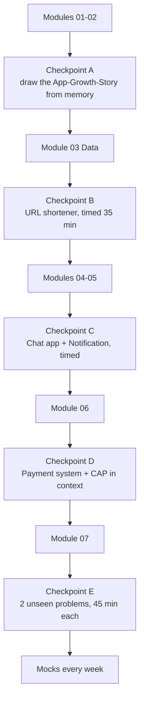

	
# 🔁 Revision System

You will forget replication lag by the time you reach Kafka. That's normal. System design is worse than most subjects for this because the concepts only "click" when they collide inside a case study — so revision here is **solving, not re-reading**.

## The principle

**Retrieval > re-reading.** Draw it from memory, then check. Explain it out loud, then check.

## The checkpoint schedule



| Checkpoint | Test (no notes) | Pass bar |
|---|---|---|
| **A** | Draw the 1 → 1M users architecture and narrate each step | Every box justified with "because…" |
| **B** | [[Design-URL-Shortener]] in 35 min | Has numbers, API, ID scheme, cache, DB choice |
| **C** | [[Design-Chat-App]] + [[Design-Notification-System]] | WebSocket fan-out, offline delivery, retry + DLQ |
| **D** | [[Design-Payment-System]] | Idempotency keys, ledger, saga, reconciliation |
| **E** | Two problems you've never read | Finishes all framework steps; one deep dive 3 levels deep |

## Spaced intervals for each case study

`Day 0 solve → Day 2 re-draw → Day 7 re-solve timed → Day 21 explain to someone → Day 45 re-solve`

## The 5-minute daily drill

Pick 10 random cards from [[Rapid-Fire-Revision]]. Say the answer out loud. Mark misses in [[SD-Progress-Tracker]] (`R` column).

## Weekly ritual (Sunday, 60 min)

1. One timed mock on an unseen problem (from [[Case-Studies-MOC]] "extra" list or a friend's pick).
2. Diff against the note. Log gaps.
3. Read one real engineering-blog post-mortem ([[SD-Resources]]). Ask: *which concept in my vault would have prevented this?*

## Flashcard format (Spaced Repetition plugin)

```text
What breaks when you shard by user_id and one user is a celebrity?::Hot partition — one shard gets disproportionate load. Fix: split hot keys (key#salt), cache, or special-case celebrities (hybrid fan-out).
```

---
**Up:** [[System-Design-MOC]] · **Tracker:** [[SD-Progress-Tracker]]
