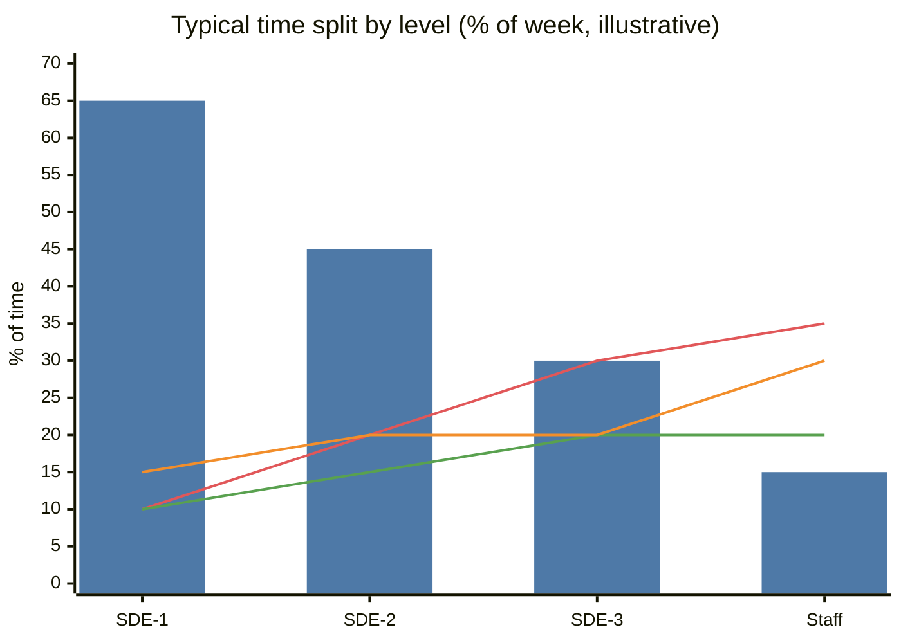
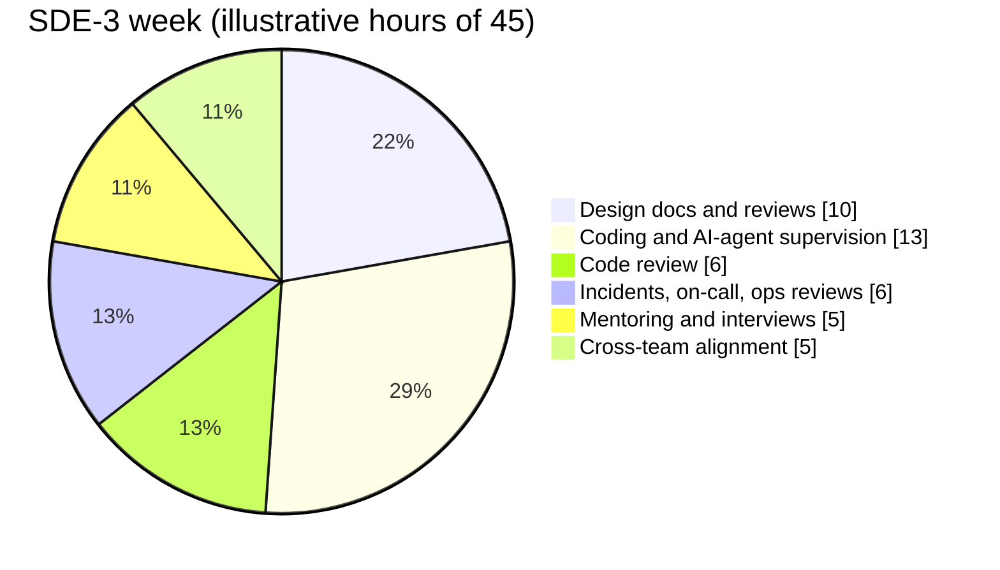
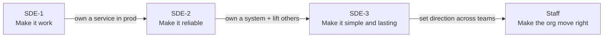
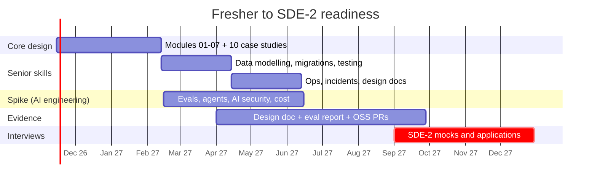

# 🪜 SDE Career Ladder — What Each Level Actually Does and Knows

> [!important] The real difference between levels
> It isn't years. It's **scope × ambiguity × who depends on you**.
> SDE-1 makes a task work. SDE-2 makes a feature or service work in production. SDE-3 makes a *system of services* work for years and makes other engineers better. Staff makes *several teams* go the right direction.
> Microsoft's Nate Waddoups has a one-liner for SDE-3: **"creates simple solutions to complex problems."**

## The ladder at a glance

| | SDE-1 (0–2 yrs) | SDE-2 (2–5 yrs) | SDE-3 / Senior (5–8+ yrs) | Staff (8+ yrs) |
|---|---|---|---|---|
| **Scope** | Tasks, bugs, small features | A feature or service end to end | Multiple services / a product area | Multiple teams / org-wide architecture |
| **Ambiguity** | Well-defined problems | Some ambiguity, clear goal | Ambiguous problem, they define the goal | Ambiguous strategy, they define the problem |
| **Design** | Participates, learns | Writes designs for their service | Leads architecture, reviews others' designs | Sets technical direction, makes build-vs-buy calls |
| **Production** | Fixes bugs with help | On-call, owns SLOs of their service | Leads incidents, designs for failure | Defines reliability strategy |
| **People** | Learns | Mentors SDE-1s | Mentors SDE-2s, interviews, raises the bar | Grows seniors, influences without authority |
| **With AI (2026+)** | Uses assistants; must **understand and verify** | Directs agents on features, owns review quality | Designs AI-assisted workflows + guardrails for the team | Decides where AI fits in the org's SDLC |
| **Interview focus** | DSA, LLD/machine coding, basics | HLD + LLD + behavioural | Architecture depth, leadership scenarios | Strategy, past impact, org design |

## 📊 Visual model

**Scope grows faster than coding time:**

> [!note] Bars = hands-on coding (incl. directing AI agents). Line 1 = design and reviews. Line 2 = operations and incidents. Line 3 = mentoring and alignment.

**What a 5–7-year engineer's week looks like:**

**Growth path:**

---

## What to know at each level — mapped to this vault

### SDE-1 → interview-ready
- DSA + [[LLD-and-Machine-Coding-Primer]]
- Tier 1 of [[Where-to-Focus]]: [[Estimation-and-Latency-Numbers]], [[Load-Balancing]], [[SQL-vs-NoSQL]], [[Indexing]], [[Caching]], [[Message-Queues]], [[API-Design]], [[Idempotency]]
- 5 case studies: [[Design-URL-Shortener]], [[Design-Rate-Limiter]], [[Design-Chat-App]], [[Design-Notification-System]], [[Design-News-Feed]]
- **AI-era baseline:** [[AI-Native-SDLC]]. Use agents *and* be able to explain every line they wrote.

### SDE-2 → owns a service in production
- All of modules 01–07 + 10 core case studies
- [[Data-Modeling-and-Schema-Evolution]] · [[Zero-Downtime-Migrations-and-Deployments]] · [[Testing-Distributed-Systems]] · [[Operational-Excellence-and-Incidents]] · [[Concurrency-and-Async-Models]] · [[Design-Docs-and-ADRs]] (writing one)
- If full-stack: [[Frontend-System-Design]]
- One AI-era skill: [[LLM-Evals-and-AI-Observability]] or [[Platform-Engineering]]

### SDE-3 → owns a system, raises others
- [[Domain-Driven-Design]] · [[Multi-Tenancy-and-SaaS-Architecture]] · [[Capacity-Planning-and-Performance-Engineering]] · [[Workflow-Orchestration-and-Durable-Execution]] · [[Cost-Aware-Architecture]] · [[Large-Scale-Migrations]] · [[Technical-Leadership-for-Engineers]]
- Distributed depth: [[Consensus-and-Leader-Election]], [[Consistency-Models]], [[Multi-Region-and-Disaster-Recovery]]
- AI-era: [[Verification-Engineering]], [[AI-Security-Engineering]], [[Context-Engineering-and-Agent-Protocols]]

### Staff → awareness of where the industry goes
- [[Future-Engineering-MOC]] end to end: [[Platform-Engineering]], [[Data-Engineering-for-AI]], [[Supply-Chain-Security-and-Post-Quantum]], [[Privacy-and-AI-Regulation]], [[Edge-Wasm-and-eBPF]], [[AI-Cost-and-Small-Models]]

---

## Promotion evidence checklist (what reviewers look for)

| Evidence | SDE-1→2 | SDE-2→3 |
|---|---|---|
| Shipped a project you **scoped** yourself | ✅ | ✅ (multi-service) |
| Wrote a design doc others approved | 1 | Several, incl. reviewing others' |
| Led / resolved an incident + wrote the postmortem | Participated | Led |
| Did a migration with zero downtime | Helpful | Expected |
| Improved a metric (latency, cost, reliability) with numbers | ✅ | ✅ (bigger scope) |
| Mentored someone measurably | — | ✅ |
| Introduced a practice others adopted (tests, evals, tooling) | — | ✅ |

## My 18-month plan (fresher → SDE-2-ready)

---
**Prev:** [[Market-Research-2026]] · **Up:** [[System-Design-MOC]] · **Detailed levels:** [[Level-Expectations]]
