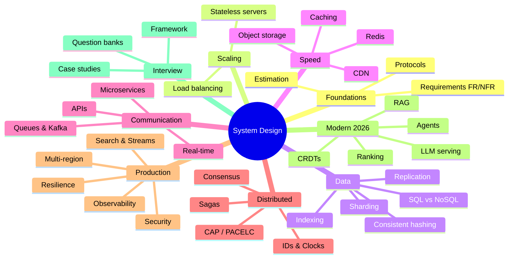

# 🗺️ System Design — Master Map of Content

The whole vault, in dependency order. Every note is reachable from here.
Built on the 30-lecture syllabus (L1–L30) + 5 practice problems, then extended with what interviews are actually asking in 2026 (AI-era systems, ML ranking, real-time collaboration, cost as a constraint).

---

## 🏁 Start
[[SD-Start-Here]] · [[SD-Learning-Roadmap]] · [[SD-Progress-Tracker]] · [[SD-Revision-System]]

## 🎨 Visual boards
- 🗺️ [[System-Design-Map.canvas|Whole-syllabus Canvas map]] — every note as a clickable card, grouped and colour-coded by module
- 🧩 [[Case-Study-Concept-Map.canvas|Case study ↔ concept Canvas]] — lines show which concepts each design uses
- 📋 [[SD-Dashboard.base|Live progress dashboard (Bases)]] — tables that update from each note's `status`
- 🕸️ Graph view — colour groups per module are pre-configured (white nodes = MOCs)

## 🧭 Strategy (read before you study anything)
[[Market-Research-2026]] · [[SDE-Career-Ladder]] · [[Where-to-Focus]] · [[System-Design-Trends-2026]] · [[Level-Expectations]] · [[Company-Patterns]]

---

## 01 · Foundations → [[Foundations-MOC]]
[[What-is-System-Design]] (L1) · [[How-an-App-Works]] (L2) · [[Network-Protocols]] (L3) · [[Estimation-and-Latency-Numbers]] (L4)

## 02 · Scaling the Application → [[Scaling-MOC]]
[[App-Growth-Story]] (L5) · [[Scaling-Servers-Stateless-and-SPOF]] (L6) · [[Load-Balancing]] (L6)

## 03 · Storing Data → [[Data-Storage-MOC]]
[[SQL-vs-NoSQL]] (L7) · [[Transactions-and-Isolation-Levels]] ➕ · [[Indexing]] (L8) · [[Replication]] (L9) · [[Sharding-and-Partitioning]] (L10) · [[Consistent-Hashing]] (L10) · [[Choosing-a-Database]] ➕

## 04 · Making It Fast → [[Performance-MOC]]
[[Caching]] (L11) · [[Cache-Pitfalls]] (L11) · [[Redis-Deep-Dive]] ➕ · [[Object-Storage]] (L12) · [[CDN]] (L12)

## 05 · How Systems Communicate → [[Communication-MOC]]
[[API-Design]] (L13) · [[REST-vs-gRPC-vs-GraphQL]] (L13) · [[Real-Time-Communication]] (L13) · [[Message-Queues]] (L14) · [[Kafka-Deep-Dive]] (L14) · [[Event-Driven-Architecture]] (L14) · [[Microservices-vs-Monolith]] (L15) · [[Proxies-and-API-Gateways]] (L15)

## 06 · Distributed Systems Thinking → [[Distributed-Systems-MOC]]
[[Why-Distributed-Systems-Are-Hard]] (L16) · [[CAP-and-PACELC]] (L16) · [[Consistency-Models]] (L16) · [[Consensus-and-Leader-Election]] (L17) · [[Clocks-and-Ordering]] (L17) · [[Unique-ID-Generation]] (L17) · [[Distributed-Transactions]] (L18) · [[Idempotency]] (L18)

## 07 · Running Systems in Production → [[Production-MOC]]
[[Resilience-Patterns]] (L19) · [[Multi-Region-and-Disaster-Recovery]] (L19) · [[Observability-and-SLOs]] (L19) · [[Authentication-and-Authorization]] (L20) · [[Security-Essentials]] (L20) · [[Search-Systems]] (L21) · [[Batch-and-Stream-Processing]] (L21)

## 08 · Modern & Upcoming (2026) → [[Modern-Topics-MOC]] ➕
[[Probabilistic-Data-Structures]] · [[Geospatial-Indexing]] · [[Real-Time-Collaboration-CRDTs]] · [[Recommendation-and-Ranking-Systems]] · [[LLM-Serving-and-Inference]] · [[RAG-and-Vector-Databases]] · [[AI-Agent-Systems]]

## 09 · Interview Playbook → [[Interview-Playbook-MOC]]
[[Interview-Framework]] (L22) · [[Level-Expectations]] · [[Company-Patterns]] · [[Common-Mistakes-and-Mock-Interview]] · [[Trade-off-Language]] · [[LLD-and-Machine-Coding-Primer]]

## 10 · Case Studies (HLD) → [[Case-Studies-MOC]]
**Syllabus (L23–L30):** [[Design-URL-Shortener]] · [[Design-Rate-Limiter]] · [[Design-Chat-App]] · [[Design-News-Feed]] · [[Design-Video-Streaming]] · [[Design-Ticket-Booking]] · [[Design-Ride-Sharing]] · [[Design-Payment-System]]
**Practice problems:** [[Design-Notification-System]] · [[Design-Typeahead]] · [[Design-File-Storage-Sync]] · [[Design-Key-Value-Store]] · [[Design-Food-Delivery]]
**➕ Extra high-frequency:** [[Design-Web-Crawler]] · [[Design-Job-Scheduler]] · [[Design-Leaderboard-Top-K]] · [[Design-Flash-Sale]] · [[Design-Ad-Click-Aggregator]] · [[Design-LLM-Chat-Service]]

## 11 · Interview Questions → [[Interview-Questions-MOC]]
[[Conceptual-Questions]] · [[Tricky-Questions]] · [[Scenario-Questions]] · [[Trade-off-Questions]] · [[Rapid-Fire-Revision]]

## 13 · Senior Engineering (SDE-2 → SDE-3) → [[Senior-Engineering-MOC]] ➕
[[Domain-Driven-Design]] · [[Data-Modeling-and-Schema-Evolution]] · [[Zero-Downtime-Migrations-and-Deployments]] · [[Multi-Tenancy-and-SaaS-Architecture]] · [[Capacity-Planning-and-Performance-Engineering]] · [[Concurrency-and-Async-Models]] · [[Workflow-Orchestration-and-Durable-Execution]] · [[Testing-Distributed-Systems]] · [[Operational-Excellence-and-Incidents]] · [[Cost-Aware-Architecture]] · [[Design-Docs-and-ADRs]] · [[Large-Scale-Migrations]] · [[Frontend-System-Design]] · [[Technical-Leadership-for-Engineers]]

## 14 · Future Engineering (2027–2029) → [[Future-Engineering-MOC]] ➕
[[AI-Native-SDLC]] · [[Verification-Engineering]] · [[LLM-Evals-and-AI-Observability]] · [[Context-Engineering-and-Agent-Protocols]] · [[AI-Security-Engineering]] · [[AI-Cost-and-Small-Models]] · [[Platform-Engineering]] · [[Data-Engineering-for-AI]] · [[Edge-Wasm-and-eBPF]] · [[Supply-Chain-Security-and-Post-Quantum]] · [[Privacy-and-AI-Regulation]]

## 📚 Reference
[[SD-Glossary]] · [[SD-Resources]] · [[Cheat-Sheet-Building-Blocks]] · [[Cheat-Sheet-Problem-to-Pattern]]

---

> [!info] ➕ = not in the original Excel syllabus
> Added after researching 2026 interview loops. These are the notes that separate "knows the textbook" from "knows what's being asked now". See [[System-Design-Trends-2026]] for why each one is here.
