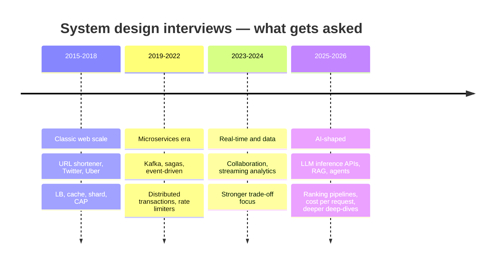
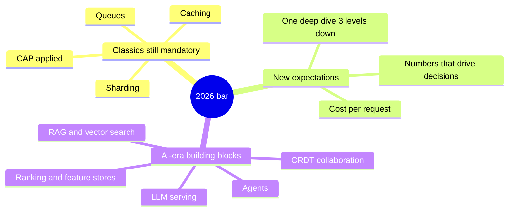

# 📈 What Changed in System Design Interviews (2025 → 2026)

What the round looks like now, compiled from recent interview reports and prep-platform write-ups (sources at the bottom). Treat blog claims as *directional*, not survey data — but the direction is consistent across all of them.

---

## 📊 How the round evolved

## 1. The classics are still the entry ticket — but they cap your score

Load balancer → cache → sharding → queue → CAP is still required. What changed: at top companies a *classic-only* answer now tops out around "hire" rather than "strong hire". Reports describe a 2019-style Twitter answer scoring ~4/5, with the 2026 version expected to add a **ranking layer**.

- **URL shortener** has been pushed down to phone screens and early-career loops. Still worth knowing perfectly — it's the vehicle for IDs, base62 and caching — but don't expect it as the main SDE-2 problem.
- **Dropbox-style file sync** alone is treated as foundational; the 2026 version is "Notion/Google Docs with real-time editing + AI summarisation". → [[Real-Time-Collaboration-CRDTs]]

**What it means for me:** master [[Case-Studies-MOC]] first, then learn the "2026 extension" of each (listed in each case study's *Follow-ups* section).

## 2. Old questions got AI-shaped extensions

| Classic prompt | 2026 version |
|---|---|
| Design Twitter | Personalised timeline: candidate generation → feature hydration → ML ranking within a ~200 ms p95 budget → [[Recommendation-and-Ranking-Systems]] |
| Design Slack | + natural-language Q&A over message history = RAG with **access-control-aware retrieval** → [[RAG-and-Vector-Databases]] |
| Design Dropbox | Collaborative docs (CRDTs) + summarise/Q&A over the workspace |
| Design recommendations | Full ML lifecycle: feature store, training–serving skew, drift, offline evals (NDCG, recall@k), A/B tests, feedback loops |

## 3. Brand-new AI-native questions

The most-reported new prompts:

1. **Design an LLM inference API** — described as "the new URL shortener". Token streaming, continuous batching, KV cache, GPU scheduling, multi-tenant rate limiting, billing by tokens. → [[LLM-Serving-and-Inference]] · [[Design-LLM-Chat-Service]]
2. **Design a RAG system over enterprise documents** — ingestion, chunking, embeddings, hybrid search (BM25 + vectors), reranking, citations, freshness. → [[RAG-and-Vector-Databases]]
3. **Design a model-serving platform** — multi-tenant, autoscaling on GPUs, model versioning, A/B.
4. **Design AI agent infrastructure** — tool orchestration, memory, sandboxing, long-running traces. → [[AI-Agent-Systems]]

These are asked mostly at AI labs, AI-first startups and ML-heavy teams. At an Indian product company SDE-1/2 loop you're far more likely to get food delivery or payments — but a RAG or LLM-gateway question is now a realistic curveball.

## 4. Cost is a first-class requirement

Interviewers increasingly expect **cost per request** next to latency and throughput — especially when an LLM call can cost more than the entire rest of the request. Saying *"semantic cache in front of the model cuts cost, here's the hit-rate trade-off"* is a 2026 signal. → [[Caching]] · [[LLM-Serving-and-Inference]]

## 5. The round format shifted toward depth

- AI tools now handle breadth (boxes and arrows) at some companies, so interviewers push **harder on the deep dive** of one component.
- Where AI help is allowed (some AI labs/startups), you're graded on **verifying** AI-derived numbers, not on producing them. FAANG-style loops generally still prohibit it — confirm with the recruiter.
- What rose in weight: clarifying requirements before drawing, narrating reasoning, explicit trade-offs. → [[Interview-Framework]] · [[Trade-off-Language]]

## 6. India-specific reality (product companies & unicorns)

- **SDE-1:** usually DSA + **machine coding / LLD** (Flipkart, Razorpay, Swiggy). HLD is often light or absent. → [[LLD-and-Machine-Coding-Primer]]
- **SDE-2+:** a dedicated HLD round is standard (Flipkart, Zomato, Swiggy, PhonePe, Meesho).
- Domain-flavoured prompts: payment gateway & reconciliation (Razorpay), delivery partner assignment / surge (Zomato, Swiggy), inventory & flash sales (Flipkart, Blinkit), UPI-style payments (PhonePe). → [[Company-Patterns]]

## 7. What's fading

- Reciting the CAP theorem without applying it to the specific feature being designed.
- Drawing "microservices" by default for a problem that fits in a monolith.
- Memorised architectures with no numbers behind them.

---

> [!tip] Job-market side of the story
> Layoffs, hiring demand and SDE-2/3 expectations are in [[Market-Research-2026]]; the skills it points to are in [[Senior-Engineering-MOC]] and [[Future-Engineering-MOC]].

## The takeaway, in one paragraph

Learn the classics deeply enough to *derive* them, because they're still mandatory. Then add three things most candidates don't have: **numbers** (estimation + cost), **one deep-dive you can go 3 levels into** per case study, and **literacy in the AI-era building blocks** (vector search, LLM serving, ranking pipelines, CRDTs). That combination is where the 2026 bar sits.

---

## 📚 Sources

- [How System Design Interviews Actually Changed in 2026 — DG Learning](https://dglearning.substack.com/p/how-system-design-interviews-actually)
- [AI in System Design Interviews: How the Round Changed in 2026 — techinterview.org](https://www.techinterview.org/post/3233474919/ai-in-system-design-interviews-2026/)
- [System design interviews changed — Design Gurus](https://designgurus.substack.com/p/system-design-interviews-changed)
- [GenAI & LLM System Design Interview Guide (2026) — PracHub](https://prachub.com/resources/genai-llm-system-design-interview-guide-2026)
- [Indian Unicorn Interviews: Flipkart, Meesho, Zomato, Razorpay (2026) — Jobrise](https://jobrise.io/blog/flipkart-meesho-zomato-interview-india)
- [3 ways AI has changed FAANG interviews in 2026 — Formation](https://formation.dev/blog/3-ways-ai-has-changed-faang-interviews-in-2026)

---
**Next:** [[Where-to-Focus]] · **Up:** [[System-Design-MOC]]
