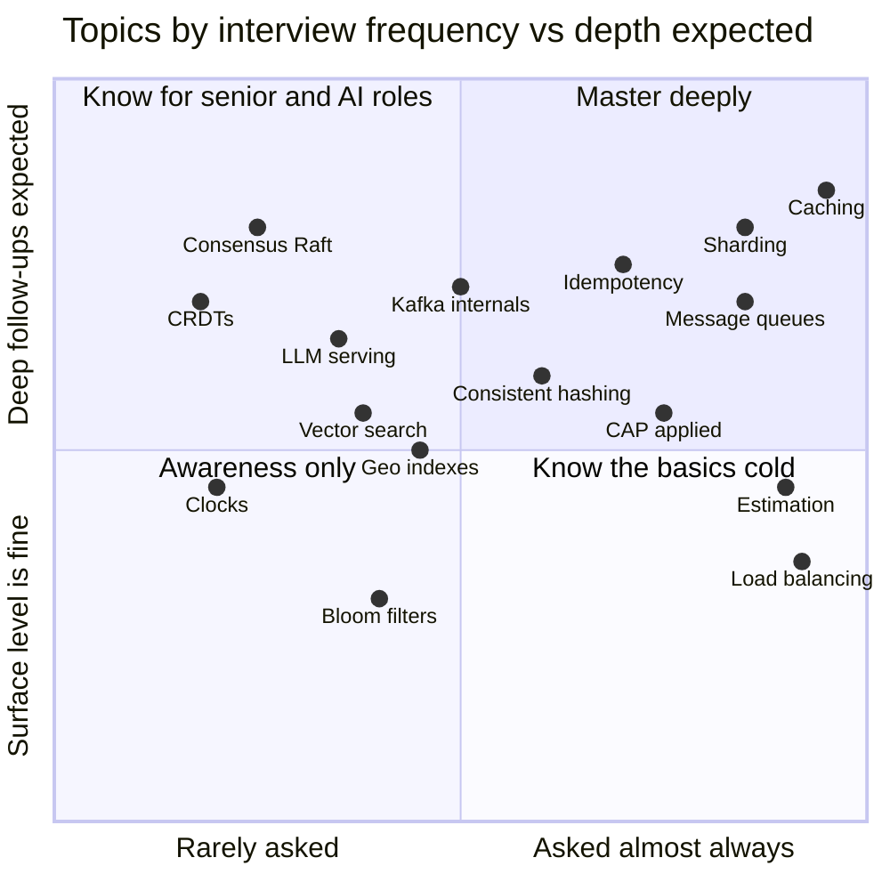

# 🎯 Where to Focus — The 80/20 of System Design

> [!important] The honest truth
> Interviewers don't grade the boxes. They grade **why** each box is there, **what it costs**, and **what breaks first**. Every hour spent memorising a diagram is better spent learning one trade-off deeply.

---

## Tier 1 — Non-negotiable (asked in nearly every HLD round)

| Topic | Why it's tier 1 |
|---|---|
| [[Estimation-and-Latency-Numbers]] | Every design decision hangs on QPS and storage numbers |
| [[Scaling-Servers-Stateless-and-SPOF]] · [[Load-Balancing]] | Step 1 of every design |
| [[SQL-vs-NoSQL]] · [[Choosing-a-Database]] | "Why this DB?" is guaranteed |
| [[Indexing]] · [[Replication]] · [[Sharding-and-Partitioning]] | The three ways data scales |
| [[Caching]] · [[Cache-Pitfalls]] | Asked in ~every problem; invalidation is the follow-up |
| [[Message-Queues]] | Async is how real systems absorb spikes |
| [[API-Design]] · [[Idempotency]] | Clean APIs + safe retries = senior signal |
| [[CAP-and-PACELC]] (applied, not recited) | "What happens during a partition?" |

## Tier 2 — Expected at SDE-2, and as deep-dives

[[Consistent-Hashing]] · [[Kafka-Deep-Dive]] · [[Real-Time-Communication]] · [[Distributed-Transactions]] · [[Unique-ID-Generation]] · [[Resilience-Patterns]] · [[CDN]] · [[Object-Storage]] · [[Transactions-and-Isolation-Levels]] · [[Redis-Deep-Dive]] · [[Geospatial-Indexing]] · [[Search-Systems]]

## Tier 3 — Differentiators (senior, AI-first companies, "impress me")

[[Consensus-and-Leader-Election]] · [[Clocks-and-Ordering]] · [[Probabilistic-Data-Structures]] · [[Real-Time-Collaboration-CRDTs]] · [[Multi-Region-and-Disaster-Recovery]] · [[Batch-and-Stream-Processing]] · [[Recommendation-and-Ranking-Systems]] · [[LLM-Serving-and-Inference]] · [[RAG-and-Vector-Databases]] · [[AI-Agent-Systems]]

---

## 📊 The focus map

> [!tip] How to use it
> Top-right first. Bottom-right: be crisp, don't over-invest. Top-left: only after the rest, or if targeting senior / AI-first companies.

## The 10 case studies to master first (highest frequency × best concept coverage)

| # | Case study | Concepts it forces you to use |
|---|---|---|
| 1 | [[Design-URL-Shortener]] | IDs, base62, read-heavy caching |
| 2 | [[Design-Rate-Limiter]] | Algorithms, Redis atomicity, distributed counters |
| 3 | [[Design-Chat-App]] | WebSockets, presence, ordering, fan-out |
| 4 | [[Design-News-Feed]] | Fan-out on write vs read, celebrity problem |
| 5 | [[Design-Notification-System]] | Queues, retries, dedup, preferences |
| 6 | [[Design-Payment-System]] | Idempotency, ledgers, sagas, reconciliation |
| 7 | [[Design-Ticket-Booking]] | Concurrency, locks, waiting room |
| 8 | [[Design-Ride-Sharing]] | Geo indexes, high-write location updates |
| 9 | [[Design-Video-Streaming]] | Object storage, transcoding, CDN, ABR |
| 10 | [[Design-Food-Delivery]] | Combines geo + payments + notifications (India favourite) |

Then: [[Design-Typeahead]] · [[Design-File-Storage-Sync]] · [[Design-Key-Value-Store]] · [[Design-Flash-Sale]] · [[Design-LLM-Chat-Service]].

---

## Focus by target

> [!tip] Market context
> Why the SDE-2/SDE-3 and future rows matter now: [[Market-Research-2026]]. Level-by-level topic list: [[SDE-Career-Ladder]].

| Target | Weight your time |
|---|---|
| **Indian product co. SDE-1** (Flipkart, Swiggy, Razorpay, CRED) | 50% LLD/machine coding ([[LLD-and-Machine-Coding-Primer]]), 50% HLD tier 1 + 5 case studies |
| **Indian product co. SDE-2** | HLD tier 1+2, all 10 case studies, domain cases (payments, delivery, flash sale) |
| **FAANG / big tech SDE-2+** | Tier 1+2, all case studies, deep dives 3 levels deep, [[Recommendation-and-Ranking-Systems]] |
| **AI startups / AI teams** | Tier 1 + all of [[Modern-Topics-MOC]] + [[Design-LLM-Chat-Service]] |
| **Moving SDE-2 → SDE-3 (5–7 yr bar)** | All of the above + [[Senior-Engineering-MOC]] (migrations, schema evolution, testing, ops, cost, design docs) + one spike from [[Future-Engineering-MOC]] |
| **Future-proofing (next 1–3 yrs)** | [[AI-Native-SDLC]] + [[Verification-Engineering]] for everyone; AI-eng spike: [[LLM-Evals-and-AI-Observability]], [[AI-Security-Engineering]], [[Context-Engineering-and-Agent-Protocols]] |
| **Service companies (TCS/Infosys/Accenture etc.)** | Conceptual questions ([[Conceptual-Questions]]), basic HLD (URL shortener, rate limiter), REST/DB basics |

---

## The 3 skills that matter more than any topic

1. **Driving the conversation** — you set the agenda: requirements → numbers → API → design → deep dive. → [[Interview-Framework]]
2. **Quantifying** — "~12k QPS reads, so a single Postgres primary with 3 replicas + Redis is enough; we don't need sharding yet." → [[Estimation-and-Latency-Numbers]]
3. **Naming the trade-off before being asked** — "I'm choosing fan-out on write, which costs write amplification for celebrities; I'll handle them with a hybrid." → [[Trade-off-Language]]

---
**Next:** [[Foundations-MOC]] · **Up:** [[System-Design-MOC]]
