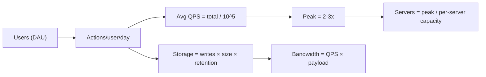
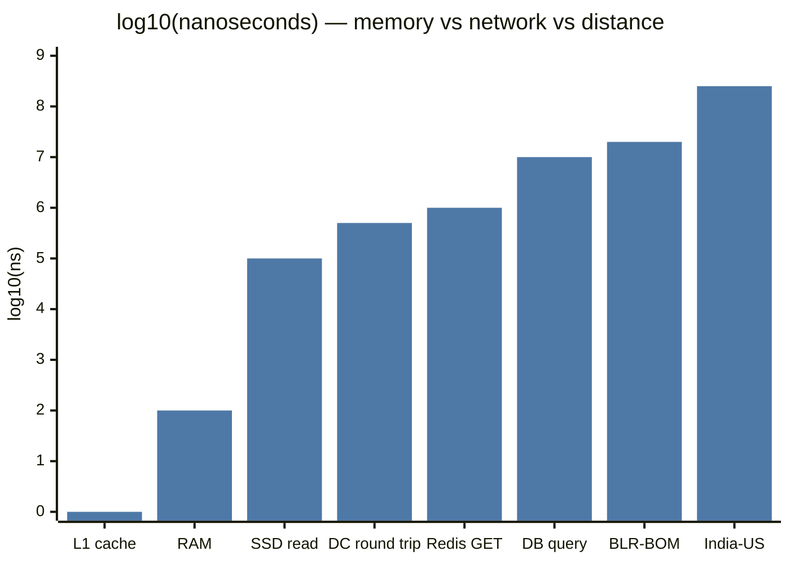
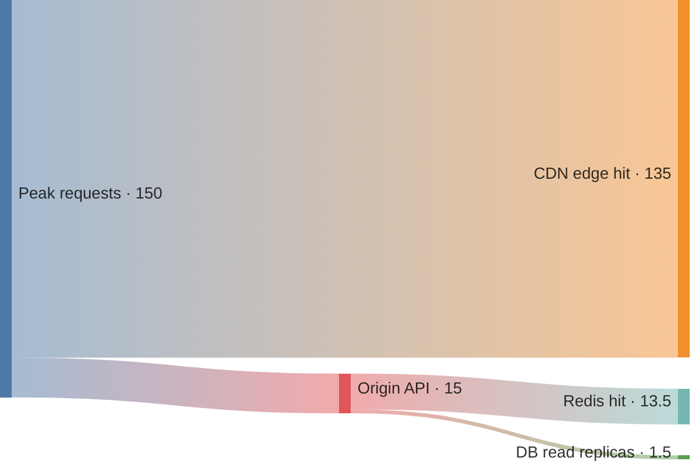

# Measuring and Estimating a System

## What is it?

Two skills: **measuring** a system (latency, throughput, percentiles) and **estimating** one before it exists (back-of-the-envelope math for QPS, storage, bandwidth, servers).

## Why it matters

Numbers turn opinions into decisions. "Add a cache" is a guess. "Reads are 50k QPS, a single Postgres replica handles ~5–10k simple QPS, so we need a cache with >90% hit rate or ~8 replicas" is engineering.

## Core terms

| Term | Meaning |
|---|---|
| **Latency** | Time for one request (ms) |
| **Throughput** | Requests handled per second (QPS/RPS) |
| **Bandwidth** | Max data per second the pipe allows (Gbps) |
| **QPS** | Queries per second; **peak QPS** ≈ 2–3× average |
| **p50 / p95 / p99** | 50% / 95% / 99% of requests are faster than this |

**Analogy:** latency = how long one car takes on a highway; throughput = cars per hour; bandwidth = number of lanes.

### Why percentiles, not averages

Average hides pain. If p50 = 50 ms and p99 = 2 s, 1 in 100 requests is awful — and a page that makes 100 backend calls hits a p99 on almost every load (**tail latency amplification**: 1 − 0.99¹⁰⁰ ≈ 63%). SLOs are written on p99. → [[Observability-and-SLOs]]

## Latency numbers every engineer should know (order of magnitude)

| Operation | ~Time |
|---|---|
| L1 cache reference | 1 ns |
| Main memory (RAM) reference | 100 ns |
| Compress 1 KB (fast codec) | ~2 µs |
| Read 1 MB sequentially from RAM | ~3–10 µs |
| SSD random read | ~16–100 µs |
| Round trip within same data centre | ~0.5 ms |
| Read 1 MB sequentially from SSD | ~50 µs–1 ms |
| Redis GET over network | ~0.5–1 ms |
| Simple indexed DB query | ~1–10 ms |
| HDD seek | ~2–10 ms |
| Bengaluru ↔ Mumbai RTT | ~20 ms |
| India ↔ US East RTT | ~200–250 ms |

**The lessons:** memory ≫ SSD ≫ network ≫ disk seek ≫ cross-continent. Avoid round trips; batch; keep hot data in memory; keep users near data.

## Handy conversions

```text
1 day  ≈ 86,400 s ≈ 10^5 s   (use 10^5 for mental math)
1 month ≈ 2.5 × 10^6 s ;  1 year ≈ 3 × 10^7 s
1 million req/day ≈ 12 QPS
100 million req/day ≈ 1,200 QPS
1 KB × 1 billion = 1 TB
2^10 ≈ 10^3 (K), 2^20 ≈ 10^6 (M), 2^30 ≈ 10^9 (G), 2^40 ≈ 10^12 (T)
```

## Rough capacity of building blocks (for estimates — say "roughly")

| Component | Ballpark |
|---|---|
| Stateless app server (simple API) | 1k–10k RPS per instance |
| Postgres/MySQL single node | ~5k–20k simple QPS; writes lower |
| Redis single node | ~100k+ ops/s |
| Kafka partition | ~10 MB/s+ per partition; cluster: millions msgs/s |
| One WebSocket server | ~100k–1M idle connections (tuned) |

## The estimation recipe



## Worked example — a photo-sharing app

**Assumptions:** 100M DAU; each user views 50 photos/day, uploads 0.1 photo/day; photo 500 KB, metadata 1 KB; keep 5 years.

```text
Reads:   100M × 50   = 5×10^9 /day  → 5×10^9 / 10^5 = 50,000 QPS avg → ~150k peak
Writes:  100M × 0.1  = 10^7 /day    → ~100 QPS avg → ~300 peak
Read:write ≈ 500:1  → read-heavy → cache + CDN + replicas

Storage/day: 10^7 × 500 KB = 5 TB/day photos (+10 GB metadata)
5 years:     5 TB × 365 × 5 ≈ 9 PB  → object storage, not a DB
Egress:      50k QPS × 500 KB = 25 GB/s → must be a CDN
Metadata:    10^7 × 365 × 5 × 1 KB ≈ 18 TB → needs sharding eventually
```

Each line produced a design decision. That's the point — **always end a number with "…so we need X".**

## 📊 Visual model

**Latency numbers on a log scale** (each step up = 10× slower):



**Where 150k peak QPS goes in the photo-app example:**



**Formulas worth having in your head:**

$$\text{Avg QPS} = \frac{\text{DAU} \times \text{actions/user/day}}{86{,}400} \qquad \text{Peak} \approx 2\text{–}3 \times \text{Avg}$$

$$\text{Storage} = \text{writes/day} \times \text{size} \times \text{retention days} \times \text{replication factor}$$

**Little's Law** — concurrency you must provision for:

$$L = \lambda \times W$$

> [!example] Little's Law in practice
> 2,000 req/s × 0.25 s average latency = **500 requests in flight** → that's your thread / connection pool sizing. If the DB slows to 1 s, you suddenly need 2,000 — which is how slow dependencies cause cascading failures. → [[Resilience-Patterns]]

## Common mistakes

> [!warning] Traps to avoid
> 1. Doing precise arithmetic. Round aggressively; interviewers want order of magnitude.
> 2. Estimating and then never using the numbers.
> 3. Forgetting peak vs average.
> 4. Forgetting replication factor (×3) and indexes in storage.
> 5. Spending 10 minutes on math. Budget ~3–5 minutes. → [[Interview-Framework]]

## Interview understanding

> [!question] What the interviewer is really testing
> - They test **comfort with magnitude** and whether numbers **drive decisions**.
> - *Tricky:* "Your average latency is 20 ms but users complain. Why?" — Tail latency; look at p99/p999, and fan-out amplification.
> - *Tricky:* "Latency vs throughput — can you improve one and hurt the other?" — Yes: batching raises throughput but adds latency.
> - *2026 twist:* add **cost per request** — e.g., "at $X per 1M LLM tokens, 1k QPS × 1k tokens = …/day" → [[LLM-Serving-and-Inference]].

## Mini quiz
1. 10M requests/day ≈ ? QPS
2. Why is p99 more important than average?
3. RAM vs SSD random read — rough ratio?
4. 1 KB × 1 billion = ?
5. A page calls 50 services, each with 1% slow requests. Chance the page is slow?

> [!success]- Answers (click to reveal)
> 1. ~120 QPS.
> 2. Tail requests hit real users often, especially with fan-out; average hides them.
> 3. ~100 ns vs ~100 µs → ~1000×.
> 4. 1 TB.
> 5. 1 − 0.99⁵⁰ ≈ 40%.

---
**Next:** [[Scaling-MOC]] · **Up:** [[Foundations-MOC]] · **Used in:** every case study

## 📚 Resources
- 📄 [Latency numbers every programmer should know (interactive, colin-scott)](https://colin-scott.github.io/personal_website/research/interactive_latency.html)
- 📄 [The Tail at Scale — Dean & Barroso (CACM 2013)](https://research.google/pubs/the-tail-at-scale/) — *Why:* the origin of tail-latency thinking.
- 🎥 Search "back of the envelope estimation" on ByteByteGo.

## My notes
-
