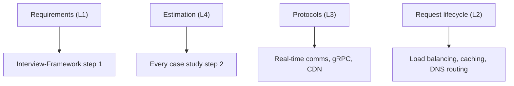

# 🧱 01 · Foundations MOC

> [!important] Why this module decides your interview
> Half of all weak system design answers fail here, not in Kafka: they skip requirements, never estimate, and can't explain what happens between a click and a response. The fancy parts only make sense on top of this.

| # | Note | Lecture | You'll be able to |
|---|---|---|---|
| 1 | [[What-is-System-Design]] | L1 | Separate HLD/LLD, list FR vs NFR, name the 9 qualities and their tensions |
| 2 | [[How-an-App-Works]] | L2 | Trace a request from browser to DB and back |
| 3 | [[Network-Protocols]] | L3 | Pick TCP vs UDP, explain HTTP/1.1 vs 2 vs 3, status codes, TLS |
| 4 | [[Estimation-and-Latency-Numbers]] | L4 | Do back-of-the-envelope math in 3 minutes, p50/p99 |

## Where this reappears

## Self-check before moving on

- [ ] I can list 5 non-functional requirements and say which two usually conflict.
- [ ] I can estimate QPS and storage for "100M DAU, 10 posts/day each" in under 3 minutes.
- [ ] I can explain why p99 matters more than average.

**Next module:** [[Scaling-MOC]] · **Up:** [[System-Design-MOC]]
