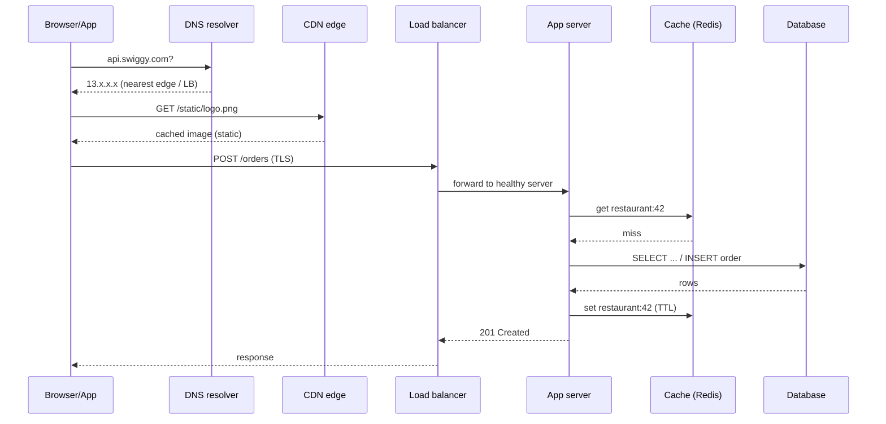
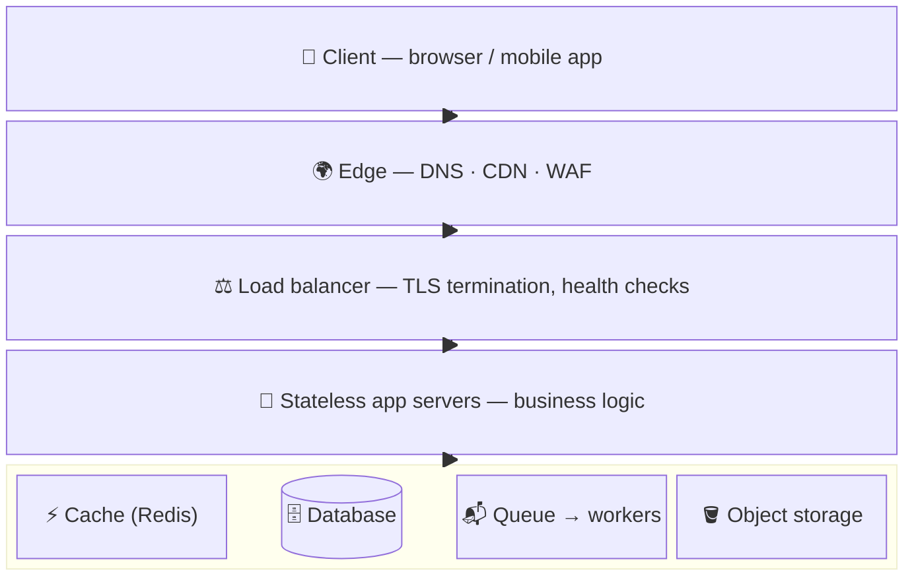
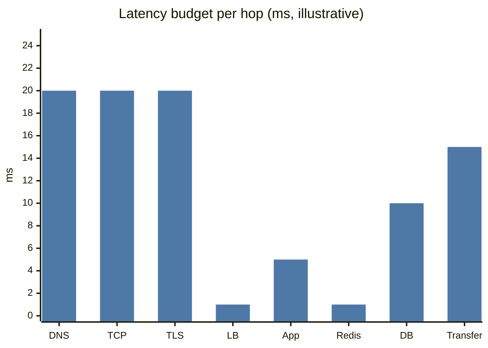

# How an App Works Behind the Scenes

## What is it?

The journey of one request: you tap "Order" in Swiggy → something finds the right server → the server checks the database → a response comes back → the screen updates. Every system design diagram is a zoomed-in version of this path.

## Why it matters

Every component you'll add later (CDN, load balancer, cache, queue) is inserted **somewhere on this path** to fix a specific problem. If you can't draw the path, you can't explain why the component goes where it goes.

## Analogy — the desk and the almirah

- **CPU** = you, doing the work.
- **RAM** = your desk: tiny, but everything on it is instantly reachable.
- **Disk** = the almirah (cupboard): huge, but you must walk over and dig.
- **Database on another machine** = the almirah in a different building.
- **Network** = the road between buildings.

Caching is putting the most-used files on your desk. Indexing is labelling the almirah shelves. A CDN is opening branch almirahs in every city.

## The request path

## Step by step

1. **DNS** turns `api.swiggy.com` into an IP. Cached at browser, OS, resolver. Can do geo-routing (return the nearest region). → [[CDN]]
2. **TCP + TLS handshake** — connection + encryption. Costs round trips; that's why HTTP keep-alive and HTTP/2 matter. → [[Network-Protocols]]
3. **Static content** (images, JS, CSS) is served by a **CDN** near the user. Never hits your servers.
4. **Dynamic content** (your order, your feed) hits the **load balancer**, which picks a healthy app server. → [[Load-Balancing]]
5. **App server** runs business logic. Should be **stateless** so any server can handle any request. → [[Scaling-Servers-Stateless-and-SPOF]]
6. **Cache** answers repeat reads in ~1 ms. → [[Caching]]
7. **Database** is the source of truth. Slowest, hardest to scale. → [[SQL-vs-NoSQL]]
8. Slow work (send SMS, generate invoice) goes to a **queue** and returns immediately. → [[Message-Queues]]

## Static vs dynamic content

| | Static | Dynamic |
|---|---|---|
| Example | Logo, JS bundle, product images | Cart, feed, balance |
| Same for every user? | Yes | No |
| Where served | CDN / object storage | App servers + DB |
| Cacheable | Aggressively (days) | Carefully (seconds, per user) |

## Data centres, IPs, latency

- A **data centre** is a building full of servers; a cloud **region** (e.g., `ap-south-1` Mumbai) has several isolated **availability zones**.
- **Latency** is dominated by distance and round trips: Bengaluru ↔ Mumbai ≈ 15–25 ms RTT; Bengaluru ↔ US East ≈ 200+ ms. You can't beat the speed of light — you move data closer (CDN, regions). → [[Estimation-and-Latency-Numbers]]

## APIs

An API is the contract between client and server: `POST /orders {items, address}` → `201 {orderId}`. Good API design (idempotency, pagination, versioning) is its own topic → [[API-Design]].

## 📊 Visual model

**The layered picture (every HLD is a version of this):**

**Where the milliseconds go (illustrative, Bengaluru user → Mumbai region, cold connection):**

> [!tip] Reading the chart
> Network setup (DNS + TCP + TLS) dominates a cold request. That's why keep-alive, HTTP/2–3, connection pooling and CDNs matter more than shaving 2 ms off your code.

## Common mistakes

> [!warning] Traps to avoid
> 1. Forgetting DNS and CDN exist — drawing the user directly hitting an app server.
> 2. Putting session state on the app server (breaks horizontal scaling).
> 3. Serving images from the app server / DB instead of object storage + CDN. → [[Object-Storage]]
> 4. Doing slow side-effects (emails) synchronously in the request path.

## Interview understanding

> [!question] What the interviewer is really testing
> - *"What happens when you type a URL and press enter?"* — Classic. Go: DNS → TCP → TLS → HTTP request → LB → app → cache/DB → response → browser renders (parse HTML, fetch assets from CDN). Mention caching at each layer.
> - *Tricky:* "Where can a response be cached on this path?" — Browser, CDN, reverse proxy/LB, app in-memory, distributed cache, DB buffer pool. Six places.
> - *Tricky:* "Why is the DB the hardest part to scale?" — It holds state; app servers are stateless and can be cloned, data can't be cloned without consistency problems.

## Mini quiz
1. What does DNS return, and name two places it's cached?
2. Why should app servers be stateless?
3. Static vs dynamic: where does each get served from?
4. In the desk/almirah analogy, what is a cache?
5. Name 4 places a response can be cached.

> [!success]- Answers (click to reveal)
> 1. An IP address; browser, OS, ISP/recursive resolver.
> 2. So any server can serve any request → add/remove servers freely, survive crashes.
> 3. Static from CDN/object storage; dynamic from app servers + DB.
> 4. Keeping frequently-used files on the desk (RAM) instead of the almirah (disk/DB).
> 5. Browser, CDN, reverse proxy, app memory, Redis, DB buffer pool (any 4).

---
**Next:** [[Network-Protocols]] · **Up:** [[Foundations-MOC]]

## 📚 Resources
- 🎥 [Padhowithpratyush — L2 How an App Works](https://www.youtube.com/watch?v=gjwDm_zgj04)
- 📄 [What happens when you type google.com (GitHub, alex/what-happens-when)](https://github.com/alex/what-happens-when) — *Why:* absurdly detailed, great for the classic question.

## My notes
-
