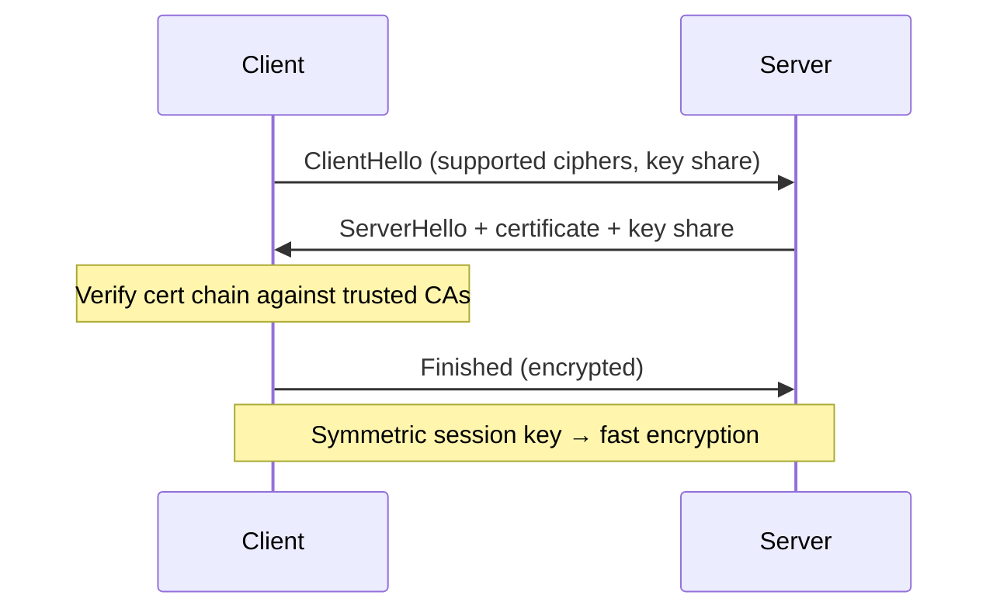
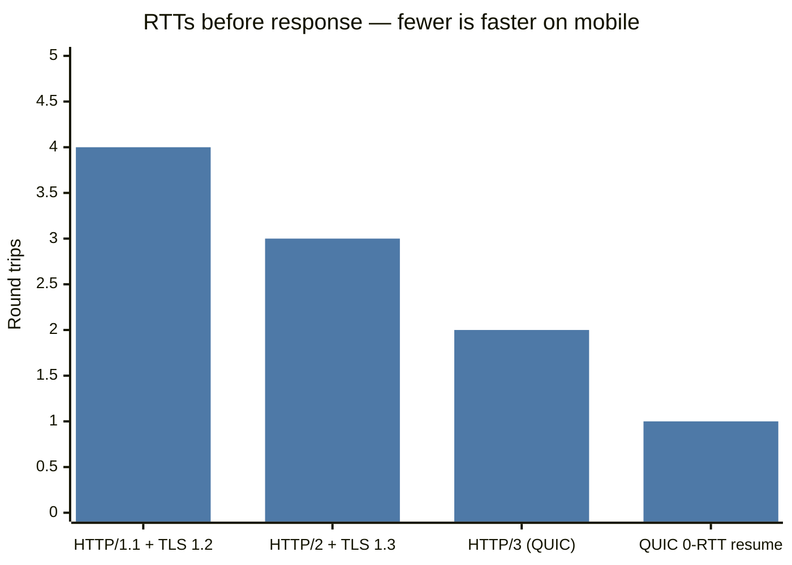
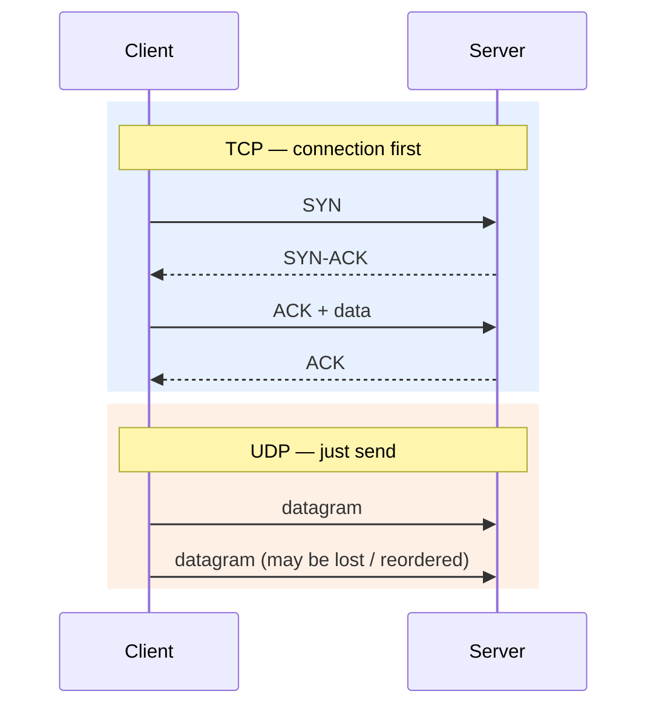
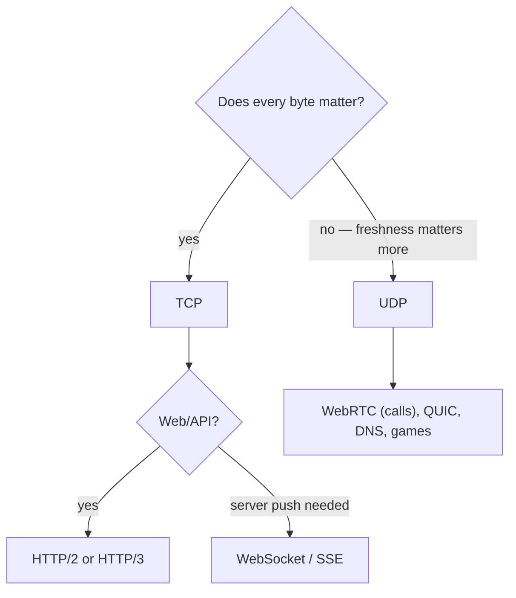

# How Computers Talk — Protocols

## What is it?

A protocol is an agreed format + set of rules for exchanging data. In system design you mostly care about **TCP vs UDP** (transport), **HTTP** (application), and **TLS** (security).

## Why it matters in design

Protocol choice decides latency (handshakes), reliability (retransmits), and what's even possible (server push needs WebSockets/SSE; live video uses UDP-based protocols).

## Analogy

- **TCP** = registered post: numbered pages, receipt for each, resent if lost, arrives in order. Reliable, slower.
- **UDP** = shouting across a room: fast, no guarantee anyone heard, no order. Great when late data is useless (live call audio).

## TCP vs UDP

| | TCP | UDP |
|---|---|---|
| Connection | Handshake (SYN, SYN-ACK, ACK) | None |
| Delivery | Guaranteed, ordered, retransmitted | Best-effort, may drop/reorder |
| Flow/congestion control | Yes | No (app decides) |
| Overhead | Higher | Minimal |
| Used by | HTTP/1.1, HTTP/2, DBs, SSH, most APIs | DNS, video calls, gaming, **QUIC/HTTP/3** |
| Pick when | Correctness matters | Freshness matters more than completeness |

**Head-of-line blocking:** in TCP, one lost packet stalls everything behind it. That's why HTTP/3 moved to QUIC over UDP.

## HTTP versions

| Version | Key idea | Problem it fixed |
|---|---|---|
| HTTP/1.1 | Text, keep-alive connections | One request at a time per connection |
| HTTP/2 | Binary, **multiplexing** many streams over one TCP conn, header compression | Many parallel connections; still TCP HOL blocking |
| HTTP/3 | Runs over **QUIC (UDP)**, per-stream loss recovery, 0-RTT/1-RTT handshakes | TCP HOL blocking, slow handshakes on mobile |

gRPC runs on HTTP/2. → [[REST-vs-gRPC-vs-GraphQL]]

## HTTP essentials

**Methods** and their safety/idempotency (critical for retries → [[Idempotency]]):

| Method | Use | Safe? | Idempotent? |
|---|---|---|---|
| GET | Read | ✅ | ✅ |
| PUT | Replace whole resource | ❌ | ✅ |
| DELETE | Remove | ❌ | ✅ |
| PATCH | Partial update | ❌ | ❌ (by default) |
| POST | Create / action | ❌ | ❌ — needs an idempotency key |

**Status codes you must know:**

| Code | Meaning | Design note |
|---|---|---|
| 200 / 201 / 204 | OK / Created / No content | |
| 301 / 302 | Permanent / temporary redirect | URL shortener choice! → [[Design-URL-Shortener]] |
| 304 | Not modified | ETag caching |
| 400 / 401 / 403 / 404 | Bad request / not authenticated / not authorised / not found | 401 vs 403 is a classic question |
| 409 | Conflict | Seat already booked, version mismatch |
| 429 | Too many requests | Rate limiter → [[Design-Rate-Limiter]] |
| 500 / 502 / 503 / 504 | Server error / bad gateway / unavailable / gateway timeout | 502/503/504 come from LBs/proxies |

**Headers that matter:** `Cache-Control`, `ETag`, `Authorization`, `Content-Type`, `Idempotency-Key`, `X-Forwarded-For`, `Retry-After`.

**Cookies:** small key-values the server sets; the browser sends them back automatically. Used for sessions. Flags: `HttpOnly` (JS can't read → XSS protection), `Secure`, `SameSite` (CSRF protection). → [[Authentication-and-Authorization]]

## TLS basics

- Asymmetric crypto (slow) only to agree on a **symmetric** session key (fast).
- TLS 1.3 = 1 round trip (0-RTT resumption possible).
- **TLS termination** usually happens at the load balancer/CDN; internal traffic may use mTLS in a service mesh.

## Ports

A port identifies a process on a machine: 80 HTTP, 443 HTTPS, 22 SSH, 5432 Postgres, 6379 Redis, 9092 Kafka, 3306 MySQL.

## 📊 Visual model

**Round trips until the first response byte (cold connection):**

**TCP three-way handshake vs UDP:**

**Protocol picker:**

## Common mistakes

> [!warning] Traps to avoid
> 1. Saying "use UDP because it's faster" for anything that needs every byte (payments, chat messages).
> 2. Using POST for reads or GET for state changes (GETs get cached/prefetched!).
> 3. Confusing 401 (who are you?) with 403 (I know you, you can't).
> 4. Forgetting handshakes cost round trips — 3 RTTs before the first byte on a cold HTTP/1.1+TLS1.2 connection.

## Interview understanding

> [!question] What the interviewer is really testing
> - *"TCP vs UDP for a video call? For a file transfer?"* — UDP (WebRTC) for calls; TCP for files.
> - *"Why is HTTP/2 faster?"* — Multiplexing over one connection, header compression; fewer handshakes.
> - *Tricky:* "Is DNS TCP or UDP?" — UDP by default; TCP for large responses and zone transfers.
> - *Tricky:* "PUT vs PATCH — which is idempotent?" — PUT. PATCH like `increment by 1` isn't.
> - *Tricky:* "Why 301 vs 302 in a URL shortener?" — 301 is cached by browsers (less load, but you lose click analytics); 302 hits you every time (analytics, more load).

## Mini quiz
1. What's head-of-line blocking and which HTTP version fixes it fully?
2. Which HTTP methods are idempotent?
3. 401 vs 403?
4. What does TLS use asymmetric crypto for?
5. Which status code does a rate limiter return?

> [!success]- Answers (click to reveal)
> 1. One lost packet blocks all later data on a TCP connection; HTTP/3 (QUIC) fixes it.
> 2. GET, PUT, DELETE (also HEAD, OPTIONS).
> 3. 401 = not authenticated; 403 = authenticated but not allowed.
> 4. Authenticating the server and agreeing a symmetric session key.
> 5. 429, ideally with `Retry-After`.

---
**Next:** [[Estimation-and-Latency-Numbers]] · **Up:** [[Foundations-MOC]]

## 📚 Resources
- 📄 [MDN — HTTP overview](https://developer.mozilla.org/en-US/docs/Web/HTTP/Overview)
- 📄 [Cloudflare Learning — What is HTTP/3](https://www.cloudflare.com/learning/performance/what-is-http3/)
- 📖 *High Performance Browser Networking* (Ilya Grigorik) — free online at hpbn.co.

## My notes
-
