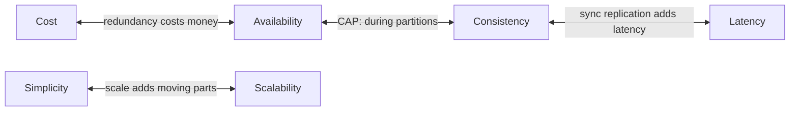
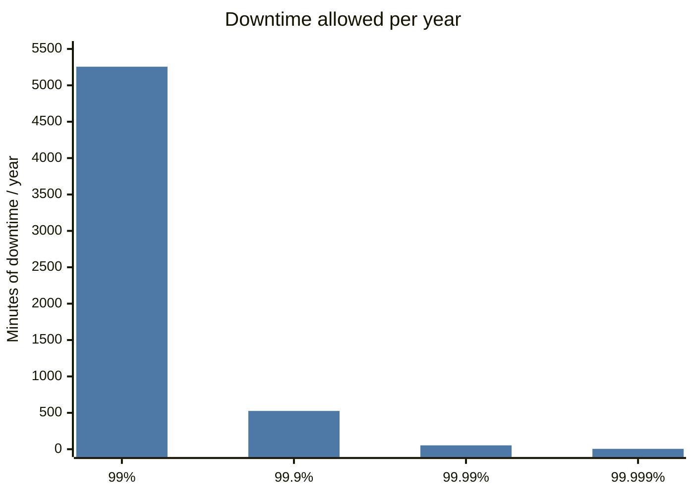
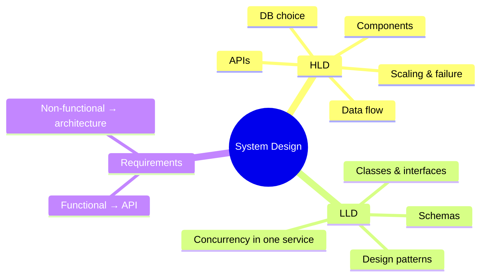

# What is System Design?

## What is it?

System design is deciding **which components** a software system needs, **how they talk**, and **where the data lives** — so the system meets its requirements at the scale, cost and reliability it needs.

## Why does it exist?

Writing code that works for one user is easy. Making it work for 10 million users, survive a data-centre failure, stay fast, and not bankrupt the company is a different problem. That problem is solved by *architecture*, not by better functions.

## Analogy

Building a house vs designing a city. A house (a feature) needs good carpentry. A city (a system) needs roads (networks), water tanks (caches), warehouses (databases), traffic police (load balancers), and a plan for when a bridge collapses (failover). You can be a great carpenter and a terrible city planner.

## Interview definition

> "System design is the process of defining a system's architecture, components, data flow and interfaces to satisfy functional and non-functional requirements under real constraints of scale, latency, availability and cost — and making the trade-offs between them explicit."

---

## HLD vs LLD

| | High-Level Design (HLD) | Low-Level Design (LLD) |
|---|---|---|
| Question | *What boxes and how do they connect?* | *What classes and how do they interact?* |
| Artifacts | Architecture diagram, data flow, DB choice, APIs | Class diagrams, interfaces, design patterns, schemas |
| Scale | Services, DBs, caches, queues, regions | Objects, methods, concurrency inside one service |
| Interview | "Design WhatsApp" | "Design a parking lot", machine coding rounds |
| Typical level | SDE-2+ (India), all levels at big tech | SDE-1 heavy in India → [[LLD-and-Machine-Coding-Primer]] |

## Functional vs Non-Functional Requirements

| Functional (FR) — *what it does* | Non-Functional (NFR) — *how well it does it* |
|---|---|
| "Users can send a message" | "Delivered in < 200 ms p99" |
| "Users can upload a video" | "99.99% available" |
| "Users see a feed" | "Feed may be up to 5 s stale" (consistency) |

**FRs decide the API. NFRs decide the architecture.** Two systems with identical FRs (a todo app for 10 users vs for 100M users) have completely different designs.

## The nine qualities (NFRs)

| Quality | Question it asks | Typical lever |
|---|---|---|
| **Scalability** | Can it handle 10× load? | Horizontal scaling, sharding |
| **Performance** | How fast is one request? | Caching, indexing, CDN |
| **Availability** | Is it up? (% of time) | Redundancy, failover |
| **Reliability** | Does it do the right thing, even under faults? | Retries, idempotency, testing |
| **Consistency** | Does everyone see the same data? | Sync replication, consensus |
| **Durability** | Is committed data ever lost? | Replication, WAL, backups |
| **Security** | Who can do what? | AuthN/AuthZ, encryption |
| **Cost** | What does each request cost? | Right-sizing, tiered storage, caching |
| **Maintainability** | Can the team change it safely? | Simple designs, observability |

## Why trade-offs are unavoidable

Every lever helps one quality and hurts another. **The whole interview is about choosing which quality to sacrifice, for this feature, and saying why.** → [[Trade-off-Language]]

### Availability in numbers

| Availability | Downtime / year | Downtime / month |
|---|---|---|
| 99% ("two nines") | 3.65 days | 7.2 hours |
| 99.9% | 8.77 hours | 43.8 min |
| 99.99% | 52.6 min | 4.38 min |
| 99.999% | 5.26 min | 26 s |

Components in **series** multiply availability (0.999 × 0.999 = 0.998). Components in **parallel** (redundant) improve it: 1 − (1 − 0.99)² = 0.9999.

## Who uses this thinking

- WhatsApp chose availability + low latency over strong consistency for message ordering across devices.
- Banks choose consistency over availability for balances.
- Netflix chose availability over freshness for recommendations (stale is fine, down is not).

## 📊 Visual model

**What each extra nine actually buys you:**

**Availability math (memorise both):**

$$A_{series} = \prod_{i=1}^{n} A_i \qquad\qquad A_{parallel} = 1 - \prod_{i=1}^{n} (1 - A_i)$$

> [!example] Worked example
> LB (99.99%) → App (99.9%) → DB (99.9%) in series ≈ **99.79%**.
> Two DB replicas in parallel at 99.9% each → $1 - 0.001^2 = 99.9999\%$ for that layer.

**HLD vs LLD — where each lives:**

## Common mistakes

> [!warning] Traps to avoid
> 1. Jumping to boxes before listing requirements.
> 2. Listing NFRs as generic adjectives ("scalable, fast") without numbers.
> 3. Treating every NFR as equally important. Pick the **top 2–3** for this system.
> 4. Designing for Google scale when the problem says 10k users.
> 5. Ignoring cost entirely — in 2026, interviewers notice. → [[System-Design-Trends-2026]]

## Interview understanding

> [!question] What the interviewer is really testing
> - *"What are the requirements?"* — They're testing whether you **scope**. Say: "I'll focus on X, Y, Z; out of scope: A, B."
> - *"Is this system read-heavy or write-heavy?"* — This one question drives caching, replication and DB choice.
> - *Tricky:* "Can a system be available but not reliable?" — Yes: it responds (available) but returns wrong/stale data (not reliable).
> - *Tricky:* "Durability vs availability?" — Durability = data not lost; availability = system answers. An S3-style store can be 11-nines durable but only 99.99% available.

## Mini quiz

1. One-line difference between HLD and LLD?
2. FRs drive the ___; NFRs drive the ___.
3. Two services each 99.9% available in series — overall availability?
4. Give a system where you'd trade consistency for availability, and one where you wouldn't.
5. What does "99.99%" allow per month?

> [!success]- Answers (click to reveal)
> 1. HLD = components & how they connect; LLD = classes/interfaces inside a component.
> 2. API; architecture.
> 3. ≈ 99.8%.
> 4. Social feed / likes count (AP is fine); bank balance / seat booking (needs consistency).
> 5. ~4.4 minutes of downtime.

---
**Next:** [[How-an-App-Works]] · **Up:** [[Foundations-MOC]] · **Used in:** [[Interview-Framework]]

## 📚 Resources
- 📖 *Designing Data-Intensive Applications* (Kleppmann), Ch. 1 — reliability, scalability, maintainability. *Why:* the canonical framing of NFRs.
- 🎥 [Padhowithpratyush — L1 What is System Design?](https://www.youtube.com/watch?v=RNa0Lx4nu80) — the syllabus lecture.
- 🎥 Search "system design introduction" on [ByteByteGo](https://www.youtube.com/@ByteByteGo).

## My notes
-
