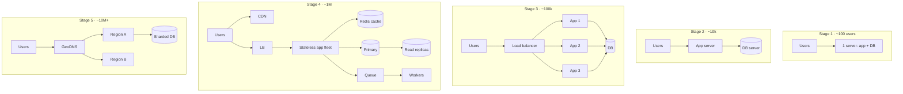
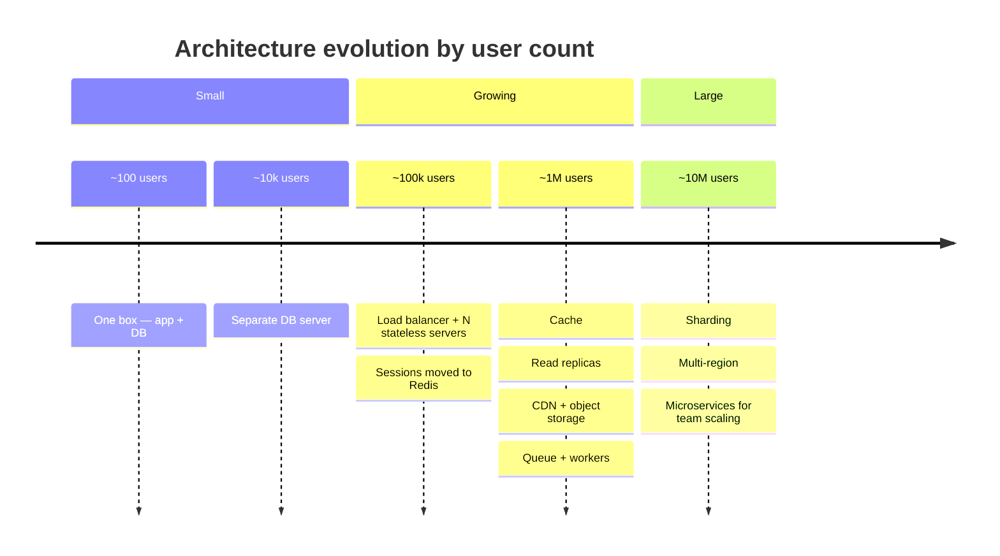
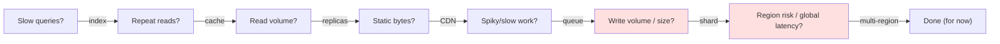

# The Story of an App Growing Up (1 → 10M users)

## What is it?

A narrative of how architecture evolves as traffic grows — each step adding **one component to fix one specific bottleneck**. It's also the map of this whole vault.

## Why it matters

Interviewers love "start simple and evolve". Showing you'd **not** build the 10M-user architecture for 1k users is a maturity signal. And each stage gives you the *reason* for a component, which is exactly what's graded.

## The story

| Stage | Bottleneck hit | Fix | Note |
|---|---|---|---|
| 1 | Everything on one box; app and DB fight for CPU/RAM | Separate DB server | — |
| 2 | One app server is a SPOF and CPU-bound | Multiple app servers + **load balancer** | [[Load-Balancing]] |
| 3 | Sessions stored in server memory break when LB switches servers | Make servers **stateless** (sessions → Redis/JWT) | [[Scaling-Servers-Stateless-and-SPOF]] |
| 4 | DB overwhelmed by repeat reads | **Cache** (Redis) | [[Caching]] |
| 5 | Still too many reads; DB is a SPOF | **Read replicas** + failover | [[Replication]] |
| 6 | Images/JS hog bandwidth, far users are slow | **Object storage + CDN** | [[Object-Storage]] · [[CDN]] |
| 7 | Slow tasks (email, video encode) block requests; spikes crush the system | **Message queue** + workers | [[Message-Queues]] |
| 8 | Write volume / data size exceeds one primary | **Sharding** | [[Sharding-and-Partitioning]] |
| 9 | Region outage; global latency | **Multi-region** | [[Multi-Region-and-Disaster-Recovery]] |
| 10 | One codebase, 200 engineers stepping on each other | **Microservices** (org scaling, not traffic!) | [[Microservices-vs-Monolith]] |

## The key insight

**Scaling is removing the current bottleneck, measuring, and finding the next one.** Order matters: cache before sharding (sharding is expensive and permanent); vertical scaling before horizontal for the DB (it's simpler).

## Real examples

- **Instagram** ran on a small Django + Postgres setup with a handful of engineers to tens of millions of users, then sharded Postgres by user ID.
- **Stack Overflow** famously served huge traffic from a small number of powerful (vertically scaled) SQL Server machines with heavy caching.
- **WhatsApp** scaled on Erlang with a tiny team by optimising per-server connection counts.

Lesson: the "right" architecture is the simplest one that meets the numbers.

## 📊 Visual model

**The bottleneck ladder** — fix the cheapest thing first:

Red = expensive and hard to undo. Everything before them is cheap and reversible.

## Common mistakes

> [!warning] Traps to avoid
> 1. Starting the interview at Stage 5.
> 2. Adding microservices to solve a *traffic* problem (they solve *team* problems).
> 3. Sharding before trying caching, indexing, replicas, and a bigger box.
> 4. Forgetting that each component is new failure surface + cost.

## Interview understanding

> [!question] What the interviewer is really testing
> - *"How would you scale this to 10× users?"* — Walk this table: identify the current bottleneck *with a number*, apply the next fix.
> - *Tricky:* "Why not shard from day one?" — Cross-shard queries, resharding pain, operational cost; YAGNI until a single primary (with vertical scaling + replicas + cache) can't keep up.
> - *Tricky:* "What's the first thing that breaks at 10× traffic?" — Usually the database (connections, write throughput) — not the app servers.

## Mini quiz
1. What problem does the load balancer solve that a bigger server doesn't?
2. Why must servers become stateless before adding more of them?
3. Cache or shard first? Why?
4. What problem do microservices actually solve?
5. Which component handles traffic spikes by buffering?

> [!success]- Answers (click to reveal)
> 1. Redundancy (no SPOF) + horizontal capacity.
> 2. Otherwise the LB sends a user to a server without their session.
> 3. Cache — cheap, reversible; sharding is costly and hard to undo.
> 4. Organisational scaling: independent deploys and ownership.
> 5. A message queue.

---
**Next:** [[Scaling-Servers-Stateless-and-SPOF]] · **Up:** [[Scaling-MOC]]

## 📚 Resources
- 📖 *System Design Interview Vol 1* (Alex Xu), Ch. 1 "Scale from zero to millions of users" — the canonical version of this story.
- 🎥 Search "scale from zero to millions of users" on ByteByteGo.

## My notes
-
