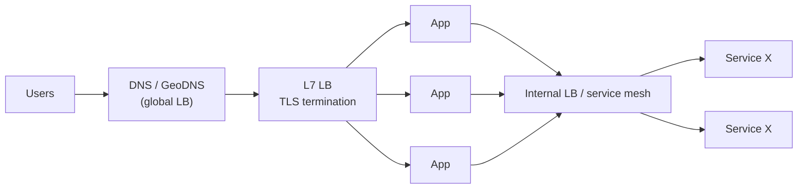
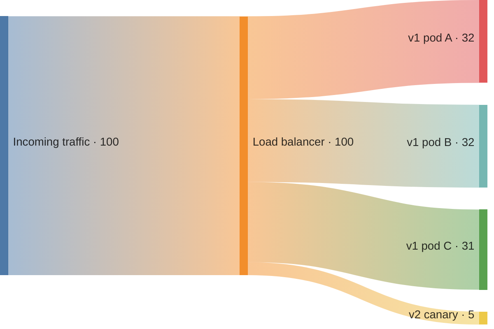
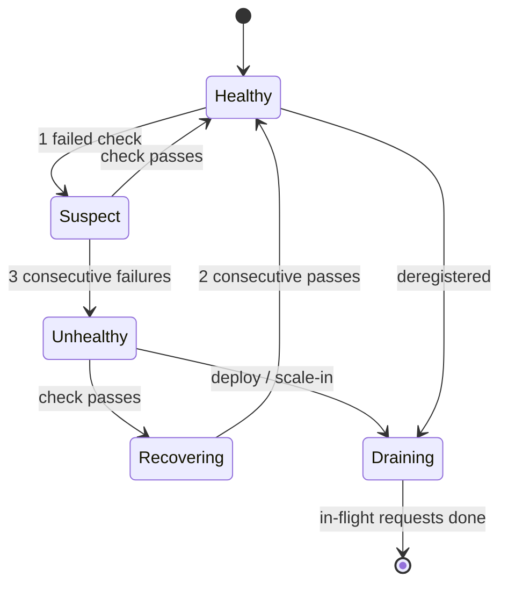

# Load Balancing

> DevOps-vault link: this note is the *design* angle. The ops angle (nginx config, 502/503 debugging) lives in my DevOps notes under Load-Balancers.

## What is it?

A component that spreads incoming requests across multiple backends and **only sends traffic to healthy ones**.

## Why does it exist?

Capacity (many servers share load) and availability (route around dead servers, enable zero-downtime deploys). Availability is the more important one.

## Analogy

The bank queue manager: one door, many tellers; a teller on break gets no customers.

## Interview definition

> "A load balancer distributes traffic across a pool of backends using an algorithm and health checks; L4 balancers route on IP/port, L7 balancers understand HTTP and can route on path, host, headers."

## Where load balancers sit

Layers: **global** (DNS/anycast picks a region) → **edge/L7** (picks a server) → **internal** (service-to-service, often client-side LB or a mesh).

## L4 vs L7

| | L4 (TCP/UDP) | L7 (HTTP) |
|---|---|---|
| Sees | IP, port | Method, host, path, headers, cookies |
| Routes by | Connection | Request (path `/api` → service A) |
| TLS | Pass-through or terminate | Terminates (can inspect) |
| Speed | Faster | Slightly slower, much smarter |
| Examples | AWS NLB, HAProxy TCP, IPVS | AWS ALB, nginx, Envoy, Traefik |
| Use for | DBs, non-HTTP, extreme throughput, static IPs | Web apps, APIs, microservice routing, canaries |

## Algorithms

| Algorithm | How | Use when |
|---|---|---|
| Round robin | In turn | Identical servers, similar requests |
| Weighted round robin | Bigger servers get more | Mixed sizes, **canary** (5% weight) |
| Least connections | Fewest active | Long/variable requests (WebSockets, uploads) |
| Least response time | Fastest | Latency-sensitive |
| IP hash | hash(client IP) | Crude stickiness |
| **Consistent hashing** | Hash ring over keys | Cache affinity — same key → same server, minimal reshuffle → [[Consistent-Hashing]] |
| Power of two choices | Pick 2 random, choose less loaded | Large fleets; near-optimal with little state |

## Health checks

- **Active:** LB polls `/health` every N seconds; unhealthy after K failures.
- **Passive:** LB notices real request failures (outlier detection).
- **Liveness vs readiness:** "restart me" vs "don't send me traffic". Never make liveness depend on the DB — a DB blip restarts the whole fleet.

## Failover & deploys

- **Connection draining:** let in-flight requests finish before removing a server.
- Deploy strategies the LB enables: rolling, blue/green, canary, A/B.
- **The LB itself:** managed cloud LBs are multi-AZ; self-hosted uses active-passive with a virtual IP (keepalived/VRRP).

## Client-side vs server-side LB

Server-side: a dedicated LB box. Client-side: the caller picks an instance from a service registry (gRPC, Envoy sidecar). Client-side removes a hop and a SPOF but needs service discovery. → [[Proxies-and-API-Gateways]]

## 📊 Visual model

**Weighted routing for a canary deploy:**

**Health-check state machine for one backend:**

## Common mistakes

> [!warning] Traps to avoid
> 1. Forgetting the LB is a SPOF.
> 2. Round robin for WebSockets (long-lived connections pile up unevenly) → least connections.
> 3. Sticky sessions to paper over stateful servers.
> 4. Health check on `/` (slow, may need auth).
> 5. Ignoring that gRPC/HTTP2 multiplexes on one long connection — L4 LBs balance *connections*, not requests, so traffic skews. Use an L7 LB for gRPC.

## Interview understanding

> [!question] What the interviewer is really testing
> - *"L4 vs L7?"* — What each can see → what each can route on.
> - *"How do you avoid the LB being a SPOF?"* — Managed multi-AZ LB, or active-passive with VIP failover, plus DNS across regions.
> - *Tricky:* "Why does consistent hashing appear in load balancing?" — For stateful-ish backends (caches), it keeps the same key on the same server and moves only ~1/N keys when servers change.
> - *Tricky:* "Global load balancing — how?" — GeoDNS / latency-based DNS or anycast IPs; health-aware.

## Mini quiz
1. Two problems a load balancer solves?
2. Best algorithm for long-lived WebSocket connections?
3. Why can an L4 LB unbalance gRPC traffic?
4. What's connection draining?
5. Liveness vs readiness?

> [!success]- Answers (click to reveal)
> 1. Capacity and availability.
> 2. Least connections.
> 3. gRPC multiplexes many requests on one long TCP connection; L4 balances per connection.
> 4. Letting in-flight requests finish before removing a backend.
> 5. Restart-me vs send-me-traffic; liveness must not check dependencies.

---
**Next:** [[Data-Storage-MOC]] · **Up:** [[Scaling-MOC]]

## 📚 Resources
- 📄 [Google SRE Book — Load Balancing at the Frontend](https://sre.google/sre-book/load-balancing-frontend/)
- 📄 [Envoy — load balancing overview](https://www.envoyproxy.io/docs/envoy/latest/intro/arch_overview/upstream/load_balancing/overview)
- 📄 ["The power of two random choices" (Mitzenmacher)](https://www.eecs.harvard.edu/~michaelm/postscripts/mythesis.pdf)

## My notes
-
