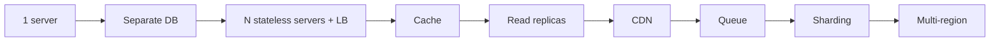

# 📈 02 · Scaling the Application MOC

| # | Note | Lecture | You'll be able to |
|---|---|---|---|
| 1 | [[App-Growth-Story]] | L5 | Narrate 1 user → 10M users and justify each component |
| 2 | [[Scaling-Servers-Stateless-and-SPOF]] | L6 | Vertical vs horizontal, stateless design, kill SPOFs |
| 3 | [[Load-Balancing]] | L6 | L4 vs L7, algorithms, health checks, failover |

> [!tip] The App-Growth-Story is a cheat code
> Almost every HLD answer is a subset of this story. If you can tell it fluently, you have a default skeleton for any problem.

**Next module:** [[Data-Storage-MOC]] · **Up:** [[System-Design-MOC]]
