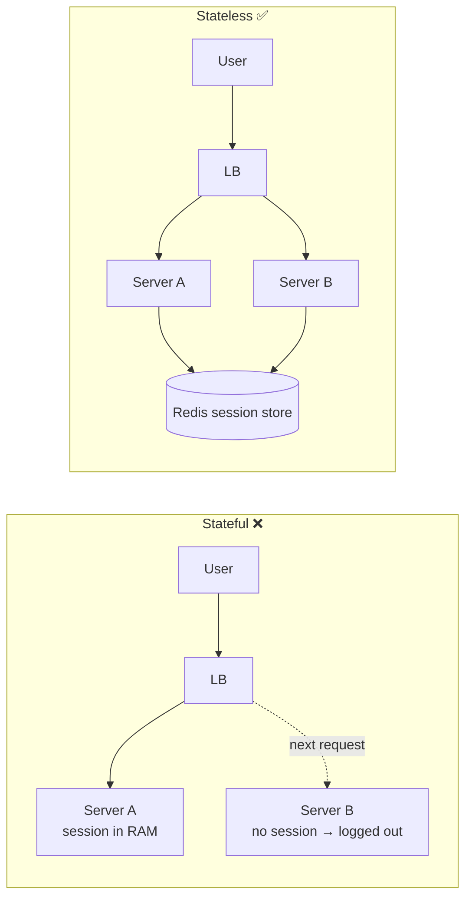
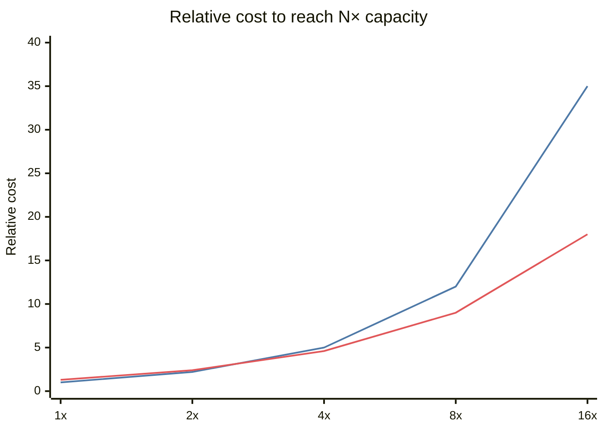
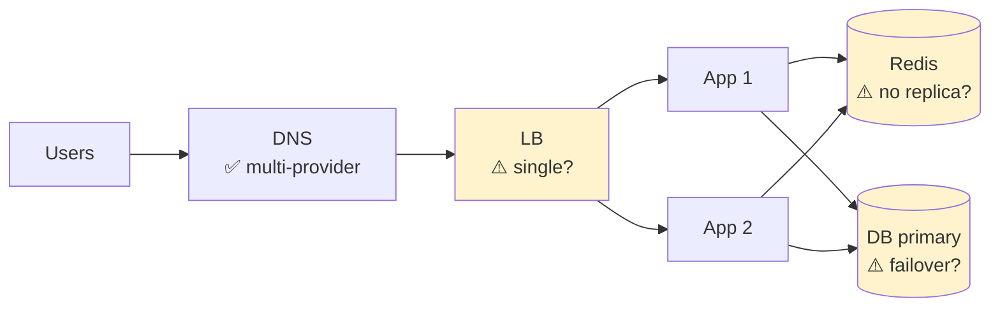

# Scaling Servers — Vertical vs Horizontal, Stateless, SPOF

## What is it?

- **Vertical scaling (scale up):** a bigger machine — more CPU, RAM, faster disk.
- **Horizontal scaling (scale out):** more machines sharing the load.
- **Stateless service:** keeps no per-user data between requests in its own memory, so any instance can serve any request.
- **SPOF (single point of failure):** any component whose failure takes down the system.

## Analogy

Vertical = hiring one superhuman chef. Horizontal = hiring ten normal chefs. Ten chefs only work if **recipes and orders are on a shared board** (stateless) rather than in one chef's head (stateful).

## Vertical vs horizontal

| | Vertical | Horizontal |
|---|---|---|
| How | Bigger box | More boxes |
| Limit | Hardware ceiling (largest instance) | Practically unlimited |
| Downtime to scale | Often (restart) | No |
| Failure | Still a SPOF | Redundant |
| Complexity | None in app | Needs LB, stateless design, distributed data |
| Cost curve | Superlinear at the top end | Linear-ish |
| Best for | Databases (early), quick wins | Stateless app tiers |

**Default answer:** scale app servers horizontally from day one (it's cheap if they're stateless); scale the database vertically as long as possible, then replicas, then shard.

## Stateless vs stateful

**Where state goes instead:**

| State | Move it to |
|---|---|
| Sessions | Redis / signed token (JWT) → [[Authentication-and-Authorization]] |
| Uploaded files | Object storage (S3) → [[Object-Storage]] |
| In-progress jobs | Queue → [[Message-Queues]] |
| Caches | Shared Redis (local caches are fine if it's OK for them to diverge) |
| WebSocket connections | Unavoidably stateful — use a connection registry → [[Real-Time-Communication]] |

### Sticky sessions — why they're a smell

Pinning a user to a server hides statefulness. It breaks even load spreading, deploys (draining kills sessions), and failover. Use only as a stopgap. → [[Load-Balancing]]

## SPOF and redundancy

Walk every box in your diagram and ask: **"What if this dies?"**

| Component | Redundancy |
|---|---|
| App server | N instances behind LB across ≥2 AZs |
| Load balancer | Managed LB (multi-AZ) or active-passive pair with a floating IP |
| Database | Primary + replicas + automatic failover → [[Replication]] |
| Cache | Redis replicas/Sentinel or cluster; app must survive cache loss |
| Queue | Replicated brokers (Kafka RF=3) |
| Region | Multi-region → [[Multi-Region-and-Disaster-Recovery]] |
| DNS | Multiple providers / anycast |

**Active-active:** all copies serve traffic. **Active-passive:** standby takes over on failure (simpler, wastes capacity, failover takes time).

## Autoscaling

Add/remove instances based on CPU, request rate, queue depth, or custom metrics. Gotchas: **cold start** (new instances need warm-up), **scale-in kills in-flight work** (graceful shutdown), and **downstream limits** (scaling app servers 10× can melt the DB's connection pool — use a pooler like PgBouncer).

## 📊 Visual model

**Cost vs capacity (illustrative shape, not real prices):**

> [!note] How to read it
> Line 1 = vertical (bigger boxes get disproportionately expensive and eventually don't exist). Line 2 = horizontal (small overhead for LB + coordination, then roughly linear).

**SPOF hunt — walk every box:**

## Common mistakes

> [!warning] Traps to avoid
> 1. "Just scale horizontally" for the database — it's not stateless.
> 2. Ignoring connection limits: 100 app servers × 20 connections = 2,000 DB connections.
> 3. Redundant app servers in one AZ.
> 4. Forgetting the LB itself can be a SPOF.

## Interview understanding

> [!question] What the interviewer is really testing
> - *"How do you make this highly available?"* — Remove SPOFs layer by layer; redundancy across AZs; health checks + automatic failover.
> - *Tricky:* "Is a JWT-based app fully stateless?" — Mostly, but revocation needs a denylist (state again) or short expiry + refresh tokens.
> - *Tricky:* "Can WebSocket servers be stateless?" — No; the connection is state. Keep *business* state elsewhere and a registry of user→server.
> - *Tricky:* "Autoscaling made things worse — why?" — Thundering scale-out overwhelms DB connections, or scaling on the wrong metric (CPU while the bottleneck is I/O).

## Mini quiz
1. Why is vertical scaling a SPOF?
2. Where do sessions go in a stateless design?
3. Active-active vs active-passive?
4. What breaks when 200 app instances autoscale in?
5. Why avoid sticky sessions?

> [!success]- Answers (click to reveal)
> 1. It's still one machine.
> 2. Redis/shared store, or a signed token on the client.
> 3. All serve traffic vs standby waits for failover.
> 4. DB connection limits; a pooler is needed.
> 5. Uneven load, painful deploys, sessions lost on failure — it hides statefulness.

---
**Next:** [[Load-Balancing]] · **Up:** [[Scaling-MOC]]

## 📚 Resources
- 📄 [AWS Well-Architected — Reliability pillar](https://docs.aws.amazon.com/wellarchitected/latest/reliability-pillar/welcome.html)
- 📄 [The Twelve-Factor App — Processes (stateless)](https://12factor.net/processes)

## My notes
-
