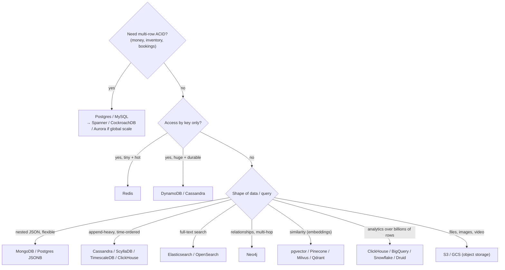
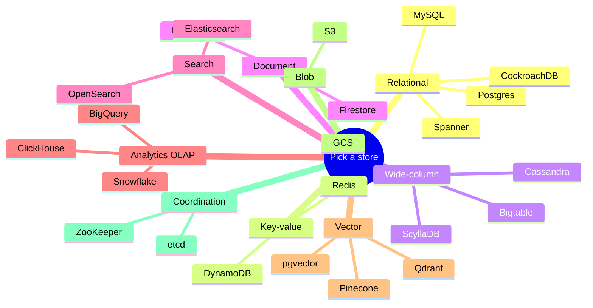
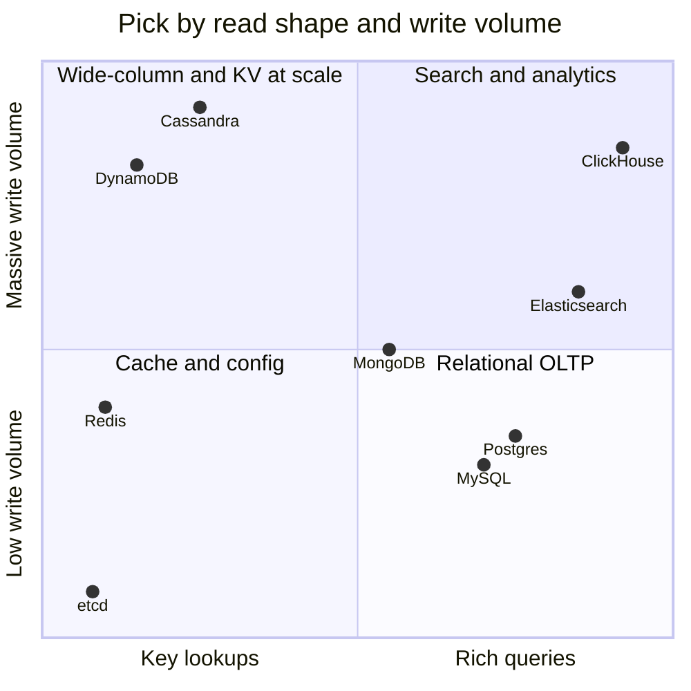

# Choosing a Database ➕

> [!info] Why this is added
> "Which database and why?" is asked in essentially every HLD round. Knowing *categories* isn't enough — you should name a **real product** and a **reason tied to the access pattern**.

## The decision flow

## Use case → database cheat table

| Use case | Pick | Why |
|---|---|---|
| Users, orders, payments, bookings | **Postgres/MySQL** | ACID, constraints, joins |
| Payments ledger at global scale | Spanner / CockroachDB / sharded Postgres | Strong consistency across regions |
| Sessions, rate-limit counters, leaderboards | **Redis** | In-memory, atomic ops, sorted sets → [[Redis-Deep-Dive]] |
| Shopping cart, user prefs (huge scale) | DynamoDB | Key access, managed, predictable latency |
| Chat messages, activity feeds, IoT | **Cassandra / ScyllaDB** | Massive writes, partition by conversation |
| Product catalogue with varied attributes | MongoDB / Postgres JSONB | Flexible schema |
| Search, autocomplete, log search | **Elasticsearch/OpenSearch** | Inverted index → [[Search-Systems]] |
| Metrics / time series | Prometheus, InfluxDB, TimescaleDB | Time-bucketed compression |
| Clickstream analytics, dashboards | **ClickHouse**, Druid, BigQuery | Columnar OLAP |
| Social graph, fraud rings | Neo4j / Neptune (or adjacency lists in SQL/KV at scale) | Multi-hop traversal |
| Embeddings for RAG / semantic search | **pgvector** (small–mid), Pinecone/Milvus/Qdrant (large) | ANN search → [[RAG-and-Vector-Databases]] |
| Images, videos, backups | **S3** | Cheap, durable blobs → [[Object-Storage]] |
| Config / leader election / service discovery | etcd / ZooKeeper | Consensus, small strongly consistent data → [[Consensus-and-Leader-Election]] |
| Geo queries ("near me") | Redis GEO, PostGIS, Elasticsearch geo | → [[Geospatial-Indexing]] |

## OLTP vs OLAP

| | OLTP | OLAP |
|---|---|---|
| Workload | Many small reads/writes | Few huge scans/aggregations |
| Storage | Row-oriented | **Column-oriented** |
| Examples | Postgres, MySQL, DynamoDB | ClickHouse, BigQuery, Snowflake, Redshift |
| Query | `WHERE id = ?` | `SUM(revenue) GROUP BY city` over 1B rows |

Never run heavy analytics on your OLTP primary — stream changes (CDC) to an OLAP store. → [[Batch-and-Stream-Processing]]

## Polyglot persistence

Real systems use several stores, each for what it's best at — e.g., a food delivery app: Postgres (orders, payments), Redis (sessions, driver locations hot cache), Cassandra (order events/tracking), Elasticsearch (restaurant search), S3 (menu images), ClickHouse (analytics). The cost: more ops, and **keeping them in sync** (CDC/outbox → [[Event-Driven-Architecture]]).

## How to say it in an interview

> "Orders need transactions and are ~2k writes/s, which a single Postgres primary handles; I'll shard by `user_id` later if needed. Delivery-location pings are ~100k writes/s, short-lived, and only queried by proximity, so they go to Redis GEO with a TTL, and a sampled trail goes to Cassandra for history."

Access pattern → number → product → trade-off. Every time.

## 📊 Visual model

**Access pattern map:**

## Common mistakes

> [!warning] Traps to avoid
> 1. Naming a DB with no reason.
> 2. One DB for everything at large scale ("put the logs in Postgres").
> 3. Too many DBs for a small system (ops cost is real).
> 4. Forgetting the sync problem between stores.

## Mini quiz
1. Best store for a leaderboard?
2. Row vs column store — which for `SUM` over a billion rows?
3. Where do embeddings go for a small RAG app?
4. What do you use for leader election metadata?
5. Chat messages at 1M writes/s?

> [!success]- Answers (click to reveal)
> 1. Redis sorted set.
> 2. Column store (OLAP).
> 3. pgvector in Postgres.
> 4. etcd / ZooKeeper.
> 5. Cassandra/ScyllaDB partitioned by conversation (+ time bucket).

---
**Next:** [[Performance-MOC]] · **Up:** [[Data-Storage-MOC]]

## 📚 Resources
- 📄 [DB-Engines ranking](https://db-engines.com/en/ranking) — *Why:* quick sense of what's widely used.
- 📖 *DDIA* Ch. 3 (OLTP vs OLAP, column storage).

## My notes
-
