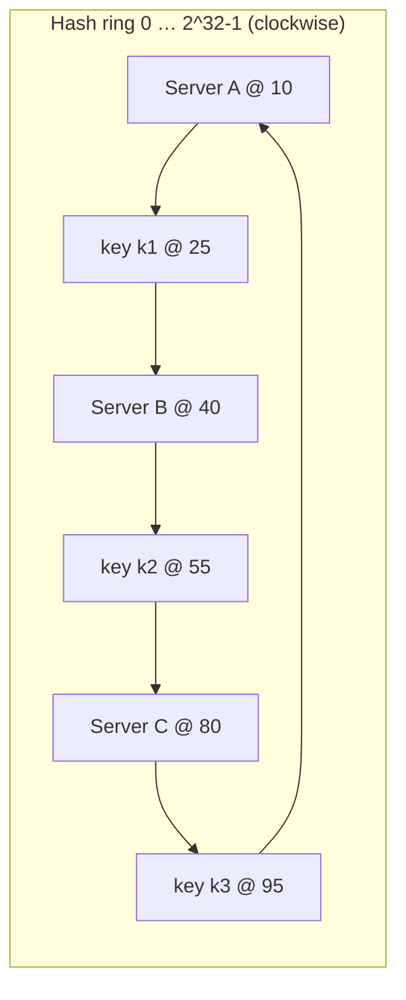
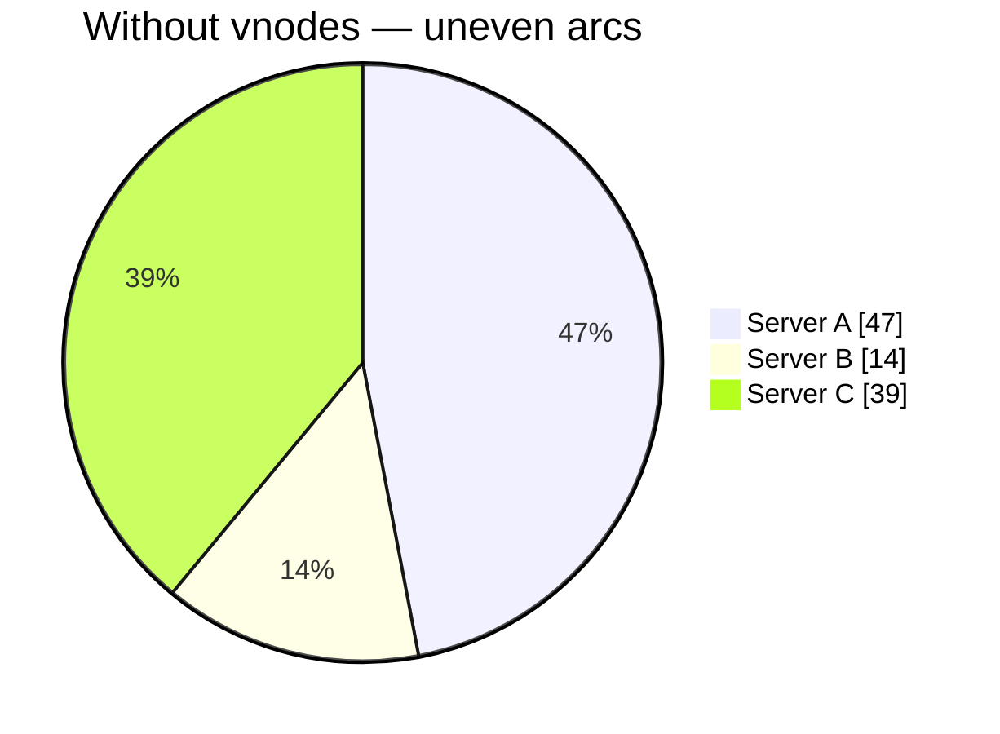
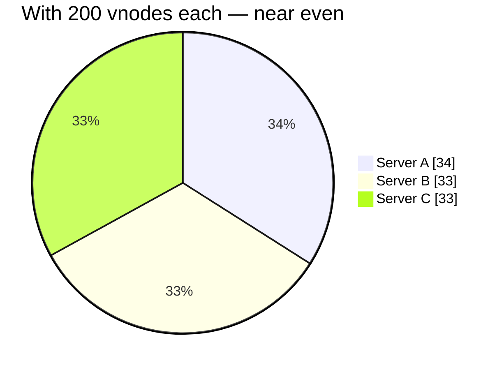
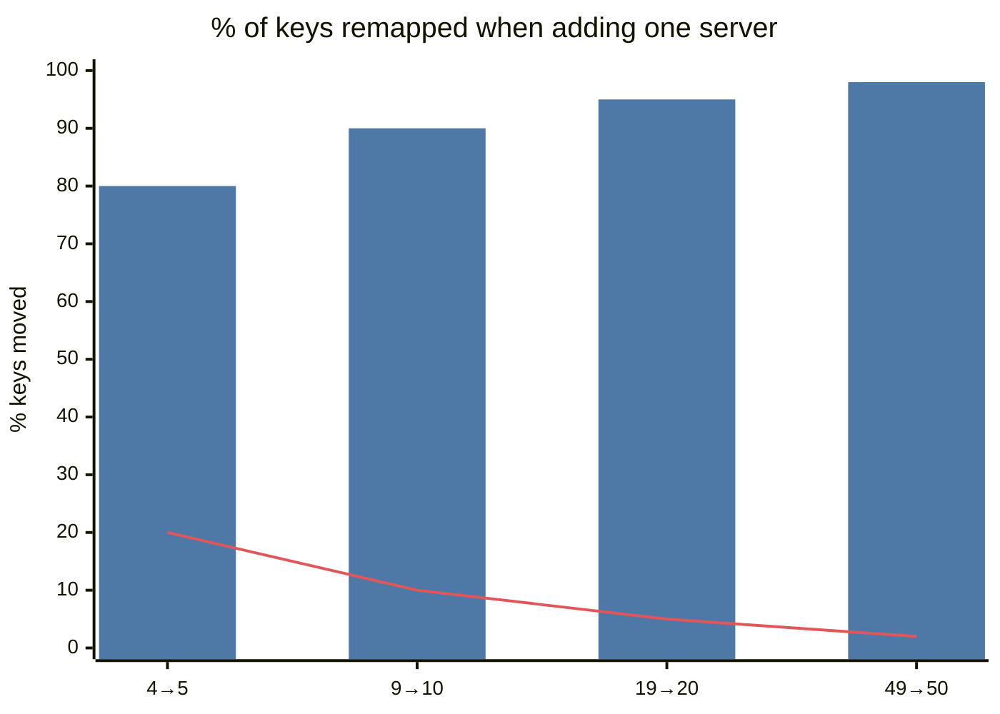

# Consistent Hashing

## What is it?

A way to map keys to servers so that **adding or removing a server moves only ~1/N of the keys**, instead of nearly all of them.

## Why `hash(key) % N` breaks

```text
N = 4:  hash("user42") = 18 → 18 % 4 = 2  → server 2
N = 5:  18 % 5 = 3                         → server 3  (moved!)
```

Changing N remaps ~**(N−1)/N** of keys. For a cache cluster that means a near-100% miss storm hitting the DB at the exact moment you're scaling. For a DB it means migrating almost all data.

## How the ring works



1. Hash **servers** onto a ring (e.g., 0 to 2³²−1).
2. Hash **keys** onto the same ring.
3. A key belongs to the **first server clockwise** from it.
4. **Add** server D between A and B → only keys between A and D move (to D).
5. **Remove** B → only B's keys move (to C).

## Virtual nodes (vnodes)

With few servers, ring positions are uneven → one server owns a huge arc. Fix: each physical server gets **many points** on the ring (e.g., 100–256 vnodes: `A#1, A#2, …`).

Benefits:
- Even load distribution.
- When a server leaves, its load spreads across **many** servers, not just one neighbour.
- **Heterogeneous hardware:** a bigger server gets more vnodes.

## Replication on the ring

Store each key on the first server + the next **N−1 distinct** physical servers clockwise (its "preference list"). That's how Dynamo/Cassandra replicate. → [[Replication]] · [[Design-Key-Value-Store]]

## Minimal implementation

```python
import bisect, hashlib

class Ring:
    def __init__(self, nodes, vnodes=100):
        self.ring, self.keys = {}, []
        for n in nodes:
            for i in range(vnodes):
                h = self._h(f"{n}#{i}")
                self.ring[h] = n
                bisect.insort(self.keys, h)

    def _h(self, s):
        return int(hashlib.md5(s.encode()).hexdigest(), 16) % (2**32)

    def get(self, key):
        h = self._h(key)
        i = bisect.bisect(self.keys, h) % len(self.keys)   # first node clockwise
        return self.ring[self.keys[i]]
```

Lookup = binary search → O(log V) where V = total vnodes.

## Alternatives worth naming

| Technique | Idea | Used in |
|---|---|---|
| **Rendezvous (HRW) hashing** | For each key, score every node `hash(key,node)`; pick max | Some CDNs, load balancers; simple, no ring |
| **Jump consistent hash** | Fast, no memory, but only for numbered buckets (no arbitrary removal) | Google internal sharding |
| **Fixed logical partitions** | 1024 slots mapped to nodes; move slots | **Redis Cluster (16,384 hash slots)**, Kafka, Elasticsearch |
| **Maglev hashing** | Lookup table, consistent + fast | Google Maglev LB |

## Who uses it

Amazon Dynamo, Cassandra, ScyllaDB, Riak, Memcached client libraries (ketama), Discord, Envoy's ring-hash LB, CDNs.

## 📊 Visual model

**Ring ownership — 3 servers without vs with virtual nodes** (each pie is the ring):





**Keys moved when going from N to N+1 servers:**



> [!note] Reading the chart
> Bars = `hash % N` (≈ (N)/(N+1) of keys move). Line = consistent hashing (≈ 1/(N+1)).

$$\text{moved}_{\text{mod}} \approx \frac{N}{N+1} \qquad \text{moved}_{\text{ring}} \approx \frac{1}{N+1}$$

## Common mistakes

> [!warning] Traps to avoid
> 1. Saying Redis Cluster uses a hash ring — it uses **16,384 hash slots** (`CRC16(key) mod 16384`).
> 2. Forgetting vnodes → uneven load.
> 3. Thinking consistent hashing solves hot keys — it doesn't; one hot key still lands on one node.
> 4. Not explaining *why* `% N` is bad (remap fraction).

## Interview understanding

> [!question] What the interviewer is really testing
> - *"How do you distribute keys across cache servers?"* — Consistent hashing with vnodes; explain the remap math.
> - *Tricky:* "What fraction of keys move when adding the 11th node?" — ~1/11.
> - *Tricky:* "Does consistent hashing balance load?" — Balances **key count** (with vnodes), not **traffic** — hot keys need other fixes. → [[Cache-Pitfalls]]
> - *Tricky:* "Why do vnodes help when a node fails?" — Its keys scatter across many nodes instead of doubling one neighbour's load.

## Mini quiz
1. Fraction of keys remapped by `% N` when N changes?
2. Where does a key go on the ring?
3. Two benefits of virtual nodes?
4. How does Redis Cluster partition keys?
5. Does consistent hashing fix hot keys?

> [!success]- Answers (click to reveal)
> 1. ~(N−1)/N — almost all.
> 2. To the first server clockwise from its hash.
> 3. Even distribution; failed node's load spreads widely; weight by capacity.
> 4. 16,384 hash slots, CRC16(key) mod 16384, slots assigned to nodes.
> 5. No.

---
**Next:** [[Choosing-a-Database]] · **Up:** [[Data-Storage-MOC]]

## 📚 Resources
- 📄 [Karger et al. — Consistent Hashing and Random Trees (1997)](https://www.cs.princeton.edu/courses/archive/fall09/cos518/papers/chash.pdf)
- 📄 [Redis — Cluster specification (hash slots)](https://redis.io/docs/latest/operate/oss_and_stack/reference/cluster-spec/)
- 🎥 Search "consistent hashing" on ByteByteGo.

## My notes
-
