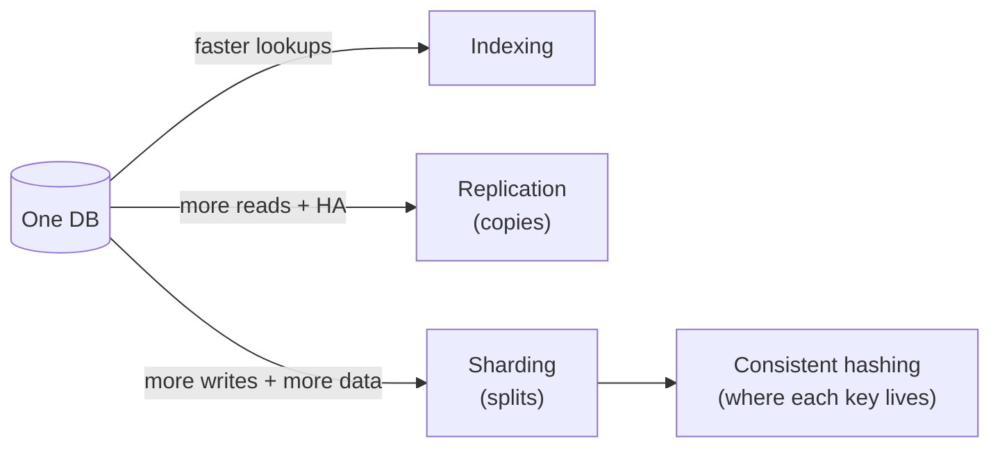

# 🗄️ 03 · Storing Data MOC

> [!important] The database is where designs live or die
> App servers are cattle. Data is the pet. Almost every hard question — consistency, hot keys, resharding, failover — is a data question.

| # | Note | Lecture | You'll be able to |
|---|---|---|---|
| 1 | [[SQL-vs-NoSQL]] | L7 | Choose a data model; ACID vs BASE; 4 NoSQL families |
| 2 | [[Transactions-and-Isolation-Levels]] ➕ | L7 | Explain anomalies, isolation levels, locking — needed for booking/payments |
| 3 | [[Indexing]] | L8 | B-tree vs LSM, composite indexes, write cost |
| 4 | [[Replication]] | L9 | Leader-follower, lag, quorums, failover |
| 5 | [[Sharding-and-Partitioning]] | L10 | Shard keys, hotspots, resharding, cross-shard queries |
| 6 | [[Consistent-Hashing]] | L10 | Why `hash % N` breaks, ring + virtual nodes |
| 7 | [[Choosing-a-Database]] ➕ | — | Name a real DB for each use case and defend it |

## The three ways data scales

**Replication = copies of the same data. Sharding = different data on different machines.** Real systems do both: each shard is replicated.

**Next module:** [[Performance-MOC]] · **Up:** [[System-Design-MOC]]
