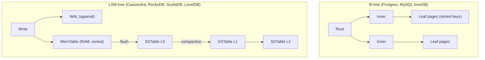
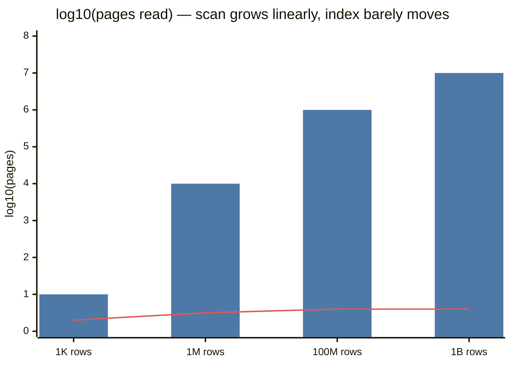
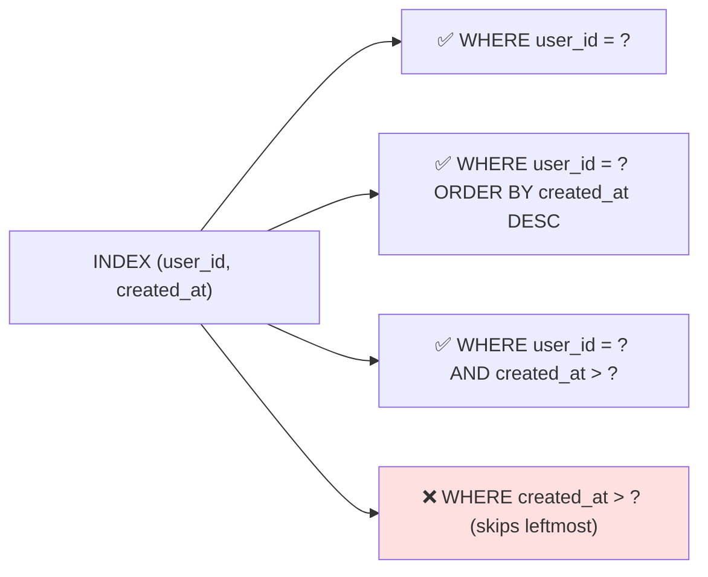

# Indexing

## What is it?

An index is an extra data structure that lets the DB find rows **without scanning the whole table** — like a book's index pointing to page numbers.

## Why it matters

A full scan of 100M rows takes seconds-to-minutes; an index lookup takes milliseconds. It's usually the **first and cheapest** performance fix — before caching, before replicas, before sharding.

## Analogy

Library without a catalogue = walk every shelf (full scan). With a catalogue sorted by title = jump straight to the shelf. But every new book means updating every catalogue (author, title, subject) → **indexes slow down writes**.

## Full scan vs index

```text
SELECT * FROM orders WHERE user_id = 42;
No index:  O(N)  — read every row
B-tree:    O(log N) — ~3-4 page reads for 100M rows
```

## B-tree vs LSM-tree (the two engine families)



| | B-tree | LSM-tree |
|---|---|---|
| Write path | Update pages in place (random I/O) | Append to memtable + WAL (sequential) |
| Write throughput | Good | **Excellent** |
| Read path | One tree walk | Check memtable + several SSTables (Bloom filters help) |
| Read latency | **Predictable, fast** | Can be higher; compaction spikes |
| Space/amplification | Fragmentation | Write amplification from compaction |
| Best for | OLTP with mixed reads/writes | Write-heavy: logs, metrics, chat, time-series |

Bloom filters let LSM reads skip SSTables that definitely don't contain the key. → [[Probabilistic-Data-Structures]]

## Index types

| Type | What | Example |
|---|---|---|
| **Primary / clustered** | Table rows stored in PK order (InnoDB) | `id` |
| **Secondary** | Separate structure pointing to rows/PK | `email` |
| **Composite** | Multiple columns, ordered | `(user_id, created_at)` |
| **Unique** | Enforces no duplicates | `email`, `idempotency_key` |
| **Covering** | Index includes all queried columns → no table lookup | `(user_id, created_at) INCLUDE (status)` |
| **Hash** | Exact match only | In-memory KV, some engines |
| **Full-text / inverted** | Word → documents | Search → [[Search-Systems]] |
| **Geospatial** | R-tree / geohash / GiST | "drivers near me" → [[Geospatial-Indexing]] |

### Composite index — the leftmost-prefix rule

Index on `(user_id, created_at)` helps:
- ✅ `WHERE user_id = 42`
- ✅ `WHERE user_id = 42 ORDER BY created_at DESC LIMIT 20` (perfect for feeds/order history)
- ❌ `WHERE created_at > '2026-01-01'` alone (can't skip the first column)

**Column order rule of thumb:** equality columns first, then range/sort column.

## Why indexes slow down writes

Every INSERT/UPDATE/DELETE must update **every** index on the table. 8 indexes ≈ 9 writes per insert, plus more lock contention and storage. Write-heavy tables get few, deliberate indexes.

## 📊 Visual model

**Full scan vs B-tree index as the table grows (log scale):**



**Composite index `(user_id, created_at)` — what it can serve:**



**Write cost per extra index:**

$$\text{writes per INSERT} = 1 + (\text{number of secondary indexes})$$

## Common mistakes

> [!warning] Traps to avoid
> 1. Indexing every column "just in case".
> 2. Low-cardinality indexes (`gender`, `is_active`) — the planner often ignores them.
> 3. Functions on indexed columns: `WHERE LOWER(email) = ?` skips the index unless you build an expression index.
> 4. Wrong composite order.
> 5. `OFFSET 100000` pagination — still scans; use keyset/cursor pagination. → [[API-Design]]

## Interview understanding

> [!question] What the interviewer is really testing
> - *"The query is slow — what do you check?"* — `EXPLAIN ANALYZE`; is it a seq scan? add/fix index; then caching; then replicas.
> - *Tricky:* "Why does Cassandra write faster than Postgres?" — LSM: sequential appends vs in-place random page updates.
> - *Tricky:* "Would you index a column in a table with 50k writes/s?" — Only if a critical query needs it; consider async secondary indexing or a separate search store.
> - *Tricky:* "Why not hash indexes everywhere?" — No range queries or ordering.

## Mini quiz
1. Index lookup complexity in a B-tree?
2. Which engine family suits write-heavy chat logs?
3. Index `(a, b)` — does `WHERE b = 5` use it efficiently?
4. What is a covering index?
5. Why do Bloom filters matter for LSM trees?

> [!success]- Answers (click to reveal)
> 1. O(log N).
> 2. LSM-tree (Cassandra/ScyllaDB).
> 3. No — leftmost-prefix rule.
> 4. One containing all columns the query needs, so no table lookup.
> 5. They skip SSTables that definitely don't contain a key, cutting read I/O.

---
**Next:** [[Replication]] · **Up:** [[Data-Storage-MOC]]

## 📚 Resources
- 📄 [Use The Index, Luke!](https://use-the-index-luke.com/) — *Why:* the best free guide to SQL indexing.
- 📖 *DDIA* Ch. 3 — storage engines, B-trees vs LSM.

## My notes
-
