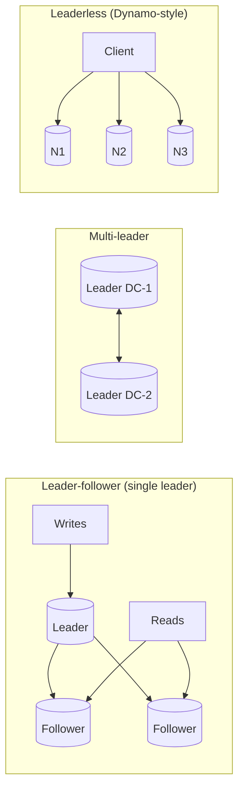
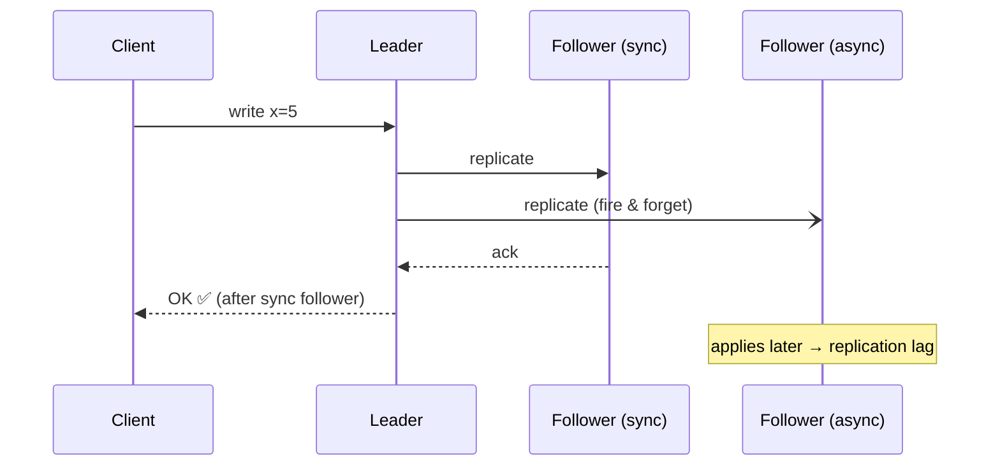
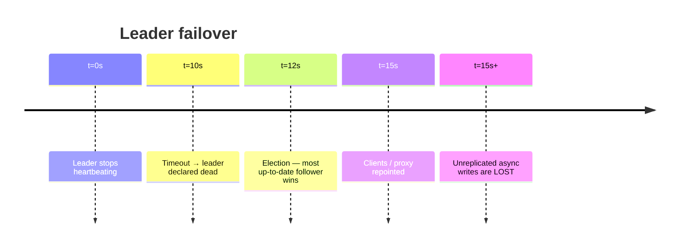

# Replication

## What is it?

Keeping **copies of the same data** on multiple machines.

## Why does it exist?

1. **Availability** — survive a machine/AZ dying.
2. **Read scaling** — spread reads across copies.
3. **Latency** — put a copy near users (other regions).
4. **Durability** — data isn't lost with one disk.

## Analogy

A teacher (leader) writes on the board; students (followers) copy into notebooks. Students who copy slowly have stale notebooks (**replication lag**). If the teacher leaves, a student becomes teacher (**failover**) — but whatever they hadn't copied is gone.

## The three architectures



| | Single leader | Multi-leader | Leaderless |
|---|---|---|---|
| Writes go to | One leader | Any leader (usually one per region) | Any W of N replicas |
| Conflicts | None (one writer) | **Yes** — must resolve | **Yes** — versioning, read repair |
| Examples | Postgres, MySQL, MongoDB, Redis | Multi-region MySQL/Postgres setups, CouchDB, collaborative apps | Cassandra, DynamoDB (internally), Riak |
| Good for | Most OLTP | Multi-region writes, offline clients | High availability writes, huge scale |

## Sync vs async

| | Synchronous | Asynchronous |
|---|---|---|
| Leader waits for follower ack? | Yes | No |
| Data loss on leader crash | None (for synced replicas) | Recent writes can be lost |
| Write latency | Higher | Low |
| Availability | Follower down can block writes | Unaffected |
| Common setup | **Semi-sync**: 1 sync + rest async | Default in many setups |

## Replication lag — the problems it causes

| Problem | Symptom | Fix |
|---|---|---|
| **Read-your-writes** | User posts a comment, refreshes, it's gone | Read own recent writes from leader (e.g., for 10 s after write), or track LSN/version |
| **Monotonic reads** | Comment appears, then disappears on refresh (hit a staler replica) | Pin a user to one replica (hash user_id) |
| **Consistent prefix** | See an answer before the question | Keep causally related writes in the same partition |

→ [[Consistency-Models]]

## Failover

1. Detect leader failure (heartbeat timeout — but slow ≠ dead!).
2. Elect a new leader (most up-to-date follower) → [[Consensus-and-Leader-Election]].
3. Reconfigure clients/proxies to the new leader.

**Dangers:** lost async writes, **split brain** (two leaders accept writes), timeouts too short → needless failovers. Managed DBs (RDS Multi-AZ, Aurora, Patroni for Postgres) handle this.

## Quorums (leaderless)

N replicas, write to W, read from R. If **W + R > N**, every read overlaps at least one node with the latest write.

```text
N=3, W=2, R=2 → 2+2 > 3 ✅ strong-ish reads, tolerates 1 node down
N=3, W=1, R=1 → fast, eventually consistent
W=N → durable writes but any node down blocks writes
```

Supporting tricks: **read repair** (fix stale replicas during reads), **hinted handoff** (another node holds writes for a down node), **anti-entropy** with Merkle trees. → [[Design-Key-Value-Store]]

## 📊 Visual model

**Sync vs async — when does the client get its ACK?**



**Quorum condition:**

$$W + R > N \implies \text{every read set overlaps the latest write set}$$

| N | W | R | Tolerates | Behaviour |
|---|---|---|---|---|
| 3 | 2 | 2 | 1 node down | Balanced, "strong-ish" |
| 3 | 3 | 1 | 0 for writes | Fast reads, fragile writes |
| 3 | 1 | 1 | 2 nodes down | Fastest, eventual |

**Failover timeline:**



## Common mistakes

> [!warning] Traps to avoid
> 1. Treating replicas as backups (a `DROP TABLE` replicates instantly — you still need backups).
> 2. Reading from replicas right after a write and being surprised.
> 3. Using multi-leader without a conflict-resolution plan ("last write wins" silently drops data).
> 4. Forgetting replicas also need the same index/hardware capacity as the leader.

## Interview understanding

> [!question] What the interviewer is really testing
> - *"How do you scale reads?"* — Replicas + cache; mention lag and read-your-writes.
> - *"What happens if the leader dies?"* — Failover steps + risks (lost writes, split brain, fencing).
> - *Tricky:* "Is W + R > N linearizable?" — Not strictly (sloppy quorums, concurrent writes, clock-based LWW break it), but it's the standard approximation.
> - *Tricky:* "Replication vs backup?" — Replication protects from hardware failure; backups protect from mistakes/corruption (point-in-time recovery).

## Mini quiz
1. Three reasons to replicate?
2. Async replication's main risk?
3. Read-your-writes fix?
4. Quorum condition?
5. What is split brain?

> [!success]- Answers (click to reveal)
> 1. Availability, read scaling, latency, durability.
> 2. Losing recent writes on leader failure; stale reads.
> 3. Route that user's reads to the leader for a short window, or by version/LSN.
> 4. W + R > N.
> 5. Two nodes both believe they're leader and accept conflicting writes.

---
**Next:** [[Sharding-and-Partitioning]] · **Up:** [[Data-Storage-MOC]]

## 📚 Resources
- 📖 *DDIA* Ch. 5 — replication (the reference).
- 📄 [Amazon Dynamo paper (2007)](https://www.allthingsdistributed.com/files/amazon-dynamo-sosp2007.pdf) — leaderless, quorums, hinted handoff.

## My notes
-
