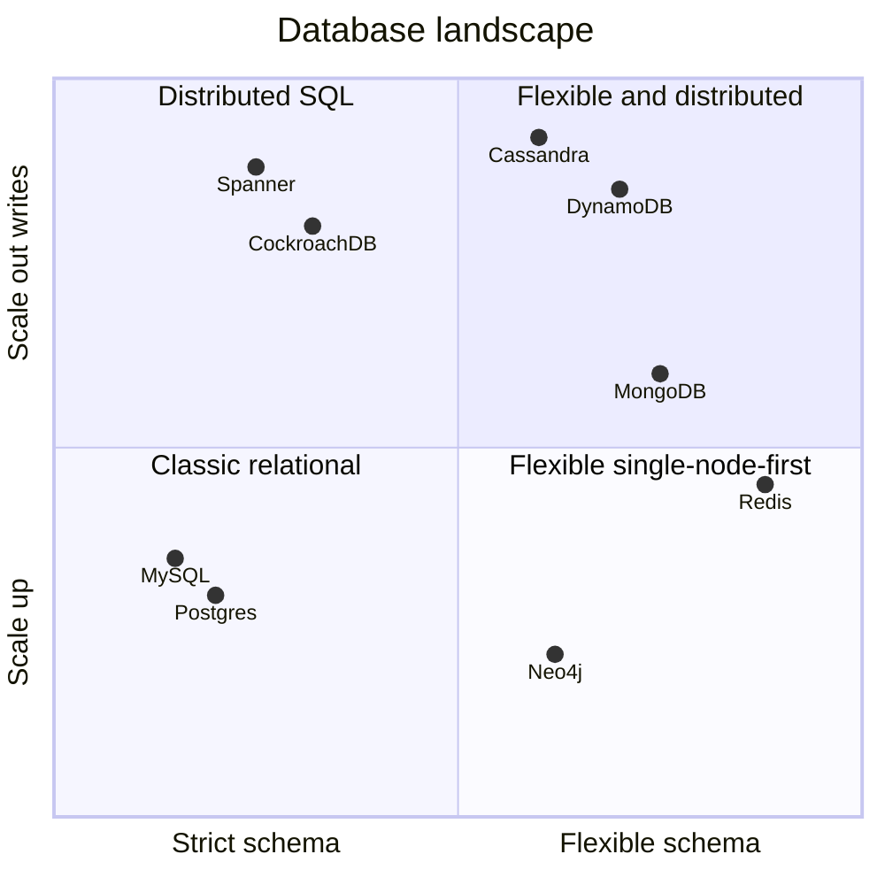
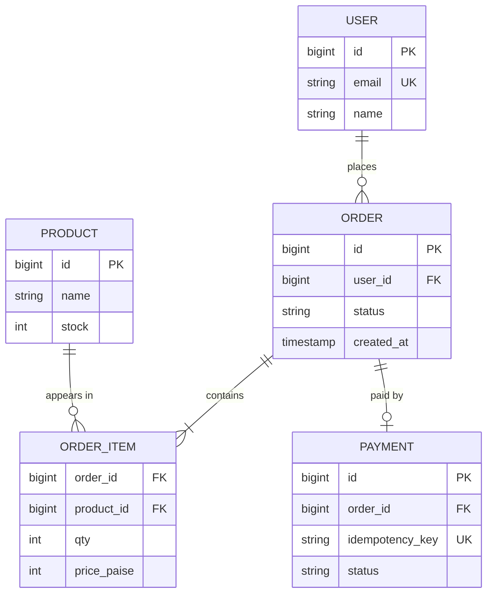

# SQL vs NoSQL

## What is it?

- **SQL (relational):** data in tables with fixed schemas, related by keys, queried with SQL, strong transactions (ACID). Postgres, MySQL.
- **NoSQL:** a family of non-relational stores optimised for specific access patterns and horizontal scale: key-value, document, wide-column, graph.

## Why both exist

Relational DBs were built for correctness and flexible queries on one machine. As the web exploded, some workloads needed massive write scale, flexible schemas, and partition tolerance more than joins — NoSQL traded features for scale. Today the line is blurry (Postgres has JSONB; DynamoDB has transactions; NewSQL like Spanner/CockroachDB gives SQL + horizontal scale).

## Relational core concepts

| Concept | Meaning |
|---|---|
| Primary key | Unique row identifier |
| Foreign key | Reference to another table's PK — enforces integrity |
| Join | Combine rows across tables at query time |
| Transaction | Group of operations that succeed/fail together |
| Normalization | Store each fact once (no duplication) → consistent, more joins |
| Denormalization | Duplicate data to avoid joins → faster reads, harder updates |

### ACID

| Letter | Meaning | Example |
|---|---|---|
| **A**tomicity | All or nothing | Debit + credit both happen or neither |
| **C**onsistency | Constraints hold after every txn | Balance never negative |
| **I**solation | Concurrent txns don't see each other's partial work | Two bookings can't both take seat 12A |
| **D**urability | Committed = survives crash | Written to WAL on disk |

→ Isolation is subtle; see [[Transactions-and-Isolation-Levels]].

### BASE (typical NoSQL stance)

**B**asically **A**vailable, **S**oft state, **E**ventually consistent — stay up and accept writes; replicas converge later. → [[Consistency-Models]]

## The four NoSQL families

| Type | Model | Examples | Great for | Bad at |
|---|---|---|---|---|
| **Key-value** | `key → blob` | Redis, DynamoDB, Riak | Sessions, caches, carts, counters | Queries by anything but key |
| **Document** | `key → JSON doc` | MongoDB, Couchbase, Firestore | Catalogues, profiles, CMS — nested, varying fields | Cross-document joins/transactions (improving) |
| **Wide-column** | Row key → sorted columns, partitioned | Cassandra, ScyllaDB, HBase, Bigtable | Huge write throughput, time series, chat messages, feeds | Ad-hoc queries; must design per query |
| **Graph** | Nodes + edges | Neo4j, Neptune | Social graphs, fraud rings, recommendations | Bulk analytics, simple CRUD |

## SQL vs NoSQL — decision table

| Question | Leans SQL | Leans NoSQL |
|---|---|---|
| Need multi-row transactions? | ✅ payments, bookings, inventory | |
| Relationships + ad-hoc queries? | ✅ | |
| Schema changes constantly / nested data? | | ✅ document |
| Writes > 100k/s, simple access by key? | | ✅ wide-column / KV |
| Access pattern known & fixed? | | ✅ design table per query |
| Team & tooling maturity | ✅ Postgres is the safe default | |

> [!tip] The 2026 default answer
> "I'll start with **Postgres** — ACID, mature, scales vertically far, read replicas, JSONB for flexible fields. I'd move a specific workload to Cassandra/DynamoDB when its write volume or partition needs exceed one primary." Interviewers like a default plus a trigger to change it.

## Modelling: query-first (NoSQL) vs entity-first (SQL)

- **SQL:** model entities, normalise, let the query planner + indexes serve any query.
- **Cassandra/DynamoDB:** list the queries first, then design one table per query, with the partition key = what you look up by. Duplication is expected.

Example — chat messages in Cassandra: `PRIMARY KEY ((conversation_id), message_ts)` → all messages of a chat on one partition, sorted by time. → [[Design-Chat-App]]

## 📊 Visual model

**Where databases sit (schema flexibility vs horizontal write scale):**

**A normalised e-commerce schema (SQL view):**

## Common mistakes

> [!warning] Traps to avoid
> 1. "NoSQL because it scales" — with no access pattern analysis.
> 2. "SQL doesn't scale" — false; Instagram, Shopify, Uber (partly), GitHub run on sharded MySQL/Postgres.
> 3. Choosing MongoDB for money movement without considering transaction semantics.
> 4. Normalising a read-heavy feed so every page load does 6 joins.
> 5. Picking Cassandra and then needing `WHERE email = ?` on a non-key column.

## Interview understanding

> [!question] What the interviewer is really testing
> - *"Why this database?"* — Always answer with **access pattern + consistency need + scale number**.
> - *Tricky:* "Can NoSQL be ACID?" — Yes, within limits: MongoDB multi-document transactions, DynamoDB transactions (≤100 items), FoundationDB fully ACID.
> - *Tricky:* "Normalise or denormalise for a news feed?" — Denormalise the read path (precomputed feed), keep a normalised source of truth.
> - *Tricky:* "When is a graph DB actually justified?" — Multi-hop traversals (friends-of-friends, fraud rings) where joins explode.

## Mini quiz
1. Name the 4 NoSQL types with one example each.
2. What does the I in ACID protect against?
3. Normalization trades ___ for ___.
4. Why design Cassandra tables per query?
5. A good default DB for a new product, and why?

> [!success]- Answers (click to reveal)
> 1. KV (Redis), document (MongoDB), wide-column (Cassandra), graph (Neo4j).
> 2. Concurrent transactions interfering (seeing partial work, lost updates).
> 3. Read speed (more joins) for consistency/less duplication.
> 4. It can only query efficiently by partition (and clustering) key.
> 5. Postgres — ACID, flexible querying, JSONB, replicas, huge ecosystem.

---
**Next:** [[Transactions-and-Isolation-Levels]] · **Up:** [[Data-Storage-MOC]]

## 📚 Resources
- 📖 *DDIA* Ch. 2 (data models) and Ch. 7 (transactions).
- 📄 [AWS — DynamoDB single-table design / NoSQL design best practices](https://docs.aws.amazon.com/amazondynamodb/latest/developerguide/bp-general-nosql-design.html)

## My notes
-
