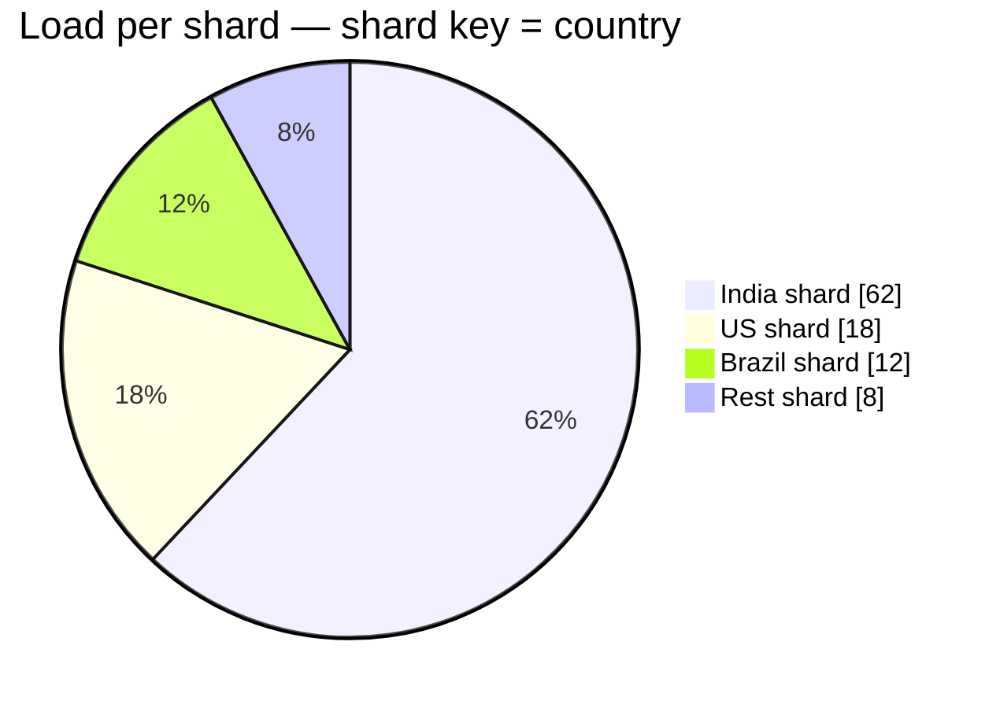
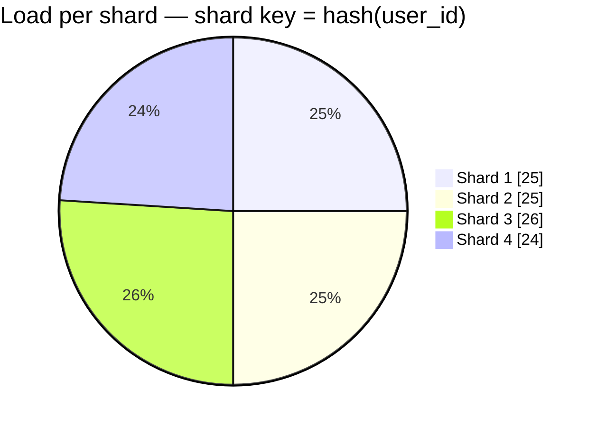
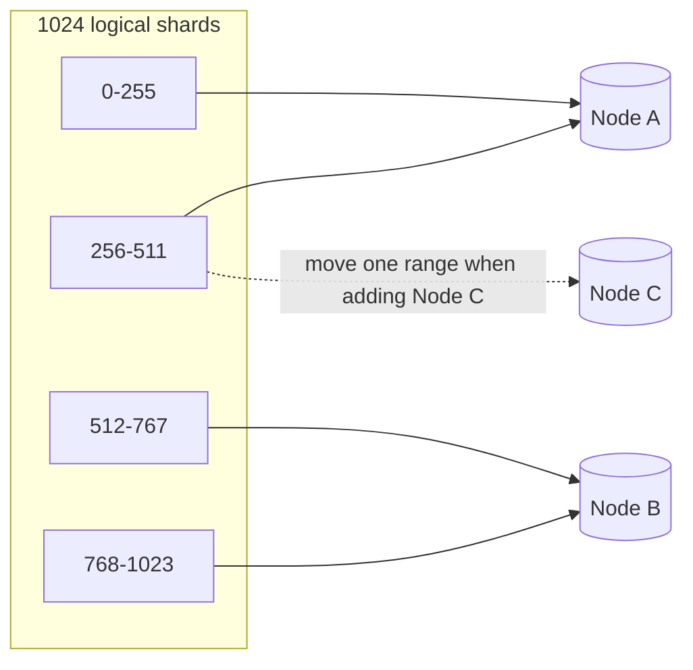

# Sharding and Partitioning

## What is it?

Splitting one big dataset into smaller pieces (**shards/partitions**), each on a different machine, so that writes and storage scale beyond one server.

- **Vertical partitioning:** split by *columns/features* (users table on DB-1, orders on DB-2; or move blob columns out).
- **Horizontal partitioning (sharding):** split by *rows* (users A–M on shard 1, N–Z on shard 2).

## Why does it exist?

Replication scales **reads**, not **writes** — every replica still applies every write. When a single primary can't take the write rate or hold the data, you shard.

## Analogy

One huge phone directory is too heavy → split into volumes A–F, G–M, N–Z. Finding "Paul" is fast (go to N–Z). Finding "everyone born in 1999" means opening every volume (**scatter-gather**).

## Sharding strategies

| Strategy | How | Pros | Cons |
|---|---|---|---|
| **Range** | `user_id 1–1M → S1`, … or by date | Range scans easy | **Hotspots** (new IDs/today's dates all on last shard) |
| **Hash** | `hash(key) → shard` | Even spread | Range queries scatter; resharding moves data (use [[Consistent-Hashing]]) |
| **Directory / lookup** | Lookup table key → shard | Flexible, can move single tenants | Lookup service is a dependency/SPOF |
| **Geo** | By region/country | Data residency, latency | Uneven sizes |
| **Tenant-based** | Per customer (SaaS) | Isolation | Whale tenants |

## Choosing a shard key — the most important decision

Good shard key = **high cardinality + even distribution + matches the main query**.

| System | Good key | Why |
|---|---|---|
| Chat | `conversation_id` | All messages of a chat together |
| Orders | `user_id` | "My orders" is single-shard |
| Feed | `user_id` | Read your own feed from one shard |
| URL shortener | `short_code` (hash) | Lookup by code |
| Metrics | `(metric_id, time_bucket)` | Avoids one partition per metric growing forever |

❌ Bad: `country` (India is huge), `created_date` (all writes to today), `status`.

## Hotspots & the celebrity problem

One key gets disproportionate traffic (a celebrity's posts, a viral product, a flash-sale SKU).

Fixes:
- **Key salting / splitting:** `product#123#0..9` spreads writes across 10 partitions; aggregate on read.
- **Caching** the hot reads.
- **Special-case** the hot entity (separate pipeline for celebrities → [[Design-News-Feed]]).
- **Rate limiting** writes to the hot key.

## Resharding

When shards fill up: `hash % N` → `hash % (N+1)` moves ~all keys. Solutions:
- **Consistent hashing** — only ~1/N keys move. → [[Consistent-Hashing]]
- **Fixed many logical partitions** (e.g., 1024 logical shards mapped onto 8 physical nodes; move whole logical shards). Used by Cassandra vnodes, Kafka partitions, Vitess, Elasticsearch.
- **Double-writing + backfill** migrations for live systems.

## Cross-shard problems

| Problem | Mitigation |
|---|---|
| Joins across shards | Denormalise; co-locate related data by the same key; do joins in app |
| Transactions across shards | Avoid; or sagas/2PC → [[Distributed-Transactions]] |
| Global secondary index (e.g., by email) | Separate lookup table sharded by email; or global index service |
| Aggregations ("top products") | Scatter-gather or stream into an analytics store → [[Batch-and-Stream-Processing]] |
| Unique IDs | Can't use auto-increment → [[Unique-ID-Generation]] |

## Real examples

- **Instagram:** Postgres sharded into thousands of logical shards mapped to fewer physical servers; IDs embed the shard ID.
- **Discord:** messages in ScyllaDB partitioned by `(channel_id, time bucket)` to bound partition size.
- **Vitess (YouTube → PlanetScale):** sharding layer for MySQL.

## 📊 Visual model

**Bad shard key (country) vs good shard key (hash of user_id):**

**Logical shards → physical nodes (how resharding stays cheap):**

## Common mistakes

> [!warning] Traps to avoid
> 1. Sharding too early.
> 2. Shard key that doesn't match the dominant query → everything becomes scatter-gather.
> 3. Monotonic shard keys with range sharding (all writes to one shard).
> 4. Ignoring unbounded partitions (a chat with 10M messages in one partition).
> 5. Forgetting each shard still needs replication.

## Interview understanding

> [!question] What the interviewer is really testing
> - *"How would you shard this?"* — State the key, why (query pattern), what's cross-shard, and how you handle hot keys.
> - *Tricky:* "Sharding vs partitioning?" — Often used interchangeably; partitioning can be within one machine (Postgres table partitions), sharding is across machines.
> - *Tricky:* "How do you look up a user by email if you shard by user_id?" — A secondary mapping table `email → user_id`, sharded by email.
> - *Tricky:* "How do you reshard with zero downtime?" — Logical shards, dual writes, backfill, verify, cut over reads, then writes.

## Mini quiz
1. Replication scales ___; sharding scales ___.
2. Range vs hash sharding: one pro each.
3. Why is `created_at` a bad range shard key?
4. Name two hot-key mitigations.
5. How do you avoid moving all data when adding a shard?

> [!success]- Answers (click to reveal)
> 1. Reads (+ availability); writes + storage.
> 2. Range: efficient range scans. Hash: even distribution.
> 3. All new writes hit the newest shard.
> 4. Key salting/splitting, caching, special-case path, rate limits.
> 5. Consistent hashing or many fixed logical partitions.

---
**Next:** [[Consistent-Hashing]] · **Up:** [[Data-Storage-MOC]]

## 📚 Resources
- 📖 *DDIA* Ch. 6 — partitioning.
- 📄 [Instagram Engineering — Sharding & IDs at Instagram](https://instagram-engineering.com/sharding-ids-at-instagram-1cf5a71e5a5c)
- 📄 [Discord — How Discord stores trillions of messages](https://discord.com/blog/how-discord-stores-trillions-of-messages)

## My notes
-
