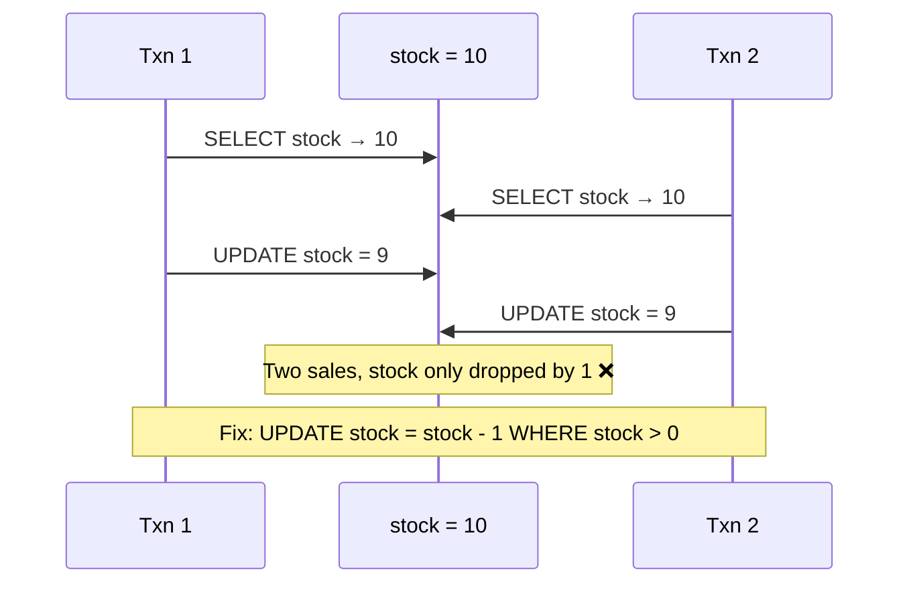
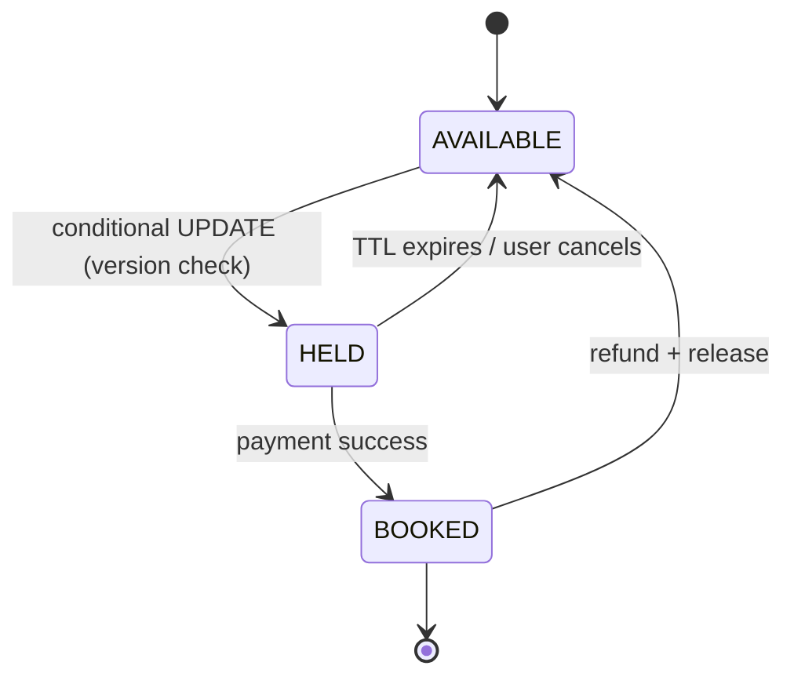
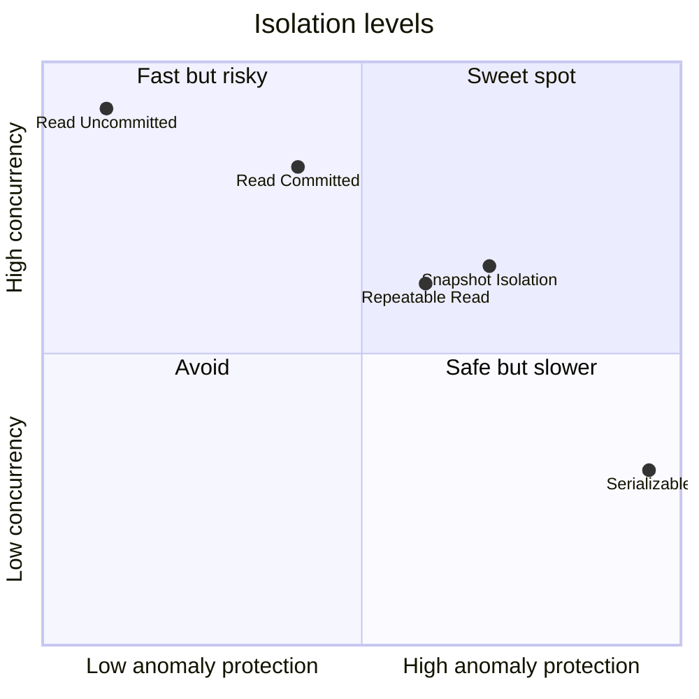

# Transactions and Isolation Levels ➕

> [!info] Why this is added
> Not a separate lecture in the syllabus, but every booking, payment and inventory question ends with *"two users click at the same time — what happens?"* This note is the answer.

## What is it?

**Isolation level** = how much concurrent transactions are allowed to see of each other. Stronger isolation = fewer anomalies but more locking/aborts = lower throughput.

## The anomalies

| Anomaly | What happens | Example |
|---|---|---|
| **Dirty read** | Read uncommitted data that later rolls back | See ₹500 credit that never happened |
| **Non-repeatable read** | Same row read twice in a txn gives different values | Price changed mid-checkout |
| **Phantom read** | Same query returns new rows the second time | "Seats available" count changes |
| **Lost update** | Two read-modify-write cycles; one overwrites the other | Two people increment a counter from 10 → both write 11 |
| **Write skew** | Two txns read overlapping data, write different rows, invariant breaks | Two doctors both go off-call because each saw the other on call |

## Isolation levels (SQL standard)

| Level | Dirty | Non-repeatable | Phantom | Notes |
|---|---|---|---|---|
| Read Uncommitted | possible | possible | possible | Almost never used |
| **Read Committed** | ❌ | possible | possible | **Postgres default**, Oracle default |
| **Repeatable Read** | ❌ | ❌ | possible* | **MySQL InnoDB default** (*InnoDB prevents most phantoms via gap locks) |
| Snapshot Isolation | ❌ | ❌ | ❌ | Postgres "Repeatable Read" is actually SI; write skew still possible |
| **Serializable** | ❌ | ❌ | ❌ | As if one-at-a-time; Postgres uses SSI (aborts on conflict) |

**MVCC (multi-version concurrency control):** readers see a snapshot; writers create new versions. Readers don't block writers. That's how Postgres/MySQL give good concurrency.

## Concurrency control techniques you'll use in designs

| Technique | How | Use when |
|---|---|---|
| **Pessimistic lock** | `SELECT … FOR UPDATE` locks the row | High contention, short txns (seat booking, wallet debit) |
| **Optimistic lock** | `version` column; `UPDATE … WHERE id=? AND version=?`; retry if 0 rows | Low contention, long user think-time (editing a profile) |
| **Atomic conditional update** | `UPDATE stock SET qty=qty-1 WHERE id=? AND qty>0` | Inventory decrement — simplest correct answer |
| **Unique constraint** | DB rejects duplicate (seat_id, show_id) | Booking, idempotency keys |
| **Distributed lock** | Redis `SET key val NX PX 30000` / ZooKeeper | Across services; must use fencing tokens → [[Consensus-and-Leader-Election]] |

```sql
-- Optimistic locking
UPDATE seats
SET status = 'HELD', held_by = :user, version = version + 1
WHERE seat_id = :id AND status = 'AVAILABLE' AND version = :v;
-- rows affected = 0 → someone else got it → tell the user
```

## Real usage

- **Ticketing (BookMyShow-like):** hold with TTL via conditional update or Redis, confirm in a transaction. → [[Design-Ticket-Booking]]
- **Payments:** ledger inserts in a serializable/strict transaction + idempotency key unique constraint. → [[Design-Payment-System]]
- **Flash sales:** atomic decrement in Redis, then async order creation. → [[Design-Flash-Sale]]

## 📊 Visual model

**The lost update, step by step:**



**Seat lifecycle with a hold TTL:**



**Isolation vs throughput (qualitative):**



## Common mistakes

> [!warning] Traps to avoid
> 1. Read-then-write in application code without a lock or conditional update (lost update).
> 2. Long transactions holding locks while calling external APIs (payment gateway inside a DB txn ❌).
> 3. Assuming "Repeatable Read" means the same thing in Postgres and MySQL.
> 4. Distributed locks without expiry or fencing tokens.
> 5. Using Serializable everywhere and then wondering about throughput/aborts.

## Interview understanding

> [!question] What the interviewer is really testing
> - *"Two users book the last seat simultaneously — what happens?"* — Show one of: pessimistic lock, optimistic version check, or atomic conditional update + unique constraint. Name the trade-off (contention vs retries).
> - *Tricky:* "Optimistic or pessimistic for a flash sale on 1 item with 1M users?" — Neither at the DB: contention is extreme. Use an atomic counter in Redis (or a queue that serialises), then persist. → [[Design-Flash-Sale]]
> - *Tricky:* "What is write skew and does snapshot isolation prevent it?" — No; needs Serializable or explicit locks/constraints.
> - *Tricky:* "Can you get a lost update under Read Committed?" — Yes, with app-level read-modify-write.

## Mini quiz
1. Postgres default isolation level?
2. What is a lost update?
3. Optimistic locking — what column and what SQL pattern?
4. Why shouldn't you call an external API inside a DB transaction?
5. What anomaly does Snapshot Isolation still allow?

> [!success]- Answers (click to reveal)
> 1. Read Committed.
> 2. Two concurrent read-modify-writes; the second overwrites the first's change.
> 3. `version`; `UPDATE … WHERE id=? AND version=?` and check rows affected.
> 4. Locks held for network-time; timeouts → long blocking, deadlocks, pool exhaustion.
> 5. Write skew.

---
**Next:** [[Indexing]] · **Up:** [[Data-Storage-MOC]]

## 📚 Resources
- 📖 *DDIA* Ch. 7 — the clearest explanation of isolation anomalies anywhere.
- 📄 [PostgreSQL docs — Transaction Isolation](https://www.postgresql.org/docs/current/transaction-iso.html)
- 📄 [Martin Kleppmann — Hermitage (isolation tests across DBs)](https://github.com/ept/hermitage)

## My notes
-
