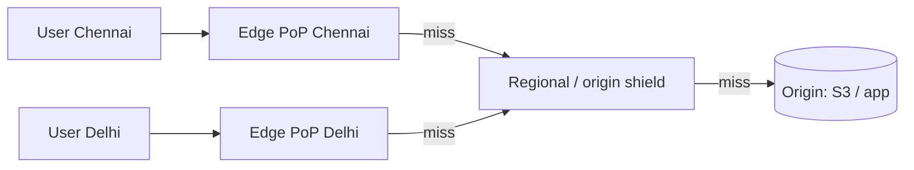
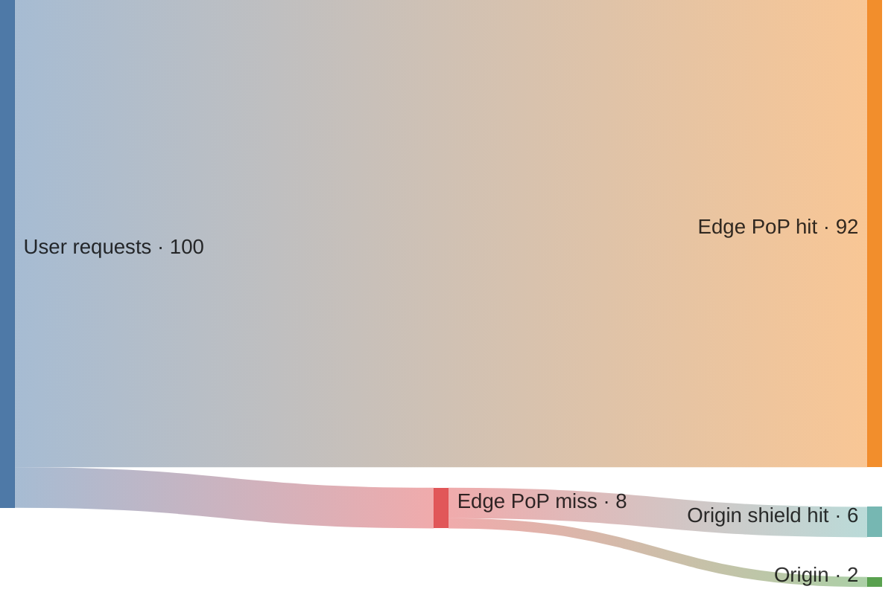
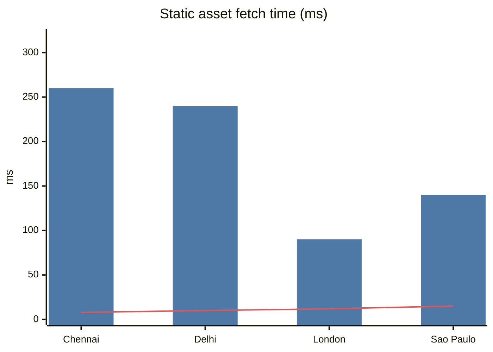
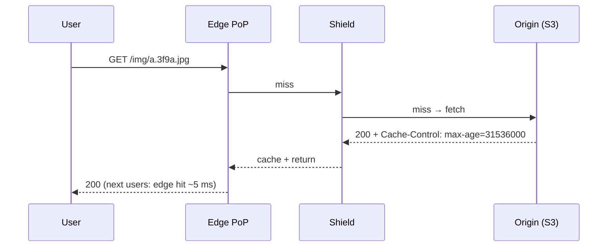

# CDN — Content Delivery Network

## What is it?

A globally distributed network of **edge servers (PoPs)** that cache content close to users. Cloudflare, Akamai, CloudFront, Fastly, Google Cloud CDN.

## Why does it exist?

You can't beat the speed of light. A user in Chennai fetching an image from a US server pays ~250 ms per round trip; from a Chennai PoP, ~5 ms. CDNs also offload origin bandwidth (often 90%+ of bytes), and absorb DDoS attacks.

## Analogy

Instead of everyone ordering from the central Amul factory, stock is kept in local shops. First customer in town → shop orders from the factory (**cache miss → origin fetch**); everyone after gets it off the shelf.

## How it works

1. DNS (GeoDNS) or **anycast** routes the user to the nearest PoP.
2. Edge checks its cache (key = URL + selected headers).
3. **Hit** → serve. **Miss** → fetch from a regional shield/origin, cache per `Cache-Control`, serve.
4. **Origin shield** collapses misses from many PoPs into one origin request.

## GeoDNS vs Anycast

| | GeoDNS | Anycast |
|---|---|---|
| How | DNS returns different IPs based on resolver location | Same IP announced from many PoPs; BGP routes to nearest |
| Failover speed | Bound by DNS TTL | Fast (routing change) |
| Used by | Route 53 latency/geo routing, many CDNs | Cloudflare, Google, DNS root servers |

## Push vs pull CDN

| | Pull | Push |
|---|---|---|
| How | Edge fetches from origin on first miss | You upload content to the CDN ahead of time |
| Good for | Most websites, long tail | Big, predictable files (game patches, video releases) |
| Downside | First request per PoP is slow | You manage uploads/storage |

## What to cache at the edge

| Content | Strategy |
|---|---|
| JS/CSS/images with hashed filenames (`app.3f9a.js`) | Cache "forever" (`max-age=31536000, immutable`) |
| Video segments | Long TTL → [[Design-Video-Streaming]] |
| HTML | Short TTL or `stale-while-revalidate` |
| Personalised API responses | Usually **don't** (or vary carefully); use edge compute instead |
| Public API responses (e.g., product page JSON) | Short TTL (seconds) — massive offload at peak |

## Invalidation

- **Versioned URLs** (best): change the filename on change → no purge needed.
- **Purge API:** invalidate a path/tag; propagates in seconds–minutes; can cost money; a mass purge = origin stampede.
- **Short TTL + stale-while-revalidate.**

## Beyond caching — edge capabilities

TLS termination near users, WAF, DDoS absorption, bot management, image resizing, **edge compute** (Cloudflare Workers, Lambda@Edge) for auth checks, A/B routing, personalisation. → [[Security-Essentials]]

## 📊 Visual model

**Where the bytes are served from (typical static-heavy site):**

**Latency with vs without a CDN (illustrative, origin in US East):**

> [!note] Bars = direct from origin. Line = served from nearest PoP.

**Pull CDN request flow:**

## Common mistakes

> [!warning] Traps to avoid
> 1. Caching responses that include `Set-Cookie` or personal data → **data leak to other users**.
> 2. Cache key including irrelevant query params/headers → low hit ratio.
> 3. Purging everything on each deploy instead of versioned assets.
> 4. Forgetting signed URLs for paid/private content.

## Interview understanding

> [!question] What the interviewer is really testing
> - *"How do you serve video/images to global users?"* — Object storage origin + CDN + versioned URLs + signed URLs for private content.
> - *Tricky:* "Can a CDN cache dynamic content?" — Yes, for short TTLs and non-personalised responses; or use edge compute.
> - *Tricky:* "What's an origin shield?" — Mid-tier cache that consolidates PoP misses so the origin sees one request instead of hundreds.
> - *Tricky:* "A viral video — what protects your origin?" — CDN + shield + request collapsing at the edge.

## Mini quiz
1. GeoDNS vs anycast — which fails over faster?
2. Push vs pull — which for a big game patch release?
3. Best invalidation strategy for static assets?
4. Biggest CDN security mistake?
5. What does an origin shield do?

> [!success]- Answers (click to reveal)
> 1. Anycast.
> 2. Push (pre-position) — or pull with pre-warming.
> 3. Versioned/hashed filenames.
> 4. Caching personalised/authenticated responses.
> 5. Collapses misses from many edges into few origin requests.

---
**Next:** [[Communication-MOC]] · **Up:** [[Performance-MOC]]

## 📚 Resources
- 📄 [Cloudflare Learning — What is a CDN?](https://www.cloudflare.com/learning/cdn/what-is-a-cdn/)
- 📄 [MDN — HTTP caching](https://developer.mozilla.org/en-US/docs/Web/HTTP/Caching)
- 📄 [Netflix Open Connect](https://openconnect.netflix.com/) — Netflix's own CDN inside ISPs.

## My notes
-
