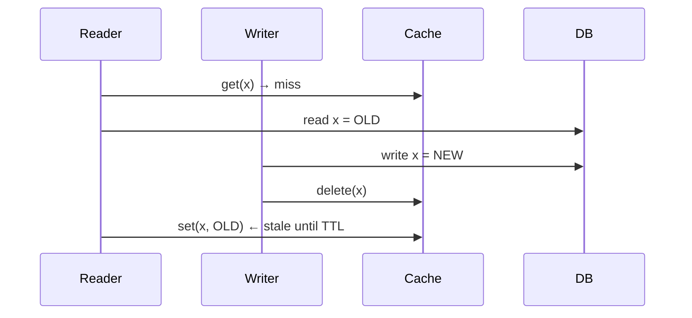
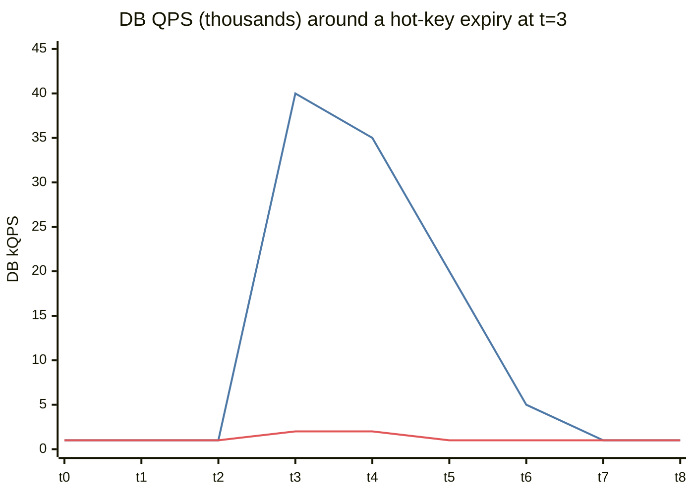
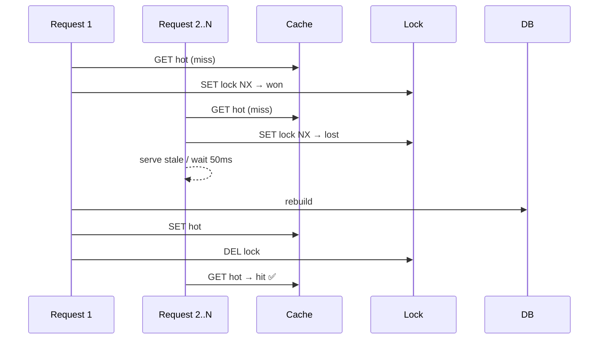
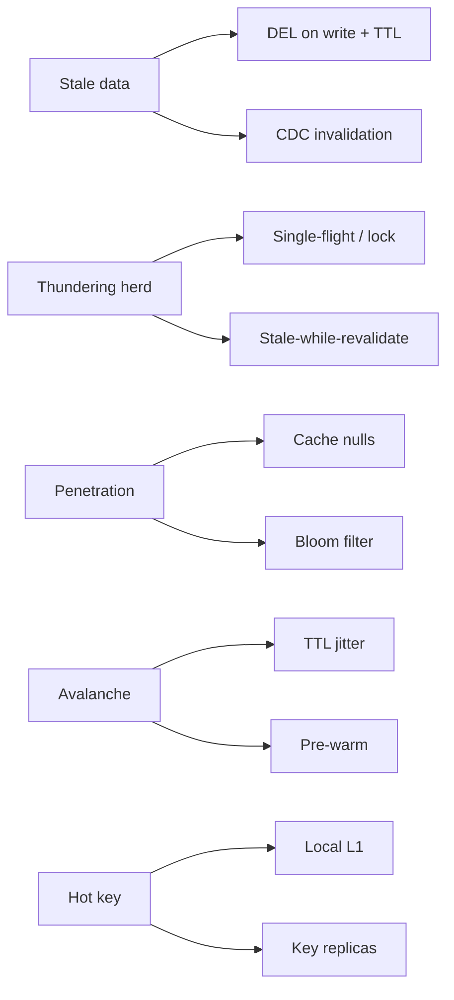

# Cache Pitfalls

> "There are only two hard things in Computer Science: cache invalidation and naming things." — Phil Karlton

This is where interviewers go after you say "add a cache". Know all five problems and two fixes each.

## The five problems at a glance

| Problem | What happens | Main fixes |
|---|---|---|
| **Stale data / invalidation** | Cache shows old value after DB changed | Delete-on-write, TTL, CDC invalidation, versioned keys |
| **Thundering herd / cache stampede** | Hot key expires → 10k requests miss together → DB melts | Request coalescing (single-flight), locks, early refresh, TTL jitter |
| **Cache penetration** | Requests for keys that **don't exist** always miss → hit DB (often attacks) | Cache negative results, Bloom filter, input validation |
| **Cache avalanche** | Many keys expire at once / cache cluster restarts | TTL jitter, warm-up, multi-level caches, rate-limit DB |
| **Hot keys** | One key gets huge traffic → one cache node saturates | Local in-process copy, key replication (`key#1..N`), CDN |

---

## 1. Invalidation

Race in cache-aside:

Mitigations:
- **Short TTL** as a safety net (bounds staleness).
- **Delayed double delete:** delete, write DB, sleep ~(read time), delete again.
- **CDC-driven invalidation:** DB binlog → Debezium → Kafka → invalidator deletes keys. Decoupled and reliable.
- **Versioned keys:** `product:42:v17` — new version = new key; old dies by TTL.
- **Leases** (Facebook memcache): cache hands out a token on miss; only the lease holder can set.

## 2. Thundering herd (stampede)

Fixes:
- **Single-flight / request coalescing:** only one request rebuilds; others wait for its result.
- **Mutex in Redis:** `SET lock:key 1 NX PX 5000` — winner rebuilds; losers serve stale or wait.
- **Stale-while-revalidate:** serve the old value while one worker refreshes.
- **Probabilistic early expiration:** refresh slightly before TTL with probability rising near expiry.
- **Never-expire hot keys** with a background refresher.

## 3. Penetration (non-existent keys)

Attacker requests `/product/-1`, `/product/99999999…` — never cached, always a DB hit.
- **Cache the miss:** `product:-1 → NULL` with a short TTL (30–60 s).
- **Bloom filter** of all valid IDs in front: "definitely not present" → reject without DB. → [[Probabilistic-Data-Structures]]
- Validate inputs; rate-limit by client. → [[Design-Rate-Limiter]]

## 4. Avalanche

Everything set at deploy time with TTL = 1h → everything expires at the same minute.
- **TTL jitter:** `ttl = base + random(0, 10%)`.
- Pre-warm on deploy/restart.
- Redis replicas + persistence so a restart isn't empty.
- Circuit breaker + DB rate limiting so the DB survives a cold cache. → [[Resilience-Patterns]]

## 5. Hot keys

A celebrity profile or flash-sale SKU gets 500k reads/s → one Redis shard pegged.
- **L1 local cache** (in-process, 1–5 s TTL) in front of Redis.
- **Replicate the key** across shards: `hot:item:42#{0..9}`, read a random suffix.
- Read from Redis replicas.
- Push to **CDN** if the response is shareable.
- Detect hot keys (`redis-cli --hotkeys`, client-side sampling).

## 📊 Visual model

**Stampede when a hot key expires (illustrative):**

> [!note] Lines
> Line 1 = no protection. Line 2 = single-flight + stale-while-revalidate.

**Single-flight in action:**

**Problem → fix map:**

## Common mistakes

> [!warning] Traps to avoid
> 1. Saying "add a cache" and stopping.
> 2. Updating the cache on write (race) instead of deleting.
> 3. Same TTL for everything.
> 4. No protection for the DB when cache is cold.

## Interview understanding

> [!question] What the interviewer is really testing
> - *"A celebrity posts and your cache node dies — why?"* — Hot key; local cache + replication of the key.
> - *"How do you prevent a stampede when the homepage cache expires?"* — Single-flight/lock + stale-while-revalidate + jitter.
> - *"Bots hit random product IDs and your DB CPU spikes."* — Penetration; negative caching + Bloom filter + rate limiting.
> - *Tricky:* "Can a Bloom filter give false negatives?" — No (unless items are deleted from a standard Bloom filter — then use a counting Bloom filter or cuckoo filter).

## Mini quiz
1. Stampede vs avalanche?
2. Two fixes for penetration?
3. What does TTL jitter fix?
4. What is single-flight?
5. Two hot-key fixes?

> [!success]- Answers (click to reveal)
> 1. Stampede = one hot key expires, many concurrent misses. Avalanche = many keys expire/cache wiped at once.
> 2. Cache nulls with short TTL; Bloom filter (+ validation, rate limits).
> 3. Synchronised mass expiry (avalanche).
> 4. Only one in-flight rebuild per key; others share the result.
> 5. Local L1 cache; split/replicate the key; CDN; read replicas.

---
**Next:** [[Redis-Deep-Dive]] · **Up:** [[Performance-MOC]]

## 📚 Resources
- 📄 [Scaling Memcache at Facebook](https://www.usenix.org/system/files/conference/nsdi13/nsdi13-final170_update.pdf) — leases solve stale sets and stampedes.
- 📄 [Optimal Probabilistic Cache Stampede Prevention (Vattani et al., VLDB 2015)](https://cseweb.ucsd.edu/~avattani/papers/cache_stampede.pdf)

## My notes
-
