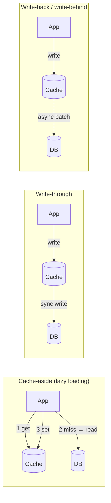
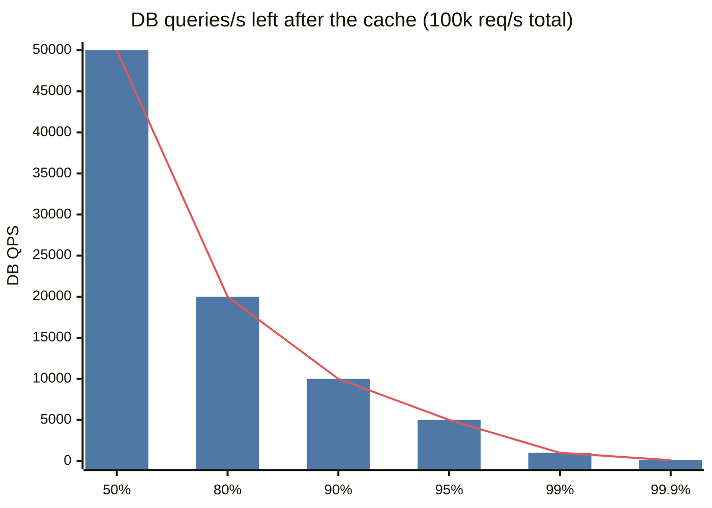
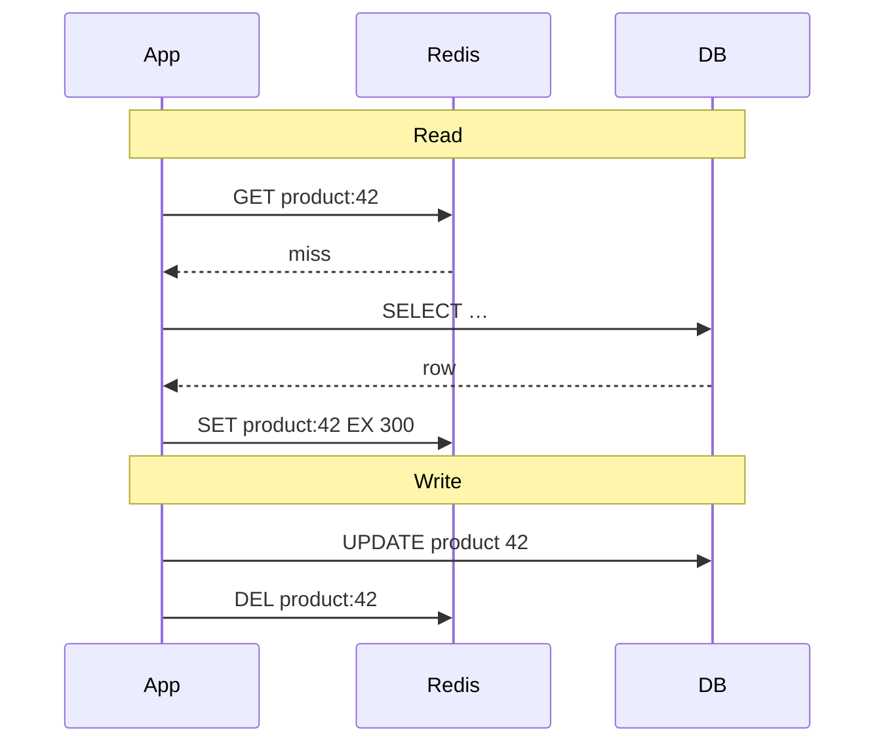
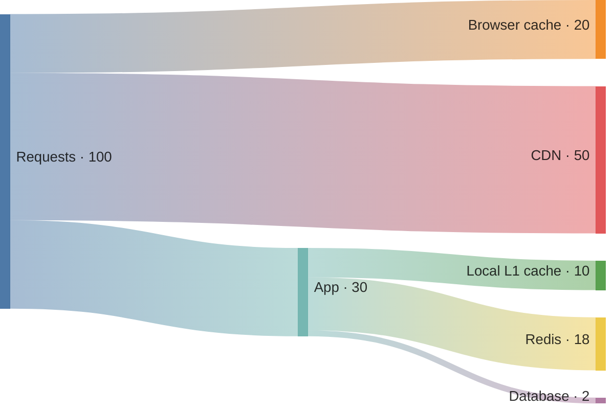

# Caching

## What is it?

Storing a copy of frequently-used data in a faster place (usually memory) so repeat requests skip the slow source (DB, remote API, heavy computation).

## Why does it exist?

RAM read ≈ 100 ns; Redis over network ≈ 0.5–1 ms; DB query ≈ 5–50 ms. Most workloads are **read-heavy and skewed** (20% of items get 80% of reads), so a small cache absorbs most traffic. It cuts latency **and** protects the DB.

## Analogy

Keeping today's most-needed files on your desk instead of walking to the almirah. The desk is small, so you must decide what to keep (**eviction**) and remember that the almirah copy may have been updated (**invalidation**).

## Key metrics

- **Hit ratio** = hits / (hits + misses). 90% vs 99% hit ratio = **10× difference** in DB load.
- **TTL** = time-to-live; after it, the entry expires.
- **Effective latency** = hit% × cache latency + miss% × (cache + DB latency).

## Where caches live

| Layer | Example | Caches |
|---|---|---|
| Client/browser | HTTP cache, service worker | Static assets, API responses with `Cache-Control` |
| CDN | Cloudflare, CloudFront, Akamai | Static + some dynamic content at the edge → [[CDN]] |
| Reverse proxy | nginx, Varnish | Whole responses |
| App in-process | Caffeine, Guava, LRU dict | Hot config, tiny reference data (diverges per instance!) |
| Distributed cache | **Redis**, Memcached | Shared across app servers → [[Redis-Deep-Dive]] |
| DB internal | Buffer pool | Pages |

## Read/write patterns (the core of this topic)

| Pattern | How | Pros | Cons | Use for |
|---|---|---|---|---|
| **Cache-aside** | App reads cache; on miss reads DB and fills cache. On write: update DB, **delete** cache key | Simple, only caches what's read, cache failure ≠ outage | First read slow; stale window | **Default** for most systems |
| **Read-through** | Cache library loads from DB on miss | App code simpler | Cache tied to DB logic | Same as cache-aside, via a provider |
| **Write-through** | Write goes to cache and DB synchronously | Cache always fresh | Write latency; caches data never read | Read-after-write heavy data |
| **Write-back** | Write to cache; flush to DB later | Fastest writes, batching | **Data loss** if cache dies before flush | Counters, view counts, analytics |
| **Write-around** | Write only to DB; cache fills on read | Avoids caching write-once data | First read miss | Logs, uploads rarely re-read |

> [!tip] Why delete instead of update on write?
> Two concurrent writers updating the cache can leave it with the older value (race). Deleting forces the next read to load fresh. Even then a narrow race exists (reader loads old value after delete) — fix with short TTLs, versioned values, or delayed double-delete. → [[Cache-Pitfalls]]

## Eviction policies

| Policy | Evicts | Good for |
|---|---|---|
| **LRU** | Least recently used | General purpose (default mental model) |
| **LFU** | Least frequently used | Stable popularity (viral items) |
| FIFO | Oldest inserted | Simple, rarely best |
| TTL-based | Expired | Freshness requirements |
| Random | Random | Surprisingly OK, cheap |

Redis supports `allkeys-lru`, `allkeys-lfu`, `volatile-ttl`, etc. Interview favourite: **implement an LRU cache** = hash map + doubly linked list, O(1) get/put. → [[LLD-and-Machine-Coding-Primer]]

## What to cache (and not)

| ✅ Cache | ❌ Don't (or carefully) |
|---|---|
| Read-heavy, rarely changing (profiles, product details) | Highly personalised + frequently changing |
| Expensive computations (feeds, recommendations, aggregates) | Data needing strict consistency (balances, seat counts) — or cache with very short TTL and verify at write |
| Session data, rate-limit counters | Huge objects with low reuse |
| **LLM responses** (exact or semantic cache) — 2026 cost lever | Secrets / PII without encryption |

## 2026 angle — caching LLM calls

- **Exact cache:** hash(prompt + params) → response.
- **Semantic cache:** embed the query, return a cached answer if a previous query is within a similarity threshold. Big cost savings, risk of wrong answers if threshold is loose.
- **Prompt/prefix (KV) caching:** providers reuse computation for a shared prompt prefix. → [[LLM-Serving-and-Inference]]

## 📊 Visual model

**Hit ratio vs DB load at 100k requests/s** — why the last few % matter so much:

$$\text{Effective latency} = h \cdot t_{cache} + (1-h)\cdot(t_{cache} + t_{db})$$

> [!example] Plug in numbers
> h = 0.95, cache 1 ms, DB 20 ms → 0.95 × 1 + 0.05 × 21 ≈ **2 ms** average (vs 20 ms without).

**Cache-aside read and write paths:**

**Traffic flow through cache layers:**

## Common mistakes

> [!warning] Traps to avoid
> 1. No TTL → stale forever + memory leak.
> 2. Caching without a plan for invalidation.
> 3. Treating the cache as the source of truth (it can vanish).
> 4. Cache servers sized for average, not peak — eviction storms.
> 5. Ignoring the thundering herd when a hot key expires. → [[Cache-Pitfalls]]

## Interview understanding

> [!question] What the interviewer is really testing
> - *"Where would you add a cache?"* — Point at the read-heavy path, name the pattern (cache-aside), the key format, TTL, eviction, and invalidation on write.
> - *Tricky:* "How do you keep cache and DB consistent?" — You can't perfectly without distributed transactions; use delete-on-write + TTL; for critical data, CDC-driven invalidation (Debezium → Kafka → invalidate). State the staleness bound.
> - *Tricky:* "Cache-aside vs write-through?" — Lazy & resilient vs always-fresh & slower writes.
> - *Tricky:* "What happens if Redis goes down?" — Cache-aside degrades to DB → can DB survive? Need circuit breaker/rate limit + warm-up. → [[Resilience-Patterns]]

## Mini quiz
1. Hit ratio 90% → 99%: DB load changes by?
2. Default caching pattern, and what to do on write?
3. Which pattern risks data loss?
4. Data structures for an O(1) LRU?
5. What's a semantic cache?

> [!success]- Answers (click to reveal)
> 1. 10× less (10% misses → 1%).
> 2. Cache-aside; update DB then delete the cache key.
> 3. Write-back.
> 4. Hash map + doubly linked list.
> 5. Cache keyed by embedding similarity; returns stored LLM answers for near-identical questions.

---
**Next:** [[Cache-Pitfalls]] · **Up:** [[Performance-MOC]]

## 📚 Resources
- 📄 [AWS — Caching best practices](https://aws.amazon.com/caching/best-practices/)
- 📄 [Facebook — Scaling Memcache at Facebook (NSDI 2013)](https://www.usenix.org/conference/nsdi13/technical-sessions/presentation/nishtala) — *Why:* leases, thundering herd, invalidation at massive scale.

## My notes
-
