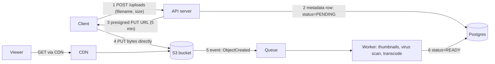
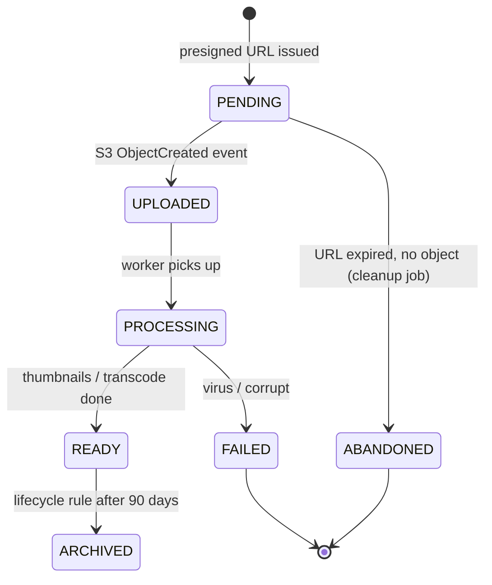

# Object Storage (Blob Storage)

## What is it?

A storage service for **files as objects** — bytes + metadata + a key — in flat "buckets", accessed over HTTP. Amazon S3, Google Cloud Storage, Azure Blob, Cloudflare R2, MinIO (self-hosted).

## Why files don't belong in a database

| Problem with BLOBs in DB | Object storage |
|---|---|
| Bloats DB, slows backups & replication | Separate, cheap tier |
| DB storage is expensive (fast SSD + replicas) | ~Cents per GB-month, tiered (hot/cold/archive) |
| App servers stream bytes → CPU/bandwidth wasted | Clients upload/download **directly** via presigned URLs |
| Hard to serve via CDN | Origin for CDN out of the box |

S3 is designed for **11 nines (99.999999999%) durability** by replicating across AZs.

## The pattern: metadata vs content

- **DB stores metadata:** owner, filename, size, content type, S3 key, checksum, status.
- **Object store stores bytes.**
- **Presigned URL:** time-limited, signed URL granting one operation on one object — the server never touches the bytes, and the bucket stays private.

## Large files: chunking & multipart upload

- Split into parts (S3: 5 MB–5 GB per part, up to 10,000 parts), upload in **parallel**, retry only failed parts, then "complete".
- Enables **resumable uploads** on flaky mobile networks.
- **Content-defined chunking + hashing** enables **deduplication** (same chunk hash = store once) and delta sync → [[Design-File-Storage-Sync]].

## Storage classes & lifecycle

| Class | Use | Trade-off |
|---|---|---|
| Standard | Hot content | Highest storage cost, instant |
| Infrequent Access | Older content | Cheaper storage, retrieval fee |
| Archive (Glacier) | Compliance, backups | Very cheap, minutes–hours to restore |

Lifecycle rules move objects automatically (e.g., videos older than 90 days → IA). Huge cost lever at video scale.

## Consistency

S3 has offered **strong read-after-write consistency** for all operations since Dec 2020. Many interview resources still say "eventually consistent" — that's outdated.

## Security

- Private buckets by default; access via presigned URLs or CDN with signed cookies/URLs.
- Server-side encryption (SSE-S3/SSE-KMS).
- Validate content type/size server-side; scan uploads.

## 📊 Visual model

**Upload lifecycle (metadata row state):**

**Multipart upload of a 1 GB file (parallel parts):**

```mermaid
gantt
    title Multipart upload — 4 parallel streams
    dateFormat X
    axisFormat %s s
    section Stream 1
    Part 1   :0, 8
    Part 5   :8, 16
    section Stream 2
    Part 2   :0, 9
    Part 6   :9, 17
    section Stream 3
    Part 3   :0, 8
    Part 7 retry :crit, 8, 20
    section Stream 4
    Part 4   :0, 9
    Part 8   :9, 16
    section Finish
    CompleteMultipartUpload :milestone, 20, 0
```

## Common mistakes

> [!warning] Traps to avoid
> 1. Streaming uploads through app servers.
> 2. Public buckets (classic data leak).
> 3. Storing images as BLOBs in Postgres/MongoDB at scale.
> 4. No lifecycle policy → storage bill grows forever.
> 5. Forgetting metadata/state tracking (orphaned objects from abandoned uploads → cleanup job / multipart abort lifecycle).

## Interview understanding

> [!question] What the interviewer is really testing
> - *"Where do you store profile pictures/videos?"* — Object storage + metadata in DB + CDN; presigned upload.
> - *Tricky:* "How do you upload a 10 GB file reliably?" — Multipart, parallel, resumable, checksums per part.
> - *Tricky:* "How do you prevent users from accessing others' files?" — Private bucket; short-lived presigned GET URLs issued after an authorization check.
> - *Tricky:* "Is S3 eventually consistent?" — Not anymore — strong read-after-write since 2020.

## Mini quiz
1. What goes in the DB vs object store?
2. What's a presigned URL and why use it?
3. Benefit of multipart upload?
4. How does chunk hashing enable dedup?
5. Name a lever to cut storage cost.

> [!success]- Answers (click to reveal)
> 1. DB: metadata; object store: bytes.
> 2. A signed, expiring URL for one operation; client talks to S3 directly, bucket stays private.
> 3. Parallelism, resumability, retry only failed parts.
> 4. Identical chunks have identical hashes → store once, reference many times.
> 5. Lifecycle tiering to IA/archive; dedup; compression.

---
**Next:** [[CDN]] · **Up:** [[Performance-MOC]]

## 📚 Resources
- 📄 [AWS — S3 strong consistency announcement](https://aws.amazon.com/s3/consistency/)
- 📄 [AWS — Multipart upload overview](https://docs.aws.amazon.com/AmazonS3/latest/userguide/mpuoverview.html)

## My notes
-
