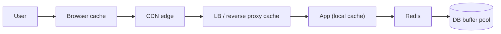

# ⚡ 04 · Making It Fast MOC

| # | Note | Lecture | You'll be able to |
|---|---|---|---|
| 1 | [[Caching]] | L11 | Where caches live, the 4 write/read patterns, eviction, TTL |
| 2 | [[Cache-Pitfalls]] | L11 | Invalidation, thundering herd, penetration, avalanche, hot keys |
| 3 | [[Redis-Deep-Dive]] ➕ | L11 | Data structures, persistence, cluster, Redis vs Memcached |
| 4 | [[Object-Storage]] | L12 | Blobs vs DB, presigned URLs, chunked/multipart uploads |
| 5 | [[CDN]] | L12 | Edge caching, push vs pull, invalidation, GeoDNS vs anycast |

> [!tip] One sentence to remember
> **The fastest request is the one that never reaches your servers.** Push work as far left on that diagram as correctness allows.

**Next module:** [[Communication-MOC]] · **Up:** [[System-Design-MOC]]
