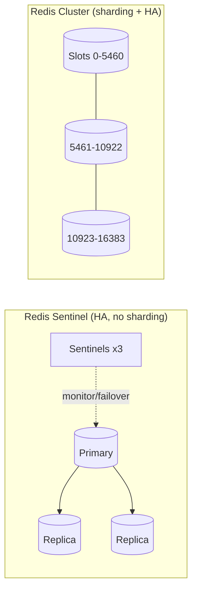
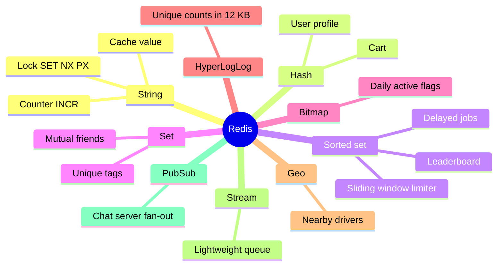
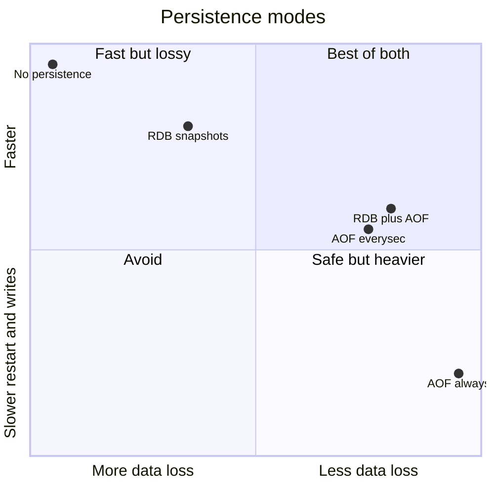

# Redis Deep Dive ➕

> [!info] Why this is added
> Redis shows up in ~every case study: cache, sessions, rate limiter, leaderboard, geo, locks, queues, pub/sub. Knowing **which Redis data structure** solves a problem is a quick senior signal.

## What is it?

An in-memory data-structure server. Single-threaded command execution (I/O threads exist in newer versions) → every command is **atomic**. Sub-millisecond latency, ~100k+ ops/s per node.

> Licensing note: Redis changed licence in 2024; **Valkey** (Linux Foundation fork) is the drop-in open-source alternative many clouds now offer. Redis 8 re-added an OSI licence option (AGPL) in 2025. Fine to just say "Redis-compatible store".

## Data structures → use cases

| Structure | Commands | Use case |
|---|---|---|
| **String** | `GET/SET/INCR/SETNX/EXPIRE` | Cache values, counters, distributed lock (`SET k v NX PX 30000`) |
| **Hash** | `HSET/HGET/HINCRBY` | Object fields (user profile, cart) |
| **List** | `LPUSH/RPOP/BRPOP` | Simple queue, recent-items list |
| **Set** | `SADD/SISMEMBER/SINTER` | Unique visitors, tags, mutual friends |
| **Sorted Set (ZSET)** | `ZADD/ZINCRBY/ZREVRANGE/ZRANGEBYSCORE` | **Leaderboards**, sliding-window rate limit, delayed jobs, timelines |
| **Bitmap** | `SETBIT/BITCOUNT` | Daily active flags for 100M users in ~12 MB |
| **HyperLogLog** | `PFADD/PFCOUNT` | Approx. unique counts in 12 KB → [[Probabilistic-Data-Structures]] |
| **Geo** | `GEOADD/GEOSEARCH` | Nearby drivers/restaurants → [[Geospatial-Indexing]] |
| **Stream** | `XADD/XREADGROUP/XACK` | Lightweight log/queue with consumer groups |
| **Pub/Sub** | `PUBLISH/SUBSCRIBE` | Fire-and-forget fan-out (chat server routing); no persistence |
| **Bloom (module/Redis Stack)** | `BF.ADD/BF.EXISTS` | Penetration protection, "username taken?" |

### Atomic multi-step logic: Lua scripts / MULTI

```lua
-- Token-bucket-ish: atomic check-and-decrement
local tokens = tonumber(redis.call('GET', KEYS[1]) or ARGV[1])
if tokens > 0 then
  redis.call('SET', KEYS[1], tokens - 1, 'EX', ARGV[2])
  return 1
end
return 0
```

Lua runs atomically — no other command interleaves. → [[Design-Rate-Limiter]]

## Persistence

| Mode | How | Trade-off |
|---|---|---|
| **RDB** | Periodic snapshots | Compact, fast restart; lose minutes of data |
| **AOF** | Append every write (fsync every second typical) | ≤1 s loss; bigger files, rewrite needed |
| RDB + AOF | Both | Common production choice |
| None | Pure cache | Fastest; empty after restart |

## High availability & scaling



- **Replication is async** → failover can lose acknowledged writes. Not a system of record for money.
- **Cluster:** 16,384 hash slots; multi-key ops only work if keys share a slot → use **hash tags** `{user42}:cart`, `{user42}:profile`.

## Redis vs Memcached

| | Redis | Memcached |
|---|---|---|
| Data types | Rich (above) | Strings only |
| Persistence | Optional | None |
| Replication/HA | Built-in | None (client-side sharding) |
| Threading | Mostly single-threaded execution | Multi-threaded |
| Pick when | Almost always | Pure, simple, huge multi-core cache; legacy |

## Distributed locks with Redis — the honest version

`SET lock:order:42 <uuid> NX PX 30000`, release only if value matches (Lua). Problems: GC pause/clock issues can let the lock expire while the holder still works. **Redlock** is debated (Kleppmann's critique). For correctness-critical locks use **fencing tokens** + a consensus store (etcd/ZooKeeper), or make the operation idempotent with DB constraints. → [[Consensus-and-Leader-Election]]

## 📊 Visual model



**Persistence trade-off:**



## Common mistakes

> [!warning] Traps to avoid
> 1. Using `KEYS *` in production (blocks the single thread) — use `SCAN`.
> 2. Huge values/keys (>1 MB) and big collections → latency spikes ("big keys").
> 3. Treating Redis as durable primary storage for critical data.
> 4. Pub/Sub for things that must not be lost (use Streams or Kafka).
> 5. Multi-key commands across cluster slots without hash tags.

## Interview understanding

> [!question] What the interviewer is really testing
> - *"How would you build a leaderboard?"* — ZSET: `ZINCRBY`, `ZREVRANGE 0 9`, `ZREVRANK`. → [[Design-Leaderboard-Top-K]]
> - *"Rate limiter?"* — INCR + EXPIRE (fixed window) or ZSET of timestamps (sliding log) or Lua token bucket.
> - *Tricky:* "Redis is single-threaded — how is it so fast?" — In-memory, no locks, efficient event loop (epoll), simple data structures; network is usually the bottleneck.
> - *Tricky:* "Can Redis lose data?" — Yes: async replication + AOF everysec → up to ~1 s, plus failover gaps.

## Mini quiz
1. Structure for a leaderboard?
2. Structure for unique visitor count at low memory?
3. RDB vs AOF?
4. What are hash tags in Redis Cluster for?
5. Why avoid `KEYS *`?

> [!success]- Answers (click to reveal)
> 1. Sorted set.
> 2. HyperLogLog.
> 3. Snapshot (compact, more loss) vs append log (≤1 s loss, bigger).
> 4. Force related keys into one slot for multi-key ops.
> 5. O(N) and blocks the single command thread.

---
**Next:** [[Object-Storage]] · **Up:** [[Performance-MOC]]

## 📚 Resources
- 📄 [Redis docs — data types](https://redis.io/docs/latest/develop/data-types/)
- 📄 [Martin Kleppmann — How to do distributed locking](https://martin.kleppmann.com/2016/02/08/how-to-do-distributed-locking.html)
- 📄 [Valkey project](https://valkey.io/)

## My notes
-
