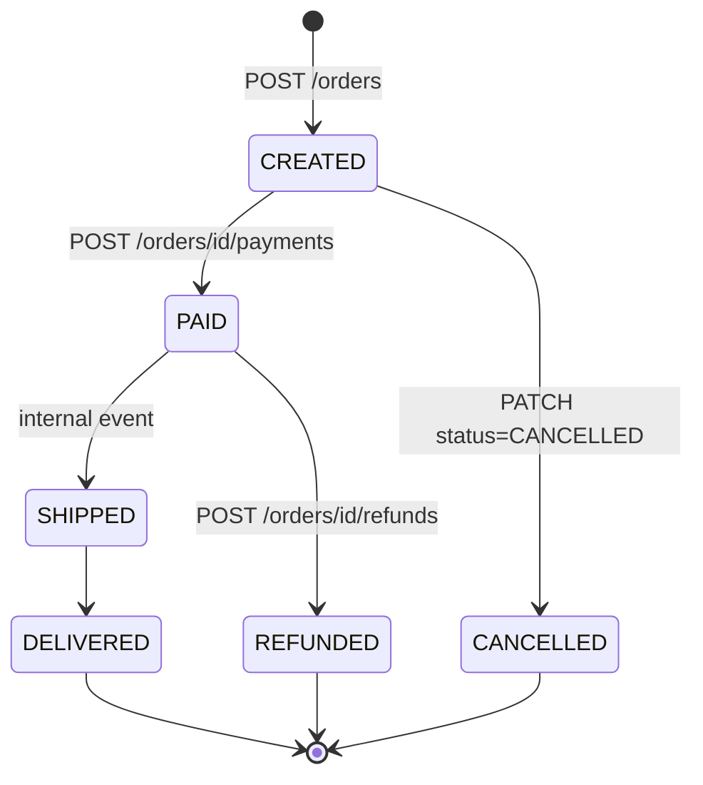
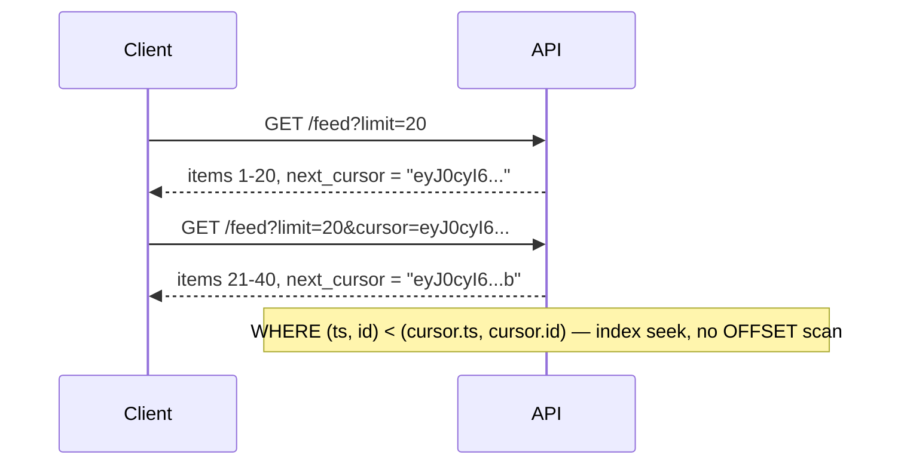
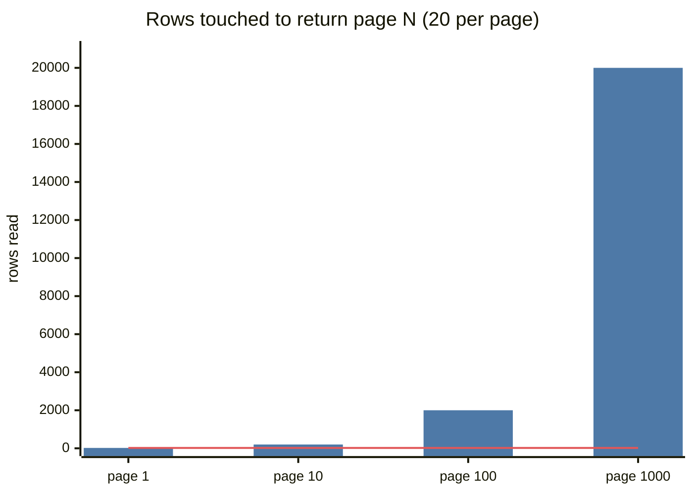

# API Design

## What is it?

Defining the contract clients use to talk to your system: resources, operations, request/response shapes, errors, and guarantees (idempotency, pagination, rate limits).

## Why it matters in interviews

Step 3 of the framework is "define the API". A clean API in 3 minutes shows you understand the functional requirements; idempotency and pagination details show seniority. → [[Interview-Framework]]

## REST principles

| Principle | Meaning |
|---|---|
| Resources as nouns | `/users/42/orders`, not `/getOrdersForUser` |
| HTTP methods as verbs | GET read, POST create, PUT replace, PATCH update, DELETE remove |
| Stateless | Each request carries everything (auth token); server keeps no session |
| Standard status codes | 201 created, 404, 409 conflict, 429 rate-limited |
| Cacheable | GETs can carry `Cache-Control`, `ETag` |
| Uniform interface | Consistent naming, plural nouns, nested where it's ownership |

```http
POST   /v1/orders                      → create order
GET    /v1/orders/{orderId}            → fetch one
GET    /v1/users/{userId}/orders?limit=20&cursor=abc → list
PATCH  /v1/orders/{orderId}            → {status: "CANCELLED"}
POST   /v1/orders/{orderId}/refunds    → action as sub-resource
```

## Idempotency — the most important API property for reliability

Networks fail **after** the server did the work. The client retries. Without idempotency → double charge, double order.

```http
POST /v1/payments
Idempotency-Key: 7f3c9a2e-...       ← client-generated UUID per logical operation
{ "amount": 49900, "currency": "INR" }
```

Server: store `(idempotency_key → response)` with a unique constraint; on a repeat, return the stored response. → [[Idempotency]]

## Pagination

| Type | How | Pros | Cons |
|---|---|---|---|
| Offset | `?limit=20&offset=4000` | Simple, jump to page N | Slow for deep pages (scans); duplicates/skips when data changes |
| **Cursor / keyset** | `?limit=20&cursor=<last_id or last_ts>` → `WHERE (ts,id) < (:ts,:id) ORDER BY ts DESC, id DESC` | Fast at any depth, stable under inserts | No "jump to page 57" |

**Feeds, chats, timelines → cursor.** Encode the cursor as an opaque base64 string so you can change its internals later.

## Versioning

| Approach | Example | Notes |
|---|---|---|
| URL path | `/v1/orders` | Most common, explicit, cache-friendly |
| Header | `Accept: application/vnd.app.v2+json` | Cleaner URLs, less visible |
| Query | `?version=2` | Rare |

Rules: additive changes (new optional fields) don't need a new version; removing/renaming fields does. Deprecate with headers + timeline.

## Error handling

Consistent error body:

```json
{
  "error": {
    "code": "SEAT_ALREADY_BOOKED",
    "message": "Seat A12 is no longer available",
    "requestId": "req_8f2c…",
    "retryable": false
  }
}
```

- 4xx = client's fault (don't retry, except 408/429); 5xx = server's fault (retry with backoff if idempotent). → [[Resilience-Patterns]]
- Include `Retry-After` on 429/503.

## Other API concerns to mention

- **Authentication:** `Authorization: Bearer <JWT>` → [[Authentication-and-Authorization]]
- **Rate limiting** per user/key → [[Design-Rate-Limiter]]
- **Filtering & sorting:** `?status=PAID&sort=-created_at`
- **Partial responses:** `?fields=id,name` to cut payload (or GraphQL)
- **Long-running operations:** return `202 Accepted` + `Location: /jobs/123`, client polls or gets a webhook
- **Batch endpoints** to cut round trips on mobile

## 📊 Visual model

**Resource lifecycle drives your endpoints:**



**Cursor pagination round trips:**



**Offset vs cursor cost at depth:**



## Common mistakes

> [!warning] Traps to avoid
> 1. Verbs in URLs (`/createUser`).
> 2. POST for payments with no idempotency key.
> 3. Offset pagination for infinite-scroll feeds.
> 4. Returning 200 with `{"error": …}`.
> 5. Leaking internal IDs/sequential IDs that let people enumerate resources.

## Interview understanding

> [!question] What the interviewer is really testing
> - *"Define the APIs for this system."* — 3–6 endpoints, method + path + key params + response. Don't spend more than ~3 minutes.
> - *Tricky:* "Client timed out on POST /orders — safe to retry?" — Only with an idempotency key.
> - *Tricky:* "Why is offset pagination bad for a feed?" — Deep offsets scan; new posts shift pages → duplicates.
> - *Tricky:* "How do you return a result that takes 2 minutes?" — 202 + job resource; poll, SSE, or webhook.

## Mini quiz
1. Which header makes POST retries safe?
2. Cursor pagination SQL pattern?
3. When do you need a new API version?
4. 4xx vs 5xx retry rule?
5. API shape for a long-running export?

> [!success]- Answers (click to reveal)
> 1. `Idempotency-Key`.
> 2. `WHERE (created_at, id) < (:c, :id) ORDER BY created_at DESC, id DESC LIMIT n`.
> 3. Breaking changes — removing/renaming fields or changing semantics.
> 4. Don't retry 4xx (except 408/429); retry idempotent 5xx with backoff.
> 5. `202 Accepted` + job ID; poll/webhook/SSE for completion.

---
**Next:** [[REST-vs-gRPC-vs-GraphQL]] · **Up:** [[Communication-MOC]]

## 📚 Resources
- 📄 [Stripe API — Idempotent requests](https://docs.stripe.com/api/idempotent_requests) — *Why:* the reference implementation.
- 📄 [Google API Design Guide](https://cloud.google.com/apis/design)
- 📄 [Microsoft REST API Guidelines](https://github.com/microsoft/api-guidelines)

## My notes
-
