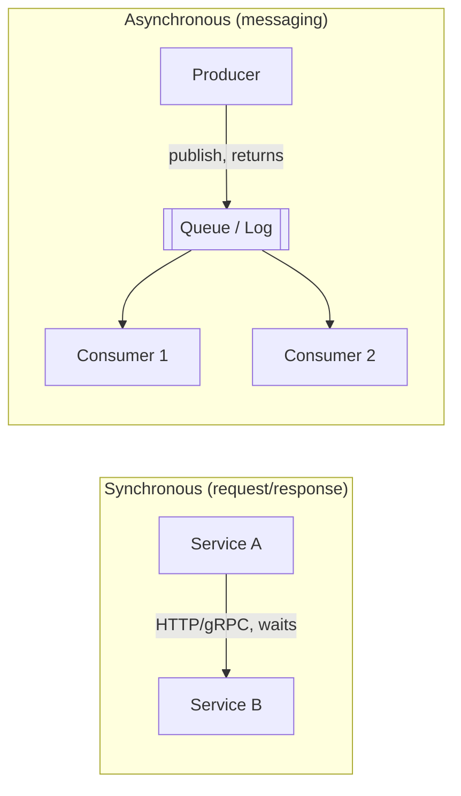

# 🔌 05 · How Systems Communicate MOC

| # | Note | Lecture | You'll be able to |
|---|---|---|---|
| 1 | [[API-Design]] | L13 | REST principles, idempotency, pagination, versioning, errors |
| 2 | [[REST-vs-gRPC-vs-GraphQL]] | L13 | Pick the right API style and defend it |
| 3 | [[Real-Time-Communication]] | L13 | Polling vs long polling vs WebSockets vs SSE vs webhooks |
| 4 | [[Message-Queues]] | L14 | Decoupling, delivery guarantees, DLQs, queue vs pub/sub |
| 5 | [[Kafka-Deep-Dive]] | L14 | Topics, partitions, consumer groups, offsets, ordering |
| 6 | [[Event-Driven-Architecture]] | L14 | Events vs commands, CDC, outbox, event sourcing, CQRS |
| 7 | [[Microservices-vs-Monolith]] | L15 | When to split, service boundaries, the costs |
| 8 | [[Proxies-and-API-Gateways]] | L15 | Forward vs reverse proxy, API gateway, service discovery, mesh |

## Sync vs async — the mental model

| | Sync | Async |
|---|---|---|
| Caller waits? | Yes | No |
| Coupling | Temporal (B must be up) | Decoupled in time |
| Good for | Reads, user needs immediate answer | Side effects, spikes, fan-out, long work |
| Failure | Cascades | Buffers |

**Rule of thumb:** the user-facing critical path stays sync and short; everything that can happen "after" goes async.

**Next module:** [[Distributed-Systems-MOC]] · **Up:** [[System-Design-MOC]]
