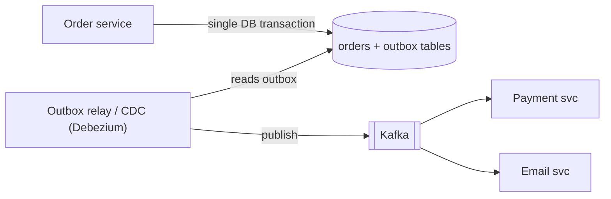
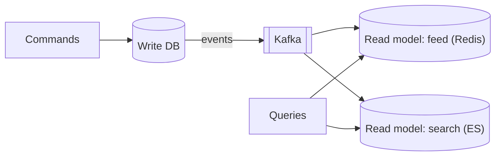
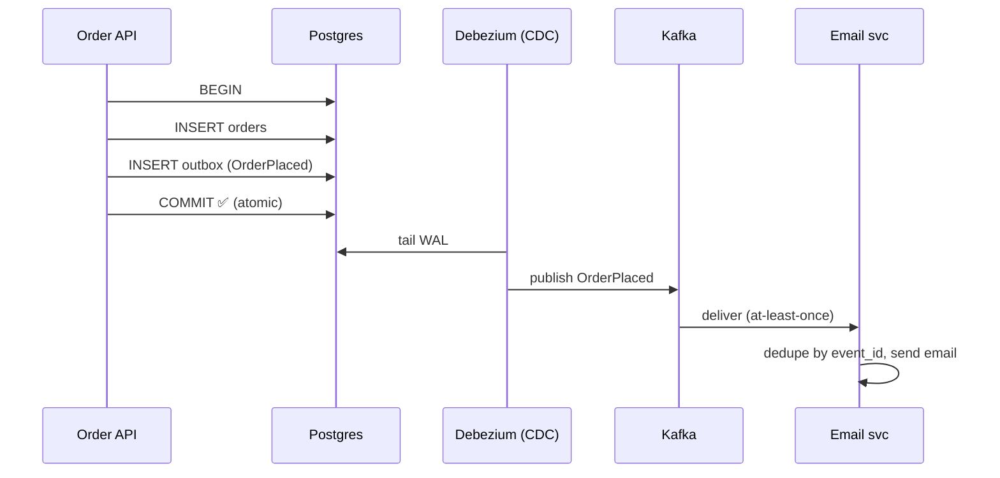
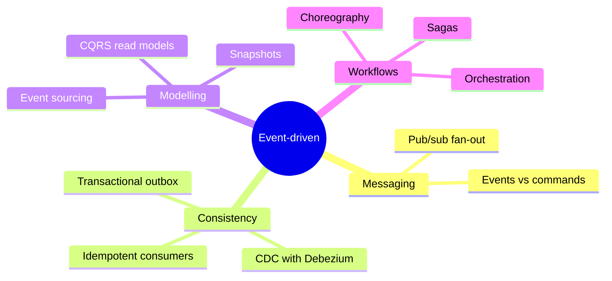

# Event-Driven Architecture (EDA)

## What is it?

Services communicate by **publishing events** ("OrderPlaced", "PaymentCaptured") that other services react to, instead of calling each other directly.

## Why

- **Loose coupling** — Order service doesn't know Email, Inventory, Analytics exist.
- **Extensibility** — add a new consumer without touching the producer.
- **Resilience** — consumers can be down; events wait.
- **Audit trail** — the event log is a history.

Cost: **harder to reason about** (no single call stack), eventual consistency, debugging needs tracing and good event schemas.

## Events vs commands

| | Command | Event |
|---|---|---|
| Tense | Imperative: `ChargeCard` | Past: `CardCharged` |
| Sender expects | Someone specific to do it | Nothing — it's a fact |
| Receivers | One | Zero or many |
| Coupling | Higher | Lower |

## The dual-write problem → Transactional Outbox

You need to update the DB **and** publish an event. If you do both directly, a crash between them leaves them inconsistent.

1. In **one local transaction**: insert the order row + insert an `outbox` row (the event).
2. A relay (polling or **CDC** from the DB log) publishes outbox rows to Kafka, marks them sent.
3. At-least-once → consumers must be idempotent. → [[Idempotency]]

## Change Data Capture (CDC)

Read the DB's replication log (Postgres WAL, MySQL binlog) and turn row changes into events. Tools: **Debezium**, AWS DMS. Uses: keep Elasticsearch/Redis/warehouse in sync, invalidate caches, power the outbox. → [[Cache-Pitfalls]] · [[Search-Systems]]

## Event sourcing

Store **the events themselves** as the source of truth; current state = replay of events (with periodic snapshots).

| Pros | Cons |
|---|---|
| Full audit history, time travel, debugging | Complex; schema evolution of old events |
| Natural fit for ledgers, collaborative docs | Queries need projections (read models) |

Fits: **ledgers/payments**, order lifecycles, version history. Overkill for CRUD.

## CQRS — Command Query Responsibility Segregation

Separate **write model** (normalised, validated) from **read models** (denormalised views optimised per query), synced by events.

Used when reads and writes have very different shapes/scale (feeds, dashboards, search). Cost: read models are eventually consistent.

## Choreography vs orchestration

Event-driven workflows across services can be **choreographed** (each reacts to events) or **orchestrated** (a coordinator tells each what to do). → [[Distributed-Transactions]]

## Event design tips

- Include `event_id` (for dedup), `event_type`, `occurred_at`, `entity_id`, `version`, minimal payload or a full snapshot (trade-off: coupling vs extra lookups).
- Use a **schema registry** (Avro/Protobuf) with backward-compatible evolution.
- Key events by entity ID for per-entity ordering.

## 📊 Visual model

**Transactional outbox, end to end:**

**Pattern map:**

## Common mistakes

> [!warning] Traps to avoid
> 1. Dual writes without an outbox.
> 2. Events that are really commands in disguise.
> 3. Huge events carrying entire DB rows "just in case".
> 4. No idempotency → duplicate side effects.
> 5. Event sourcing a simple CRUD app.

## Interview understanding

> [!question] What the interviewer is really testing
> - *"How do you keep the search index in sync with the DB?"* — CDC → Kafka → indexer (idempotent upserts).
> - *"How do you atomically save and publish?"* — Transactional outbox.
> - *Tricky:* "Event sourcing vs CDC?" — Event sourcing: events ARE the truth (designed domain events). CDC: derives low-level row-change events from a state-based DB.
> - *Tricky:* "What breaks with eventual consistency in CQRS?" — Read-your-writes; mitigate by returning the write result directly or reading from the write model briefly.

## Mini quiz
1. Event vs command naming?
2. What problem does the outbox solve?
3. Name a CDC tool.
4. One system where event sourcing fits well.
5. What's CQRS in one sentence?

> [!success]- Answers (click to reveal)
> 1. Past-tense fact vs imperative request.
> 2. Dual-write inconsistency between DB and message broker.
> 3. Debezium.
> 4. Payment ledger / order lifecycle / document version history.
> 5. Separate write model from read-optimised models synced by events.

---
**Next:** [[Microservices-vs-Monolith]] · **Up:** [[Communication-MOC]]

## 📚 Resources
- 📄 [microservices.io — Transactional outbox](https://microservices.io/patterns/data/transactional-outbox.html)
- 📄 [Martin Fowler — What do you mean by "Event-Driven"?](https://martinfowler.com/articles/201701-event-driven.html)
- 📄 [Debezium documentation](https://debezium.io/documentation/)

## My notes
-
