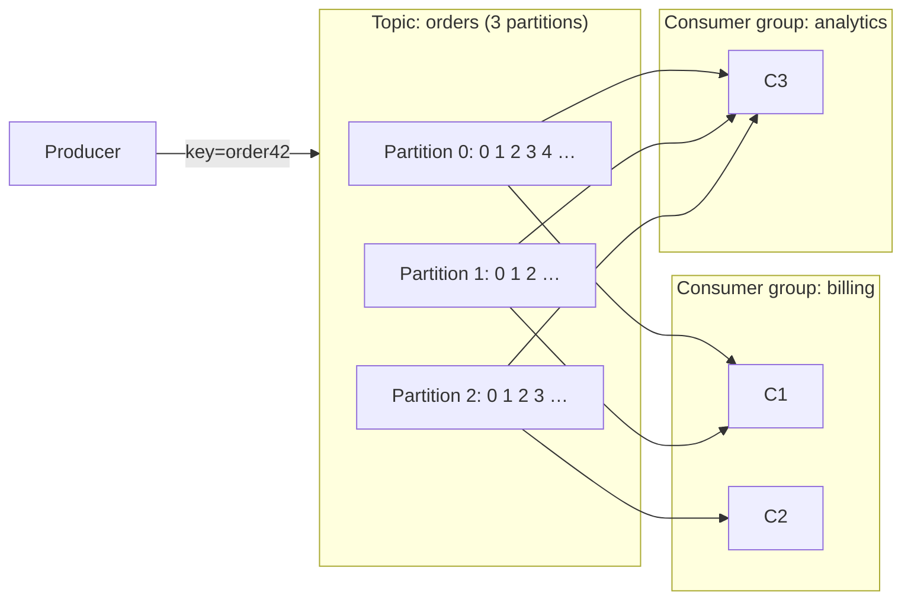
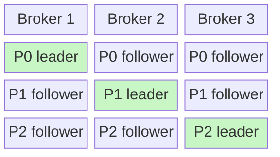
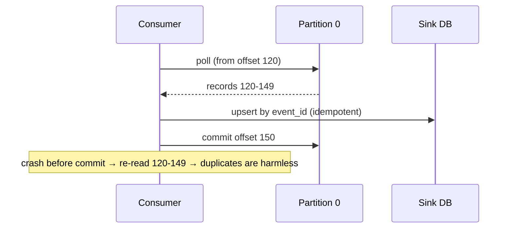

# Kafka Deep Dive

## What is it?

A **distributed, partitioned, replicated append-only log**. Producers append records to topics; consumers read at their own offset; records are retained (not deleted on read) so they can be **replayed**.

## Why Kafka is different from a queue

A queue deletes a message once consumed. Kafka keeps the log; each consumer group tracks **its own position (offset)**. So: many independent consumers, replay after a bug fix, rebuild a cache/search index from history, feed analytics and real-time services from the same stream.

## Core concepts

| Term | Meaning |
|---|---|
| **Topic** | Named stream (e.g., `orders`) |
| **Partition** | Ordered, append-only log; the unit of parallelism & ordering |
| **Offset** | Position of a record within a partition |
| **Key** | Determines the partition: `hash(key) % partitions` → same key, same partition, **ordered** |
| **Broker** | Kafka server; partitions spread across brokers |
| **Replication factor** | Copies of each partition (typically 3); one **leader**, rest followers |
| **ISR** | In-sync replicas — followers caught up with the leader |
| **Consumer group** | Set of consumers sharing work; **each partition → exactly one consumer in the group** |
| **Committed offset** | Where the group resumes after restart |
| **Retention** | By time/size; or **log compaction** (keep latest value per key) |

## Key rules (memorise)

1. **Ordering is per partition**, never across a topic.
2. **Max parallelism in a group = number of partitions.** 12 partitions → >12 consumers sit idle.
3. Choose the **key** for ordering needs (order_id, user_id) and even spread (beware hot keys).
4. Increasing partitions later **changes key→partition mapping** for new records (breaks per-key ordering across the change). Over-provision partitions up front.

## Durability settings

| Setting | Effect |
|---|---|
| `acks=0` | Fire and forget (fast, lossy) |
| `acks=1` | Leader wrote it (lost if leader dies before replication) |
| `acks=all` + `min.insync.replicas=2` (RF=3) | Survives a broker loss — **standard for important data** |
| `enable.idempotence=true` | Producer retries don't create duplicates |
| Transactions | Atomic writes across partitions + consume-transform-produce **exactly-once within Kafka** |

## Consumer delivery semantics

- Commit offset **after** processing → at-least-once (duplicates on crash) → make processing idempotent.
- Commit **before** → at-most-once.
- Kafka EOS covers Kafka→Kafka pipelines; side effects to external DBs still need idempotency or transactional sinks.

## Why it's fast

Sequential disk appends, OS page cache, zero-copy (`sendfile`), batching + compression, partitions spread over brokers.

## Rebalancing

Consumer joins/leaves → partitions reassigned. During eager rebalances consumption pauses ("stop the world"); **cooperative incremental rebalancing** and static membership reduce this.

## Coordination

Modern Kafka uses **KRaft** (built-in Raft quorum) instead of ZooKeeper; ZooKeeper mode was removed in Kafka 4.0 (2025). → [[Consensus-and-Leader-Election]]

## Where Kafka shows up in designs

- Event backbone between microservices → [[Event-Driven-Architecture]]
- Clickstream / ad clicks → stream processors (Flink) → OLAP → [[Design-Ad-Click-Aggregator]]
- CDC from databases (Debezium) → caches/search indexes
- Notification fan-out → [[Design-Notification-System]]
- Log/metrics pipelines

## Kafka vs alternatives

| | Kafka | Pulsar | Kinesis | Redpanda |
|---|---|---|---|---|
| Notes | De-facto standard | Separates compute/storage, multi-tenant | AWS-managed, shards | Kafka-API compatible, C++, no JVM |

## 📊 Visual model

**Partition leaders and replicas across brokers (RF = 3):**

**Consumer offset commit (at-least-once):**

**Parallelism rule:**

$$\text{max active consumers per group} = \text{number of partitions}$$

## Common mistakes

> [!warning] Traps to avoid
> 1. Expecting global ordering in a topic.
> 2. More consumers than partitions "to go faster".
> 3. Using a low-cardinality or skewed key (hot partition).
> 4. `acks=1` for payment events.
> 5. Treating Kafka like a task queue with per-message acks/priorities/delays (RabbitMQ/SQS fit better).

## Interview understanding

> [!question] What the interviewer is really testing
> - *"How do you preserve order of events for one order?"* — Key by order_id → same partition.
> - *"How do you scale consumers?"* — Add partitions (planned) + consumers up to partition count.
> - *Tricky:* "Kafka vs RabbitMQ?" — Log + replay + high-throughput streaming vs broker with routing, per-message acks, priorities.
> - *Tricky:* "A consumer is stuck on a bad message — the partition is blocked. Fix?" — Catch, send to a retry/DLQ topic, commit and move on.
> - *Tricky:* "Exactly-once in Kafka?" — Idempotent producer + transactions within Kafka; external sinks need idempotent writes.

## Mini quiz
1. What decides a record's partition?
2. Max useful consumers in a group with 8 partitions?
3. Durable producer config?
4. What is log compaction?
5. What replaced ZooKeeper?

> [!success]- Answers (click to reveal)
> 1. The key's hash (or round-robin if no key).
> 2. 8.
> 3. `acks=all`, RF=3, `min.insync.replicas=2`, idempotence on.
> 4. Retain only the latest record per key (good for changelogs/state).
> 5. KRaft (Kafka's built-in Raft).

---
**Next:** [[Event-Driven-Architecture]] · **Up:** [[Communication-MOC]]

## 📚 Resources
- 📄 [Apache Kafka documentation — Design](https://kafka.apache.org/documentation/#design)
- 📄 [Jay Kreps — The Log: What every software engineer should know](https://engineering.linkedin.com/distributed-systems/log-what-every-software-engineer-should-know-about-real-time-datas-unifying)
- 📖 *Kafka: The Definitive Guide* (O'Reilly).

## My notes
-
