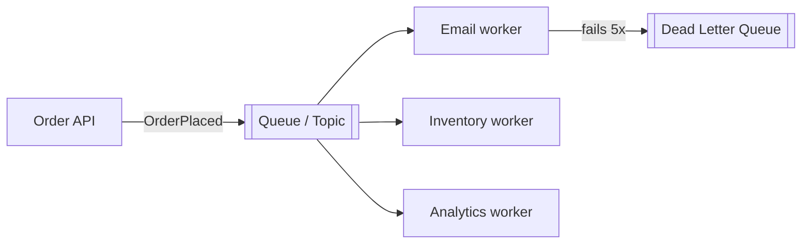
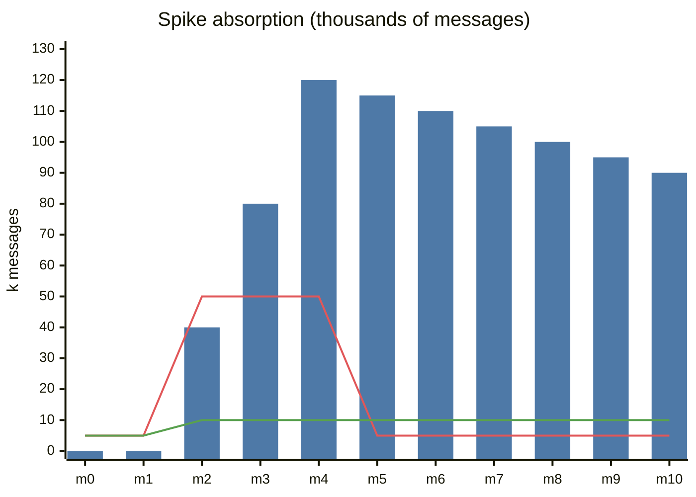
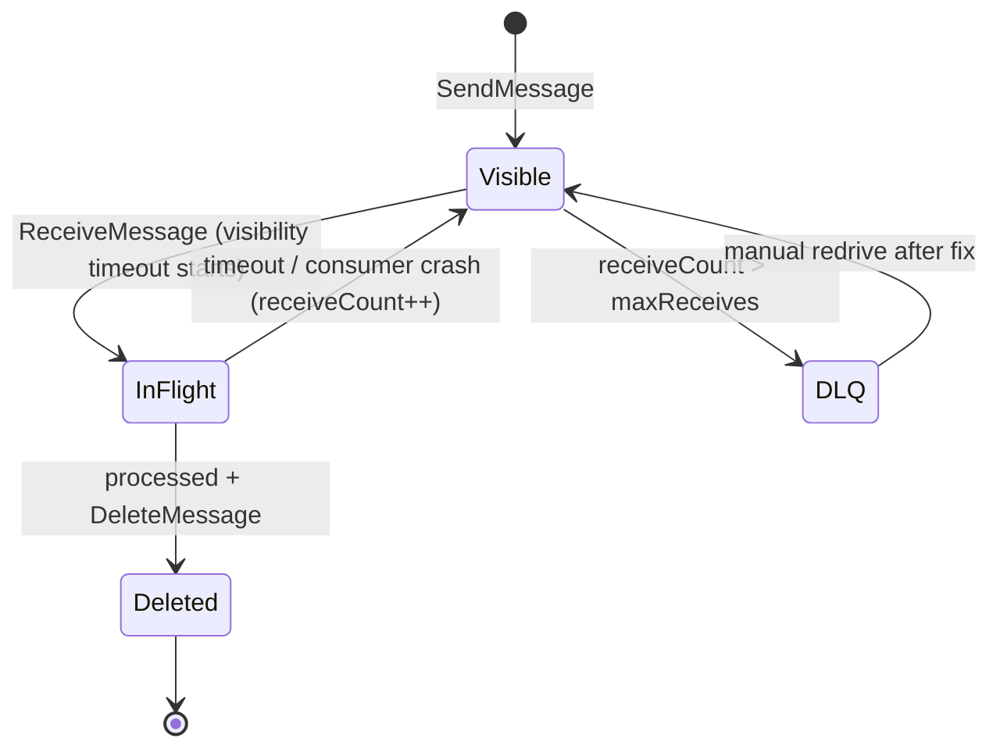
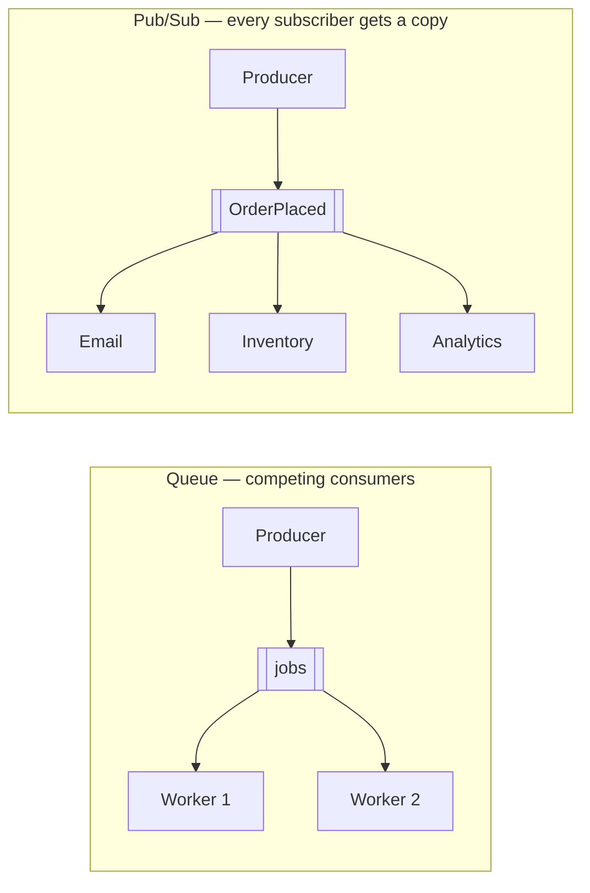

# Message Queues

## What is it?

A buffer between **producers** (who create work/messages) and **consumers** (who process them). Producers don't wait; consumers process at their own pace. RabbitMQ, AWS SQS, Kafka, Redis Streams, Google Pub/Sub, NATS.

## Why does it exist?

1. **Decoupling** — producer doesn't need the consumer to be up or even known.
2. **Absorbing spikes** — 50k orders/s during a sale get buffered; workers drain at 5k/s.
3. **Async work** — respond to the user now, send email/invoice/thumbnail later.
4. **Fan-out** — one event, many independent consumers.
5. **Retry & failure isolation** — failed work goes back or to a DLQ, not into the user's face.

## Analogy

A restaurant's order rail. Waiters (producers) clip tickets on the rail and go back to customers; cooks (consumers) take tickets when ready. Lunch rush → the rail gets long, but nobody is turned away.

## Architecture

## Queue vs Pub/Sub

| | Point-to-point queue | Publish/Subscribe |
|---|---|---|
| Each message goes to | **One** consumer (competing consumers) | **Every** subscriber (each gets a copy) |
| Use for | Work distribution (resize image once) | Event broadcasting (OrderPlaced → email, inventory, analytics) |
| Examples | SQS, RabbitMQ queue | SNS, Kafka topics (per consumer group), Google Pub/Sub |

Kafka does both: within a consumer group = queue semantics; across groups = pub/sub. → [[Kafka-Deep-Dive]]

## Delivery guarantees

| Guarantee | Meaning | How | Risk |
|---|---|---|---|
| **At-most-once** | Never redelivered | Ack before processing | **Lost** messages |
| **At-least-once** | Redelivered until acked | Ack **after** processing | **Duplicates** |
| **Exactly-once** | Effect happens once | Idempotent consumers, or transactional systems (Kafka EOS within Kafka) | Complex, scoped |

> [!important] The interview answer
> "End-to-end exactly-once delivery isn't practically achievable across arbitrary systems. I'll use **at-least-once delivery + idempotent consumers** (dedupe by message ID / idempotency key), which gives **effectively-once processing**." → [[Idempotency]]

## Acknowledgements, visibility timeout, retries

- Consumer receives → message becomes **invisible** for a timeout (SQS visibility timeout).
- Success → **ack/delete**. Crash/timeout → message reappears → retried.
- Set timeout > max processing time, or extend it while working.
- Retry with **exponential backoff**; after N failures → **Dead Letter Queue (DLQ)** for inspection/replay. Poison messages otherwise block or loop forever.

## Ordering

- Most queues are **not strictly ordered** at scale (SQS standard = best-effort).
- **FIFO queues** (SQS FIFO with message group ID) or **Kafka partitions** give ordering **per key** (e.g., per order ID), not globally.
- Global ordering = one partition = no parallelism. Almost never needed — ask "ordered relative to what?"

## Backpressure

When consumers can't keep up: queue depth grows. Responses: autoscale consumers on **queue depth/age**, shed or delay low-priority work, rate-limit producers, alert on **oldest message age** (the best lag metric).

## RabbitMQ vs SQS vs Kafka (quick)

| | RabbitMQ | SQS | Kafka |
|---|---|---|---|
| Model | Smart broker, routing (exchanges) | Managed simple queue | **Distributed append-only log** |
| Retention | Until consumed | Up to 14 days | Configurable (days/forever); **replayable** |
| Throughput | High | Very high (managed) | **Very high** (millions/s) |
| Ordering | Per queue | FIFO option | Per partition |
| Best for | Task queues, complex routing | Simple decoupling on AWS | Event streaming, replay, multiple consumers, analytics pipelines |

## 📊 Visual model

**How a queue absorbs a spike** (arrivals 50k/min for 3 minutes, workers process 10k/min):

> [!note] Reading it
> Bars = backlog (queue depth). Line 1 = arrivals. Line 2 = processing rate. Without the queue, 40k/min would have been **rejected**; with it they're **delayed**. Autoscale workers on backlog age to drain faster.

**Message lifecycle (SQS-style):**

**Queue vs pub/sub:**

## Common mistakes

> [!warning] Traps to avoid
> 1. Assuming exactly-once delivery.
> 2. Non-idempotent consumers (double emails, double charges).
> 3. No DLQ → poison message retries forever.
> 4. Using a queue where the user needs the result immediately.
> 5. Expecting global ordering.
> 6. Putting huge payloads in messages — store in S3, send the reference.

## Interview understanding

> [!question] What the interviewer is really testing
> - *"Why a queue here?"* — Name which of the 5 benefits applies (usually spike absorption + async side effects).
> - *Tricky:* "The consumer crashed after charging the card but before acking. What happens?" — Redelivery → must be idempotent (payment idempotency key). → [[Design-Payment-System]]
> - *Tricky:* "How do you guarantee the DB write and the message publish both happen?" — **Transactional outbox**. → [[Event-Driven-Architecture]]
> - *Tricky:* "Queue is growing unbounded — what do you do?" — Scale consumers, find slow dependency, shed load, check for poison messages.

## Mini quiz
1. Queue vs pub/sub in one line?
2. Which guarantee produces duplicates?
3. What's a DLQ for?
4. Best metric for consumer lag in a queue?
5. How do you get ordering per order ID in Kafka?

> [!success]- Answers (click to reveal)
> 1. Queue: each message to one consumer; pub/sub: each message to every subscriber.
> 2. At-least-once.
> 3. Parking messages that repeatedly fail so they don't block or loop.
> 4. Age of the oldest unprocessed message (or offset lag).
> 5. Use order ID as the partition key.

---
**Next:** [[Kafka-Deep-Dive]] · **Up:** [[Communication-MOC]]

## 📚 Resources
- 📄 [AWS SQS — Developer guide (visibility timeout, DLQs)](https://docs.aws.amazon.com/AWSSimpleQueueService/latest/SQSDeveloperGuide/welcome.html)
- 📄 [RabbitMQ tutorials](https://www.rabbitmq.com/tutorials)

## My notes
-
