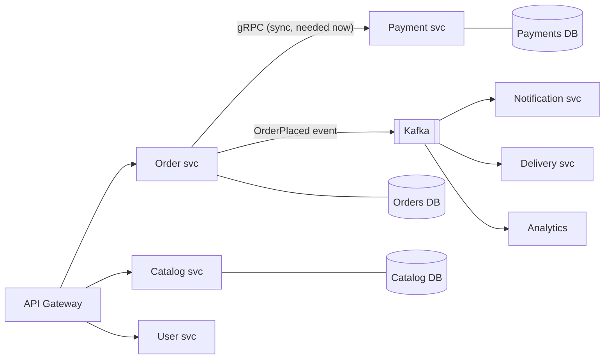
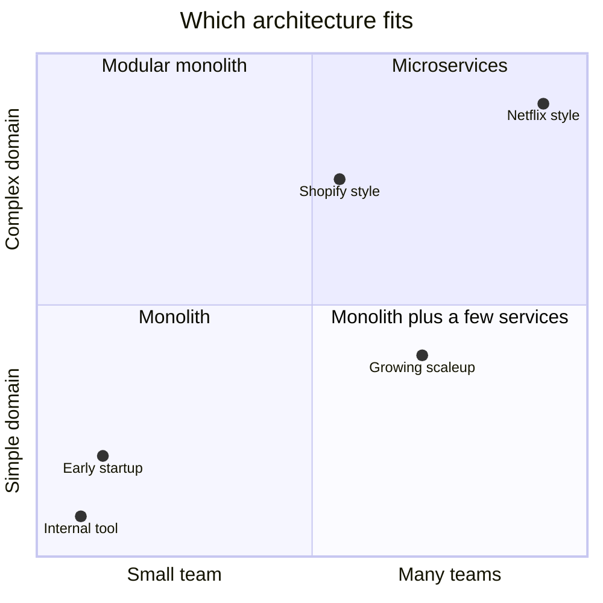
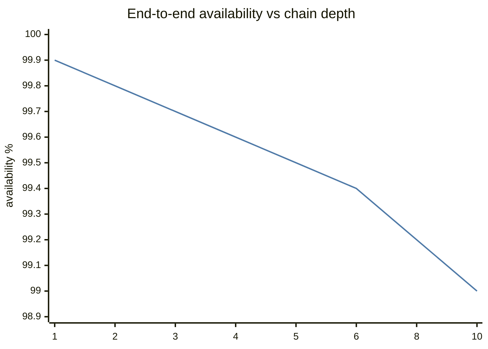
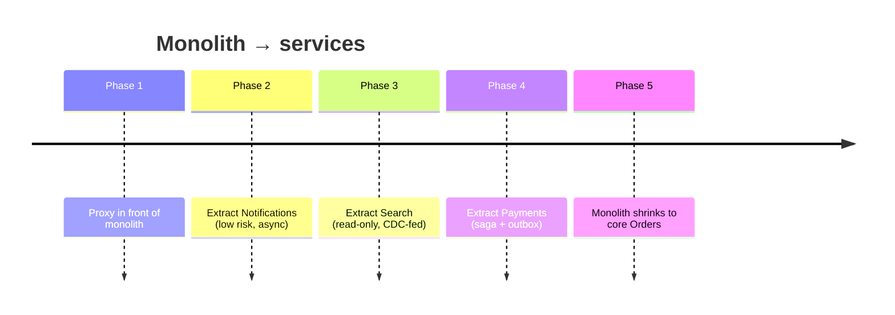

# Microservices vs Monolith

## What is it?

- **Monolith:** one deployable application containing all features, usually one database.
- **Modular monolith:** one deployable, but strict internal module boundaries.
- **Microservices:** many small, independently deployable services, each owning its data, communicating over the network.

## Why microservices exist

They solve an **organisational** problem first: 300 engineers on one codebase → slow builds, merge conflicts, one team's bug blocks everyone's deploy. Microservices let teams **deploy and scale independently**. (Conway's Law: systems mirror the org's communication structure.)

## Comparison

| | Monolith | Microservices |
|---|---|---|
| Deploy | All-or-nothing | Independent per service |
| Scaling | Whole app | Per service (scale only search) |
| Data | One DB, ACID joins | DB per service — **no cross-service joins/transactions** |
| Calls | In-process function calls (ns) | Network calls (ms), can fail |
| Debugging | Stack trace | Distributed tracing needed |
| Tech stack | One | Polyglot possible |
| Team size sweet spot | 1 to ~a few dozen engineers | Many teams |
| Ops cost | Low | **High** (CI/CD, observability, service mesh, on-call per service) |

## When microservices are a bad idea

- Small team / early startup — you'll spend time on infra, not product.
- Unclear domain boundaries — you'll draw them wrong and pay with chatty cross-service calls ("distributed monolith").
- Strong transactional needs across entities that would be split.
- No mature CI/CD, monitoring, tracing.

Famous counter-example: **Amazon Prime Video** (2023 blog) moved a monitoring pipeline from serverless microservices back to a monolith and cut costs ~90%. **Shopify** runs a giant modular monolith (Rails). Segment moved from microservices back to a monolith too.

## Drawing service boundaries

- Follow **business capabilities / bounded contexts** (DDD): Orders, Payments, Catalog, Users, Delivery, Notifications.
- **Each service owns its data**; others access only via API/events.
- High cohesion inside, loose coupling between. If two services always change together, merge them.
- Avoid chatty sync chains (A→B→C→D). Use events or data replication (read models).

## Cross-cutting concerns microservices force on you

| Concern | Solution |
|---|---|
| Finding services | Service discovery → [[Proxies-and-API-Gateways]] |
| Entry point, auth, rate limit | API gateway |
| Cross-service transactions | Sagas + outbox → [[Distributed-Transactions]] |
| Partial failures | Timeouts, retries, circuit breakers → [[Resilience-Patterns]] |
| Debugging | Distributed tracing → [[Observability-and-SLOs]] |
| mTLS, retries, traffic shifting | Service mesh (Istio, Linkerd) |
| Versioned contracts | Schema registry, backward-compatible APIs |

## The migration path: Strangler Fig

Put a proxy in front of the monolith; route one capability at a time to a new service; slowly "strangle" the monolith. Never a big-bang rewrite.

## 📊 Visual model

**Availability decays with synchronous call-chain depth (each hop 99.9%):**

**Strangler fig migration:**

## Common mistakes

> [!warning] Traps to avoid
> 1. Microservices for a 3-person team.
> 2. Shared database between services (tight coupling, hidden contracts).
> 3. Splitting by technical layer (UI service, DB service) instead of business capability.
> 4. Synchronous call chains 6 deep → latency adds up, availability multiplies down (0.999⁶ ≈ 0.994).
> 5. Saying "microservices" in an interview without saying why.

## Interview understanding

> [!question] What the interviewer is really testing
> - *"Monolith or microservices for this?"* — In a design interview, drawing *logical* services is fine; say "these could start as modules of one deployable and split when team/scale requires".
> - *Tricky:* "How do you do a transaction across Order and Payment services?" — Saga with compensations, outbox, idempotency.
> - *Tricky:* "What's a distributed monolith?" — Microservices that must be deployed together / call each other synchronously everywhere — all the costs, none of the benefits.
> - *Tricky:* "How do you query data owned by 3 services?" — API composition at gateway/BFF, or a CQRS read model fed by events.

## Mini quiz
1. Microservices primarily solve what kind of problem?
2. Rule about databases in microservices?
3. What's the Strangler Fig pattern?
4. Availability of a 5-deep chain of 99.9% services?
5. One famous move back to a monolith?

> [!success]- Answers (click to reveal)
> 1. Organisational/team scaling and independent deploys.
> 2. Each service owns its data; no shared DB.
> 3. Incrementally route features from a monolith to new services behind a proxy.
> 4. ≈ 99.5%.
> 5. Amazon Prime Video monitoring (2023), Segment.

---
**Next:** [[Proxies-and-API-Gateways]] · **Up:** [[Communication-MOC]]

## 📚 Resources
- 📄 [Martin Fowler — Microservices](https://martinfowler.com/articles/microservices.html) and [MonolithFirst](https://martinfowler.com/bliki/MonolithFirst.html)
- 📄 [Prime Video tech blog — scaling up audio/video monitoring, reducing cost by 90%](https://www.primevideotech.com/video-streaming/scaling-up-the-prime-video-audio-video-monitoring-service-and-reducing-costs-by-90)
- 📖 *Building Microservices* (Sam Newman).

## My notes
-
