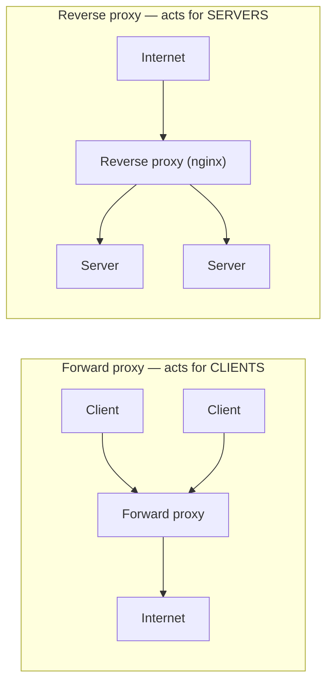
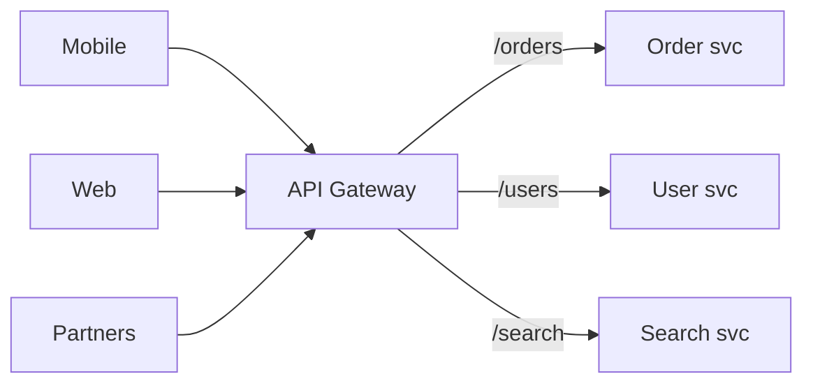
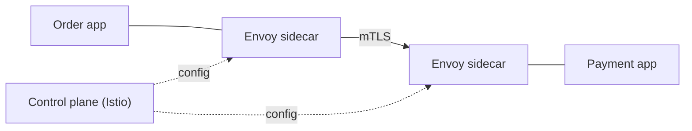
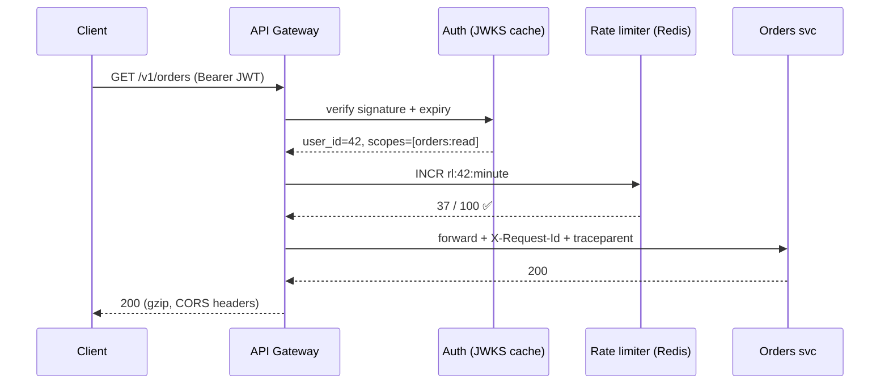
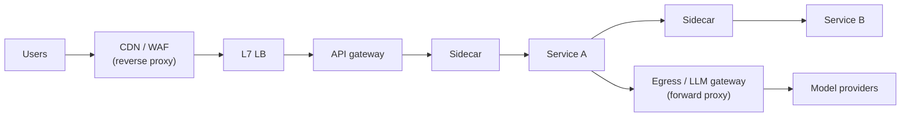

# Proxies, API Gateways and Service Discovery

## Forward vs reverse proxy

| | Forward proxy | Reverse proxy |
|---|---|---|
| Represents | Clients | Servers |
| Hides | Client identity | Server topology |
| Uses | Corporate egress filtering, caching, anonymity, VPN-like access | TLS termination, load balancing, caching, compression, WAF, routing |
| Examples | Squid, corporate proxies | **nginx**, HAProxy, Envoy, Traefik, Cloudflare |

A load balancer is a kind of reverse proxy. → [[Load-Balancing]]

## API Gateway

A reverse proxy specialised for APIs — the **single entry point** for clients into a microservice backend.

**Responsibilities:**
- Routing (path/host/header → service)
- **Authentication** (validate JWT/API key once at the edge) → [[Authentication-and-Authorization]]
- **Rate limiting & quotas** → [[Design-Rate-Limiter]]
- Request/response transformation, protocol translation (REST → gRPC)
- Aggregation (one client call → several backend calls)
- Caching, compression, CORS
- Observability: logs, metrics, tracing headers, request IDs
- Canary/traffic splitting

**Examples:** Kong, AWS API Gateway, Apigee, Envoy Gateway, Traefik, nginx; Kubernetes Gateway API.

**BFF (Backend for Frontend):** a gateway per client type (mobile BFF, web BFF) shaping responses for that UI. Often GraphQL. → [[REST-vs-gRPC-vs-GraphQL]]

**2026 variant — AI/LLM gateway:** sits in front of model providers; handles provider routing/fallback, token-based rate limits & budgets, semantic caching, prompt/response logging, PII redaction, guardrails. → [[LLM-Serving-and-Inference]]

**Pitfalls:** gateway becomes a SPOF (run it redundant, multi-AZ) and a bottleneck/"god service" if business logic creeps in. Keep it thin.

## Service discovery

In a dynamic fleet (autoscaling, containers), IPs change constantly. How does Order service find Payment service?

| Pattern | How | Examples |
|---|---|---|
| **Server-side discovery** | Client calls a stable LB/DNS name; LB knows instances | Kubernetes Service (`payments.svc.cluster.local`), AWS ALB |
| **Client-side discovery** | Client queries a registry, picks an instance itself | Consul, Eureka, etcd + gRPC client LB |
| **DNS-based** | Registry exposed as DNS (SRV/A records) | Consul DNS, CoreDNS in Kubernetes |

Registry keeps itself fresh via **registration + heartbeats/health checks**; entries for dead instances expire.

## Service mesh

A **sidecar proxy** (Envoy) next to every service instance, configured by a control plane (Istio, Linkerd). Moves networking concerns out of app code: mTLS, retries, timeouts, circuit breaking, traffic shifting, telemetry. Cost: complexity, extra hop latency, resource overhead. (Ambient/sidecar-less modes reduce overhead.)

## 📊 Visual model

**What the gateway does on every request:**

**Layers of proxies in a real system:**

## Common mistakes

> [!warning] Traps to avoid
> 1. Confusing forward and reverse proxy.
> 2. Putting business logic in the gateway.
> 3. Single gateway instance.
> 4. Hard-coding service IPs.
> 5. Adding a service mesh for 4 services.

## Interview understanding

> [!question] What the interviewer is really testing
> - *"Where do auth and rate limiting happen?"* — At the API gateway (coarse), plus authorization checks in services (fine-grained).
> - *Tricky:* "Gateway vs load balancer?" — LB distributes traffic; gateway adds API concerns (auth, quotas, transformation, aggregation). Gateways often sit behind/alongside an LB.
> - *Tricky:* "How does a new pod start receiving traffic?" — Registers (or K8s endpoints update when readiness passes); discovery/LB picks it up.
> - *Tricky:* "What's an LLM gateway?" — Gateway for model calls with token budgets, fallback, caching, logging, guardrails.

## Mini quiz
1. nginx in front of your servers is a ___ proxy.
2. Three API gateway responsibilities?
3. Client-side vs server-side discovery?
4. What does a service mesh sidecar do?
5. What's a BFF?

> [!success]- Answers (click to reveal)
> 1. Reverse.
> 2. Routing, auth, rate limiting (also transformation, aggregation, observability).
> 3. Client picks instance from registry vs an LB/DNS name does it.
> 4. Proxies all traffic for the service: mTLS, retries, timeouts, metrics.
> 5. Backend for Frontend — a gateway tailored to one client type.

---
**Next:** [[Distributed-Systems-MOC]] · **Up:** [[Communication-MOC]]

## 📚 Resources
- 📄 [microservices.io — API Gateway pattern](https://microservices.io/patterns/apigateway.html)
- 📄 [microservices.io — Service discovery](https://microservices.io/patterns/client-side-discovery.html)
- 📄 [Kubernetes Gateway API](https://gateway-api.sigs.k8s.io/)

## My notes
-
