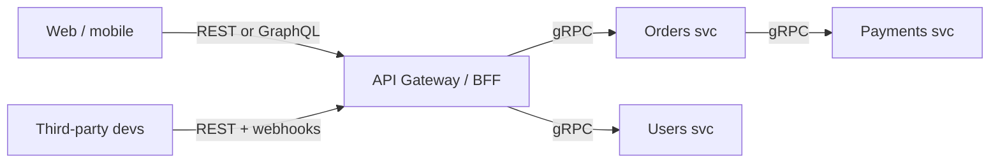
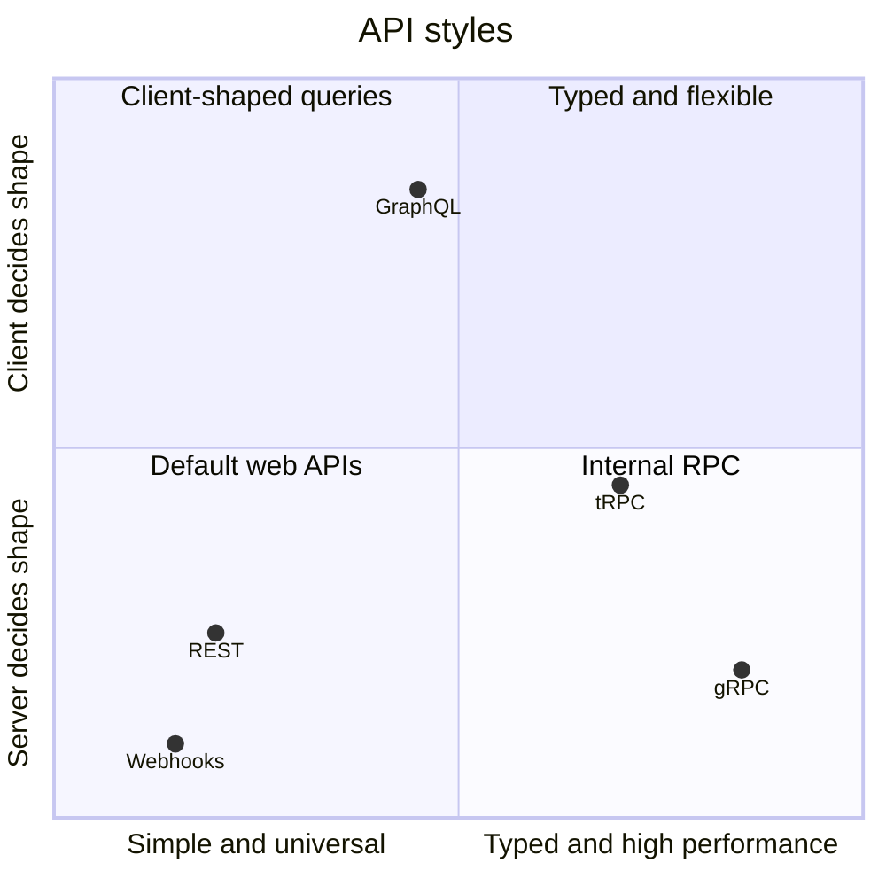
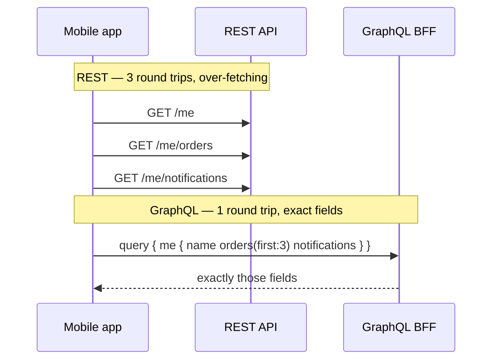

# REST vs gRPC vs GraphQL

## The one-line version

- **REST:** resources over HTTP + JSON. Universal, cacheable, simple. **Default for public APIs.**
- **gRPC:** strongly-typed RPC over HTTP/2 with Protocol Buffers. Fast, streaming, codegen. **Default for internal service-to-service.**
- **GraphQL:** one endpoint, client specifies exactly the fields it needs. **Great for aggregating many backends for varied UIs (BFF).**

## Comparison

| | REST | gRPC | GraphQL |
|---|---|---|---|
| Transport | HTTP/1.1 or 2 | **HTTP/2** | HTTP (usually POST) |
| Payload | JSON (text) | **Protobuf (binary)** — smaller, faster to parse | JSON |
| Contract | OpenAPI (optional) | `.proto` (required, codegen) | Schema (required) |
| Streaming | No (use SSE/WS) | **Uni + bi-directional streaming** | Subscriptions (via WS) |
| Browser support | Native | Needs gRPC-Web proxy | Native |
| HTTP caching | **Easy (GET + URLs)** | Hard | Hard (POST, one URL) — needs persisted queries |
| Over/under-fetching | Common | Defined per method | **Solved** — ask for exact fields |
| Learning/tooling | Easiest | Moderate | Moderate; server complexity (N+1, query cost) |
| Best for | Public APIs, CRUD, web | Internal microservices, low latency, polyglot, mobile↔backend at scale | Frontends with many screens/devices, aggregating services |

## Over-fetching & under-fetching (why GraphQL exists)

REST mobile home screen might call `/user`, `/user/orders`, `/recommendations`, `/notifications` (under-fetching → 4 round trips) and get 50 fields when it needs 5 (over-fetching).

```graphql
query {
  me { name avatarUrl
    orders(first: 3) { id status total }
    notifications(unread: true) { count }
  }
}
```

One round trip, exact fields. Cost: the server must guard against expensive queries (depth/complexity limits) and the **N+1 problem** (use DataLoader batching).

## gRPC example

```proto
service RideService {
  rpc GetEta (EtaRequest) returns (EtaResponse);
  rpc StreamDriverLocation (DriverId) returns (stream Location);   // server streaming
}
message EtaRequest { string ride_id = 1; }
```

Deadlines/timeouts and cancellation propagate across calls — great for microservice chains.

## Architecture: who uses what



Typical real-world split: **REST outside, gRPC inside, GraphQL as a BFF** when frontends are diverse (Netflix, Shopify, GitHub offer GraphQL; Google, Netflix, Uber use gRPC internally).

## 📊 Visual model



**One screen, three styles:**



## Common mistakes

> [!warning] Traps to avoid
> 1. "GraphQL is faster" — not inherently; it saves round trips, but resolvers can be slower.
> 2. gRPC for a public browser API without considering gRPC-Web/proxy needs.
> 3. GraphQL without query cost limits (DoS by deeply nested query).
> 4. Ignoring caching — REST GETs + CDN are hard to beat for public read traffic.

## Interview understanding

> [!question] What the interviewer is really testing
> - *"Which API style for X?"* — Who's the client (public/partner/internal/browser), need for streaming, caching, payload efficiency.
> - *Tricky:* "How do you load-balance gRPC?" — L7 (request-level) balancing or client-side LB; L4 balances long-lived connections unevenly. → [[Load-Balancing]]
> - *Tricky:* "How do you cache GraphQL?" — Persisted queries via GET + CDN, response caching per field/entity, client-side normalised cache (Apollo).
> - *Tricky:* "Why Protobuf over JSON?" — Smaller binary, faster serialisation, schema evolution with field numbers.

## Mini quiz
1. gRPC runs on which HTTP version?
2. What problem does GraphQL solve?
3. What's the N+1 problem in GraphQL and the fix?
4. Best style for a public partner API?
5. Why is REST easier to cache?

> [!success]- Answers (click to reveal)
> 1. HTTP/2.
> 2. Over- and under-fetching; multiple round trips for varied UIs.
> 3. Resolver per item triggers one DB query each; batch with DataLoader.
> 4. REST (+ webhooks), documented with OpenAPI.
> 5. GET requests with unique URLs map directly onto HTTP/CDN caches.

---
**Next:** [[Real-Time-Communication]] · **Up:** [[Communication-MOC]]

## 📚 Resources
- 📄 [gRPC — Introduction](https://grpc.io/docs/what-is-grpc/introduction/)
- 📄 [GraphQL — Learn](https://graphql.org/learn/)

## My notes
-
