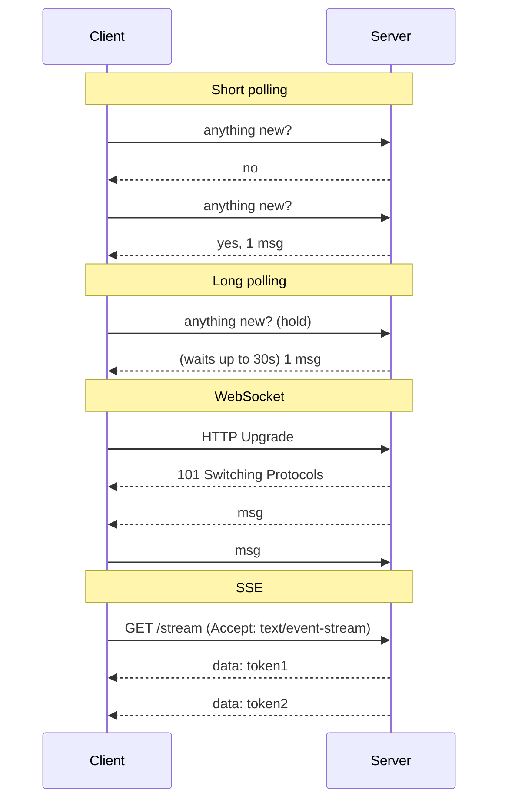
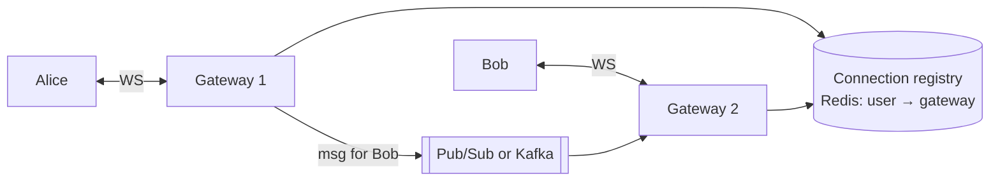
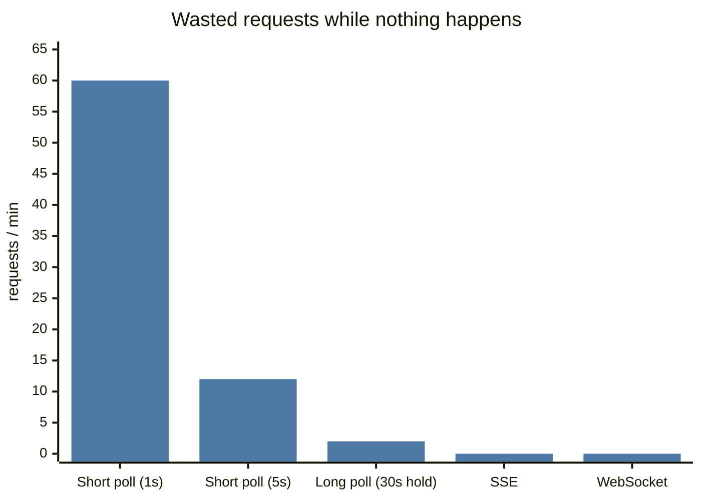
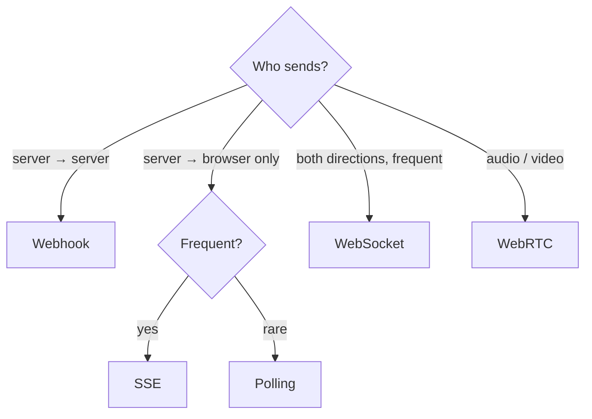
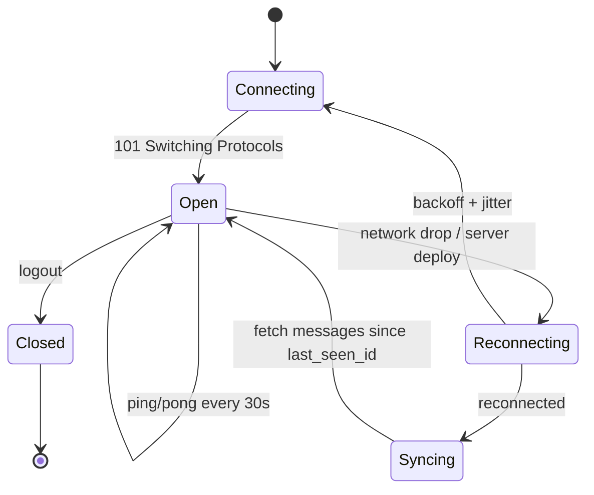

# Real-Time Communication

## The problem

HTTP is **client-asks, server-answers**. But chat messages, driver locations, live scores, and LLM tokens need the **server to push** to the client as things happen.

## The options

| | Short polling | Long polling | **WebSocket** | **SSE** | Webhook |
|---|---|---|---|---|---|
| Direction | Client pulls | Client pulls (held) | **Bi-directional** | Server → client | Server → **server** |
| Connection | New each time | Held until data/timeout | Persistent TCP | Persistent HTTP | One HTTP POST per event |
| Latency | Up to poll interval | Near real-time | Real-time | Real-time | Near real-time |
| Overhead | High (empty responses) | Medium | Low per message | Low | Low |
| Proxies/firewalls | ✅ | ✅ | Sometimes issues | ✅ (plain HTTP) | ✅ |
| Auto-reconnect | n/a | manual | manual | **Built-in** (`EventSource`, `Last-Event-ID`) | Sender retries |
| Use for | Rare updates, simplicity | Fallback, legacy | **Chat, games, collaboration, live location** | **Live feeds, notifications, LLM token streaming** | Payment status to merchants, GitHub events |

## How to choose (say this in the interview)

- **Client also sends frequently** (chat typing, game input, collaborative edits) → **WebSocket**.
- **Server-only push** (stock ticker, notifications, ChatGPT-style streaming) → **SSE** — simpler, HTTP-native, auto-reconnect. Most LLM APIs stream via SSE. → [[Design-LLM-Chat-Service]]
- **Server-to-server** event notification → **webhook** (sign the payload with HMAC, retry with backoff, receiver must be idempotent).
- **Rare updates, simplest** → polling.
- **Audio/video calls** → WebRTC (peer-to-peer, UDP).

## Scaling WebSockets — the real interview content

WebSocket servers are **stateful** (they hold connections). Problems & answers:

| Problem | Solution |
|---|---|
| Alice's server doesn't hold Bob's connection | **Registry** (`user → gateway`) in Redis + route via pub/sub/Kafka or direct gateway-to-gateway RPC |
| Uneven load | LB with **least connections**; sticky by connection (inherent) |
| Deploys drop connections | Graceful drain; clients **reconnect with backoff + jitter** and resume from last message ID |
| Reconnect storms after an outage | Jittered backoff, connection rate limiting |
| Millions of connections | Tuned servers (epoll, file descriptors); ~100k–1M per node; horizontal fleet |
| Missed messages while offline | Persist messages; on reconnect, sync since last seen ID; push notification for offline users |
| Heartbeats | Ping/pong every ~30 s to detect dead connections & keep NAT/LB alive |

## Presence ("online" status)

Heartbeat → update `last_seen` in Redis with TTL; online if TTL key exists. Don't broadcast every flicker to every friend — batch/debounce and only fan out to users currently viewing. → [[Design-Chat-App]]

## 📊 Visual model

**HTTP requests per idle client per minute (no new data):**

**Choosing the channel:**

**WebSocket connection lifecycle:**

## Common mistakes

> [!warning] Traps to avoid
> 1. WebSockets for one-way server push where SSE is simpler.
> 2. Forgetting WebSocket servers are stateful (no registry).
> 3. No resume/sync on reconnect → lost messages.
> 4. Webhooks without signatures, retries, or idempotent receivers.
> 5. Short polling every second from millions of clients.

## Interview understanding

> [!question] What the interviewer is really testing
> - *"How does the server push a message to the recipient?"* — WebSocket to recipient's gateway via a registry + pub/sub; if offline, store + push notification.
> - *Tricky:* "SSE vs WebSocket for ChatGPT-style streaming?" — SSE: one-way, HTTP-native, auto-reconnect.
> - *Tricky:* "How do you send a message to a user connected to a different server?" — Registry lookup + internal pub/sub/RPC.
> - *Tricky:* "Webhook delivery failed — what now?" — Retry with exponential backoff for hours/days, DLQ, dashboard for manual replay; receivers dedupe by event ID.

## Mini quiz
1. Which option has built-in auto-reconnect in browsers?
2. Best for collaborative editing?
3. Why are WebSocket servers hard to scale?
4. How do you secure a webhook?
5. Long polling vs short polling difference?

> [!success]- Answers (click to reveal)
> 1. SSE (`EventSource`).
> 2. WebSocket.
> 3. They're stateful — need a connection registry and cross-server routing.
> 4. HMAC signature + timestamp (replay protection) + HTTPS; receiver verifies and dedupes.
> 5. Long polling holds the request open until data or timeout; short polling returns immediately.

---
**Next:** [[Message-Queues]] · **Up:** [[Communication-MOC]]

## 📚 Resources
- 📄 [MDN — WebSockets API](https://developer.mozilla.org/en-US/docs/Web/API/WebSockets_API)
- 📄 [MDN — Server-sent events](https://developer.mozilla.org/en-US/docs/Web/API/Server-sent_events)
- 📄 [Slack Engineering — Real-time messaging](https://slack.engineering/real-time-messaging/)

## My notes
-
