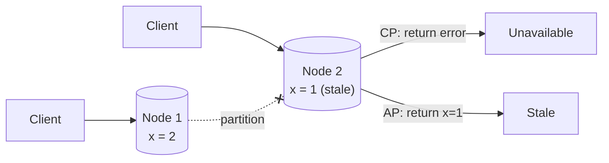
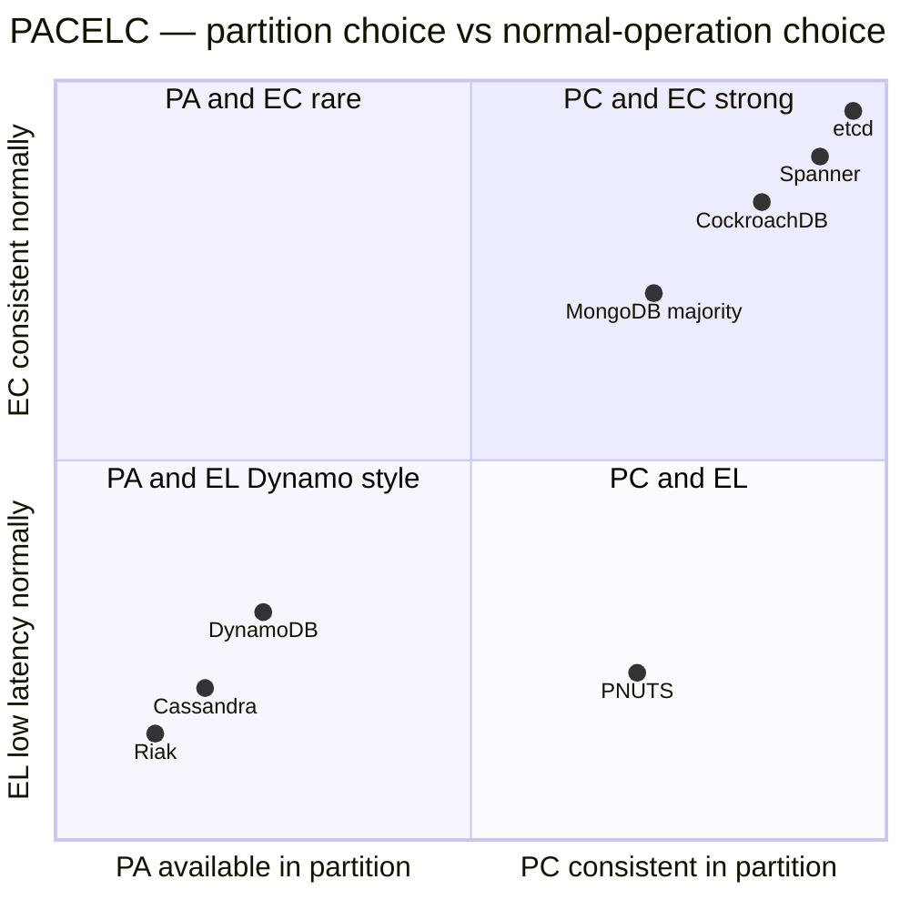
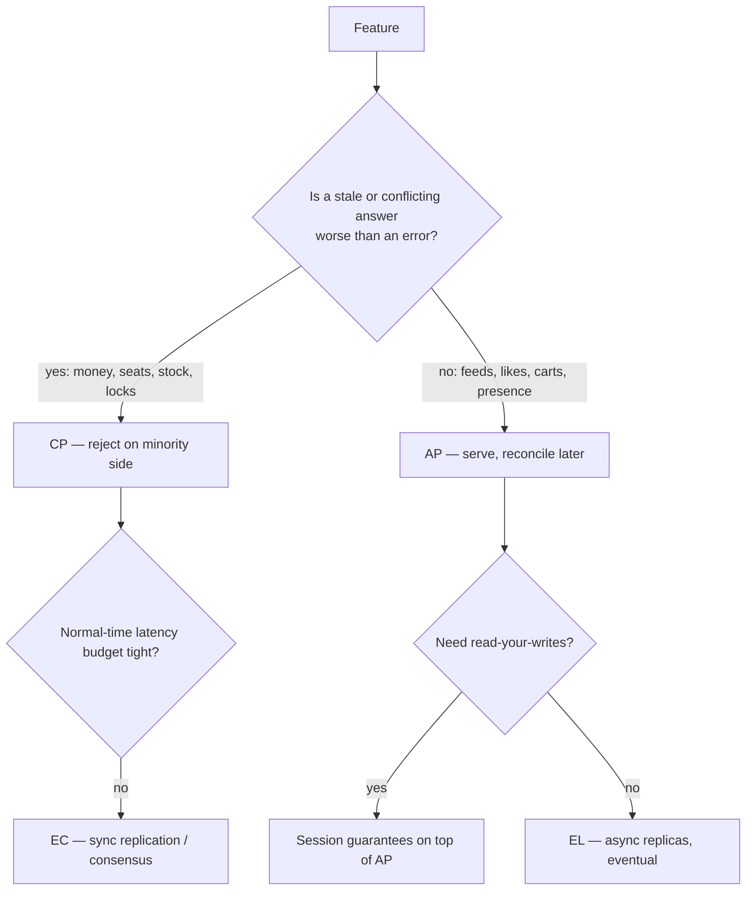

# CAP Theorem and PACELC

## What is CAP?

In a distributed data store, when a **network Partition** happens, you must choose between:
- **Consistency (C):** every read sees the latest write (linearizability) — or returns an error.
- **Availability (A):** every request to a non-failed node gets a (non-error) response — possibly stale.

**Partition tolerance isn't optional** in a real network. So CAP really says: **during a partition, choose C or A.**

## Analogy

Two bank branches lose their phone line. A customer withdraws at branch 1.
- **CP:** branch 2 refuses all withdrawals until the line is back (consistent, unavailable).
- **AP:** branch 2 keeps serving using its old ledger (available, may let the account go negative — fix later).

## The picture

## CP vs AP examples

| Choose | When | Systems (default config) |
|---|---|---|
| **CP** | Wrong data is worse than no data | Bank balance, seat booking, inventory decrement, leader election, config; etcd, ZooKeeper, Spanner, HBase, MongoDB (majority writes) |
| **AP** | Downtime is worse than stale data | Likes count, feeds, shopping cart, presence, DNS, product reviews; Cassandra, DynamoDB (eventual reads), Riak, CouchDB |

Many systems are **tunable** (Cassandra consistency levels, DynamoDB strongly consistent reads, quorum W/R). → [[Replication]]

## PACELC — the more useful version

> **If Partition → choose A or C; Else (normal operation) → choose Latency or Consistency.**

Partitions are rare; the **latency vs consistency** trade-off happens on every request (sync replication = consistent but slower).

| System | P: A or C | E: L or C |
|---|---|---|
| Cassandra, DynamoDB (default) | PA | EL |
| MongoDB (majority) | PC | EC |
| Spanner, CockroachDB | PC | EC |
| PNUTS (Yahoo) | PC | EL |

## Apply it per feature, not per system

The senior move: one product has many features with **different** choices.

| Feature in an e-commerce app | Choice | Why |
|---|---|---|
| Product catalogue, reviews | AP | Stale price description for seconds is fine |
| Cart | AP (merge on conflict) | Never refuse "add to cart" (Dynamo paper's example) |
| Inventory decrement / payment | CP | Overselling or double charge is unacceptable |
| Order history | Read-your-writes | Users must see their own order |

## 📊 Visual model

**PACELC map of real systems (default configs):**

**Decision flow per feature:**

## Common mistakes

> [!warning] Traps to avoid
> 1. "We pick CA" — not possible in a distributed system (partitions happen).
> 2. Reciting CAP without applying it to the feature at hand.
> 3. Thinking AP means "never consistent" — it means **eventually** consistent.
> 4. Confusing CAP's C (linearizability) with ACID's C (constraints).
> 5. Ignoring PACELC — most of the time you're trading latency, not availability.

## Interview understanding

> [!question] What the interviewer is really testing
> - *"Is your system CP or AP?"* — "It depends on the feature: for X I choose CP because …; for Y AP because …"
> - *Tricky:* "Can you have CA?" — Only on a single node / no partitions — i.e., not a distributed system.
> - *Tricky:* "Is Cassandra AP?" — By default yes; with QUORUM reads+writes it behaves closer to CP for those operations (but still not linearizable without LWT).
> - *Tricky:* "What does a CP system do during a partition?" — The minority side rejects writes (and possibly reads) — e.g., etcd minority can't elect a leader.

## Mini quiz
1. What does CAP force you to choose during a partition?
2. Why is "CA" not a real option?
3. What does PACELC add?
4. CP or AP: likes counter? seat booking?
5. CAP C vs ACID C?

> [!success]- Answers (click to reveal)
> 1. Consistency or availability.
> 2. Partitions happen in any real network; P isn't optional.
> 3. The latency vs consistency trade-off in normal operation.
> 4. AP; CP.
> 5. CAP C = linearizable reads; ACID C = invariants/constraints preserved.

---
**Next:** [[Consistency-Models]] · **Up:** [[Distributed-Systems-MOC]]

## 📚 Resources
- 📄 [Eric Brewer — CAP Twelve Years Later](https://www.infoq.com/articles/cap-twelve-years-later-how-the-rules-have-changed/)
- 📄 [Daniel Abadi — PACELC paper (IEEE Computer 2012)](https://www.cs.umd.edu/~abadi/papers/abadi-pacelc.pdf)
- 📄 [Martin Kleppmann — Please stop calling databases CP or AP](https://martin.kleppmann.com/2015/05/11/please-stop-calling-databases-cp-or-ap.html)

## My notes
-
