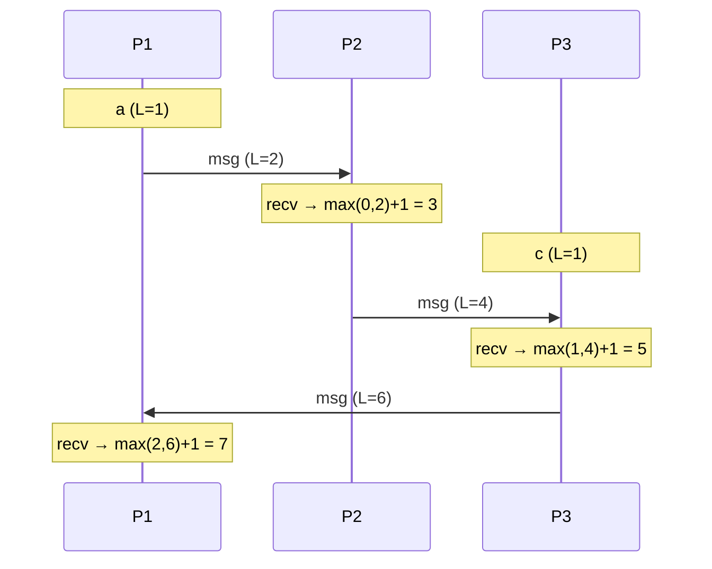
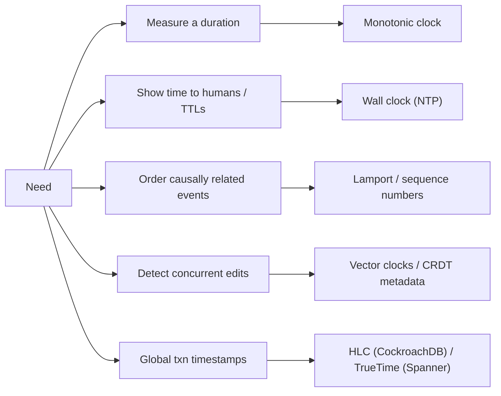

# Clocks, Time and Ordering

## What is it?

How to decide **which event happened first** when events occur on different machines whose clocks don't agree.

## Why physical clocks fail

- **Clock skew:** two machines differ by ms to seconds.
- **Drift:** quartz clocks drift (~tens of ppm).
- **NTP corrections** can make a clock **jump backwards**.
- Leap seconds, VM pauses.

So "order by timestamp" across machines can put an effect before its cause, and LWW can keep the older write.

**Rule:** use **wall-clock** time for humans (display, TTLs, approximate) and **monotonic clocks** for measuring durations on one machine; use **logical clocks / sequence numbers** for ordering.

## Lamport clocks

Each node keeps a counter:
1. Increment before each event.
2. Send the counter with every message.
3. On receive: `counter = max(local, received) + 1`.

Guarantee: if A **happened-before** B, then `L(A) < L(B)`. But `L(A) < L(B)` doesn't prove A caused B. Ties broken by node ID → a **total order** consistent with causality.

## Vector clocks

Each node keeps a vector of counters, one per node. Compare vectors:
- A ≤ B in every position → A happened before B.
- Neither ≤ the other → **concurrent** → conflict to resolve.

```text
Node A: [A:2, B:1]   Node B: [A:1, B:2]  → concurrent (conflict!)
Node A: [A:2, B:1]   later   [A:3, B:2]  → ordered
```

Used for **conflict detection** (Dynamo, Riak). Cost: vector grows with number of nodes/clients.

## Hybrid Logical Clocks (HLC)

Physical time + a logical counter: close to wall-clock time (human-meaningful) **and** respects causality. Used by **CockroachDB**, YugabyteDB, MongoDB (cluster time).

## Google TrueTime (Spanner)

GPS + atomic clocks give each timestamp an **uncertainty interval** `[earliest, latest]` (a few ms). Spanner **waits out the uncertainty** before committing ("commit wait") → globally consistent timestamps → external consistency. Expensive hardware approach; worth naming as the exception.

## Practical ordering in system design

| Need | Practical answer |
|---|---|
| Messages in a chat in order | Per-conversation sequence number assigned by the single owner (partition leader / DB sequence), or Snowflake-like IDs per conversation → [[Design-Chat-App]] |
| Events for one entity | Kafka partition keyed by entity ID → [[Kafka-Deep-Dive]] |
| Roughly time-sorted unique IDs | Snowflake/ULID → [[Unique-ID-Generation]] |
| Detect concurrent edits | Version vectors / CRDTs → [[Real-Time-Collaboration-CRDTs]] |
| Globally consistent transactions | Spanner/TrueTime, CockroachDB/HLC |

## 📊 Visual model

**Lamport clocks across three processes:**



**Which clock for which job:**



## Common mistakes

> [!warning] Traps to avoid
> 1. Sorting cross-server events by `created_at` from different machines and calling it exact.
> 2. LWW with wall clocks for important data.
> 3. Using `System.currentTimeMillis()` to measure latency (use monotonic time).
> 4. Expecting global ordering when per-entity ordering is all that's needed.

## Interview understanding

> [!question] What the interviewer is really testing
> - *"How do you order chat messages?"* — Server-assigned sequence per conversation; client timestamps only for display.
> - *Tricky:* "Lamport vs vector clocks?" — Lamport: total order consistent with causality, can't detect concurrency. Vector: detects concurrency, more space.
> - *Tricky:* "How does Spanner get consistent global timestamps?" — TrueTime bounded uncertainty + commit wait.
> - *Tricky:* "Can a clock go backwards?" — Wall clock yes (NTP step); monotonic clock no.

## Mini quiz
1. Why not trust wall-clock timestamps for ordering?
2. Lamport receive rule?
3. Two vector clocks, neither dominates — meaning?
4. What does HLC combine?
5. What does Spanner's commit wait do?

> [!success]- Answers (click to reveal)
> 1. Skew, drift, and backward jumps across machines.
> 2. `max(local, received) + 1`.
> 3. The events are concurrent → potential conflict.
> 4. Physical time + logical counter.
> 5. Waits out clock uncertainty so timestamp order matches real-time order.

---
**Next:** [[Unique-ID-Generation]] · **Up:** [[Distributed-Systems-MOC]]

## 📚 Resources
- 📄 [Lamport — Time, Clocks, and the Ordering of Events (1978)](https://lamport.azurewebsites.net/pubs/time-clocks.pdf)
- 📄 [Google — Spanner paper](https://research.google/pubs/spanner-googles-globally-distributed-database-2/)
- 📖 *DDIA* Ch. 8–9.

## My notes
-
