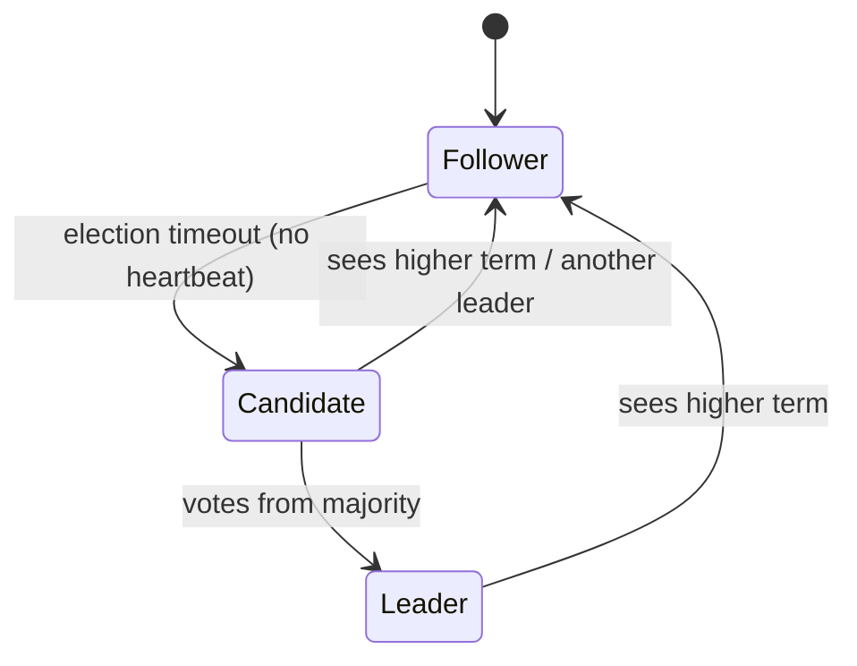
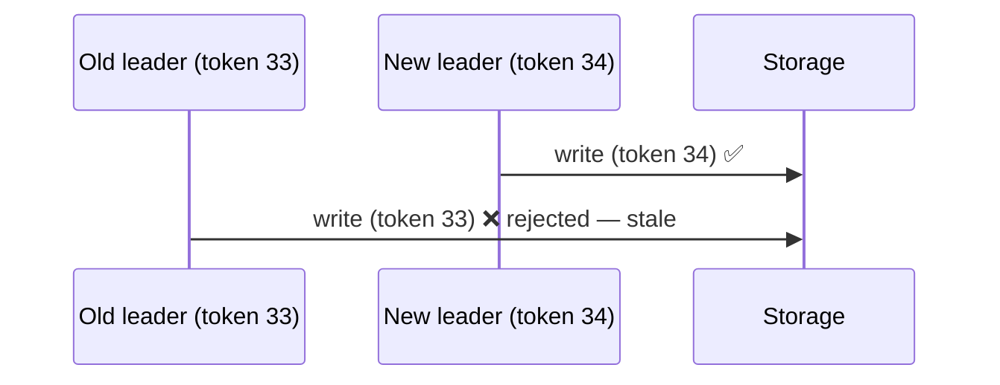
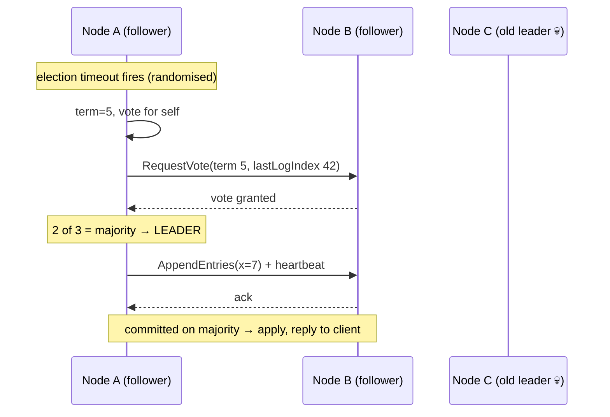
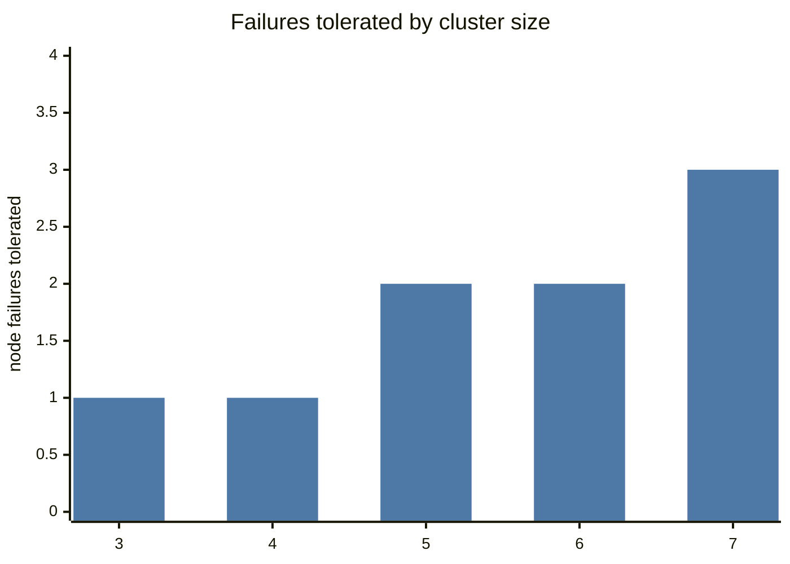

# Consensus and Leader Election

## What is it?

**Consensus** = getting a group of machines to **agree on a value** (who's leader, what's the next log entry, is this transaction committed) even when some machines crash or messages are delayed.

## Why does it exist?

Replication with one leader needs agreement on **who** the leader is. Without consensus, two nodes can both think they're leader → **split brain** → conflicting writes, corrupted data.

## Analogy

A committee of 5 votes on a chair. Any decision needs **3 of 5 (a majority)**. Two majorities always share at least one member, so two conflicting decisions can't both win. If 3 members are stuck in traffic, nothing can be decided — the committee is safe but not available.

## Raft — the intuition (the one to know)

1. **Terms:** time is divided into numbered terms; each has at most one leader.
2. **Election:** a follower that hears no heartbeat within a **randomised timeout** becomes a candidate, increments the term, votes for itself, asks others. Majority votes → leader. Randomised timeouts avoid split votes.
3. **Log replication:** clients send writes to the leader → appended to its log → replicated to followers → once a **majority** has it, it's **committed** and applied.
4. **Safety:** a candidate can only win if its log is at least as up-to-date as the majority's → committed entries are never lost.

**Cluster sizes:** 3 nodes tolerate 1 failure; 5 tolerate 2. (2f+1 nodes tolerate f.) Use odd numbers; even numbers add cost without extra tolerance.

**Paxos** is the older, equivalent-power algorithm (harder to understand). **ZAB** is ZooKeeper's protocol. Mentioning "Raft-based like etcd" is enough in most interviews.

## Where consensus is used (you rarely implement it — you *use* it)

| System | Uses consensus for |
|---|---|
| **etcd** (Raft) | Kubernetes cluster state |
| **ZooKeeper** (ZAB) | Coordination for HBase, older Kafka, Hadoop |
| **Kafka KRaft** | Cluster metadata, controller election |
| CockroachDB, TiDB, YugabyteDB | Raft per data range |
| Spanner | Paxos per split |
| Consul | Service catalogue, KV, locks |

## Leader election in your own system (practical patterns)

| Approach | How |
|---|---|
| **Lease in etcd/ZooKeeper** | Create an ephemeral key/lease; whoever holds it is leader; lease expires if holder dies |
| DB row lock / lease row | `UPDATE leader SET owner=:me, expires=now()+30s WHERE expires < now()` |
| Redis `SET NX PX` | Simple, but not safe under failover/clock issues for correctness-critical work |
| Kubernetes Lease object | Built-in leader election for controllers |

Used for: cron/job schedulers (only one instance triggers jobs → [[Design-Job-Scheduler]]), single writer for a partition, primary DB failover managers.

## Split brain & fencing tokens

A leader pauses (GC, network) → its lease expires → new leader elected → old leader wakes up and **still writes**.

**Fencing token:** every lease grant comes with a monotonically increasing number. The storage layer rejects writes with a token lower than the highest it has seen.

## 📊 Visual model

**A Raft election then a committed write:**

**Fault tolerance vs cluster size:**

$$\text{nodes} = 2f + 1 \quad\Rightarrow\quad f = \left\lfloor \frac{n-1}{2} \right\rfloor$$

> [!tip] Notice 4 = 3 and 6 = 5
> Even sizes add cost and latency without extra tolerance. Always odd.

## Common mistakes

> [!warning] Traps to avoid
> 1. Even-sized clusters (4 nodes tolerate only 1 failure, same as 3).
> 2. Using a Redis lock as if it were a consensus-backed lock.
> 3. Thinking a leader is guaranteed unique at every instant without fencing.
> 4. Spreading a 3-node consensus cluster across 2 regions (one region loss kills majority).

## Interview understanding

> [!question] What the interviewer is really testing
> - *"How do you ensure only one scheduler instance runs the job?"* — Leader election via etcd/ZooKeeper lease (or DB lease) + idempotent jobs + fencing.
> - *Tricky:* "Why majority?" — Any two majorities overlap, so conflicting decisions can't both commit.
> - *Tricky:* "What happens to a 5-node Raft cluster if 3 die?" — No majority → no leader → unavailable for writes (CP behaviour).
> - *Tricky:* "Raft vs Paxos?" — Same fault tolerance; Raft designed for understandability with a strong leader and explicit terms.

## Mini quiz
1. Nodes needed to tolerate 2 failures?
2. Why randomised election timeouts?
3. When is a Raft entry committed?
4. What's a fencing token?
5. Name two systems built on Raft.

> [!success]- Answers (click to reveal)
> 1. 5.
> 2. To avoid repeated split votes.
> 3. When replicated on a majority (in the leader's current term).
> 4. Monotonic number with each lease; storage rejects stale tokens.
> 5. etcd, Kafka KRaft, CockroachDB, Consul, TiKV.

---
**Next:** [[Clocks-and-Ordering]] · **Up:** [[Distributed-Systems-MOC]]

## 📚 Resources
- 📄 [The Raft paper — In Search of an Understandable Consensus Algorithm](https://raft.github.io/raft.pdf)
- 🎮 [Raft visualisation — thesecretlivesofdata.com](http://thesecretlivesofdata.com/raft/) — *Why:* 10 minutes and it clicks.
- 📄 [Kleppmann — How to do distributed locking (fencing tokens)](https://martin.kleppmann.com/2016/02/08/how-to-do-distributed-locking.html)

## My notes
-
