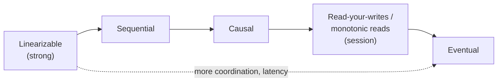
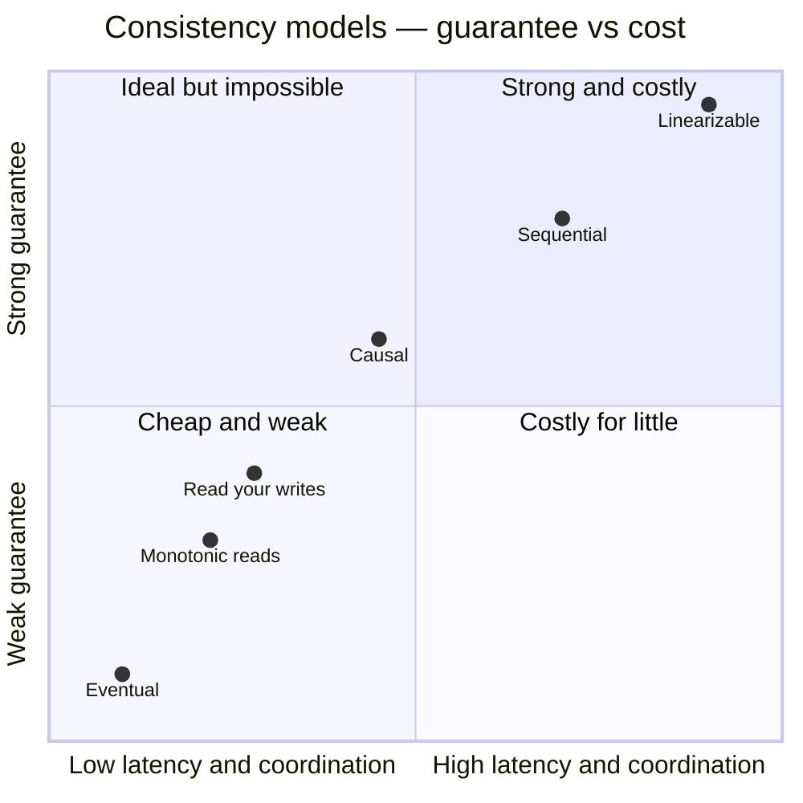
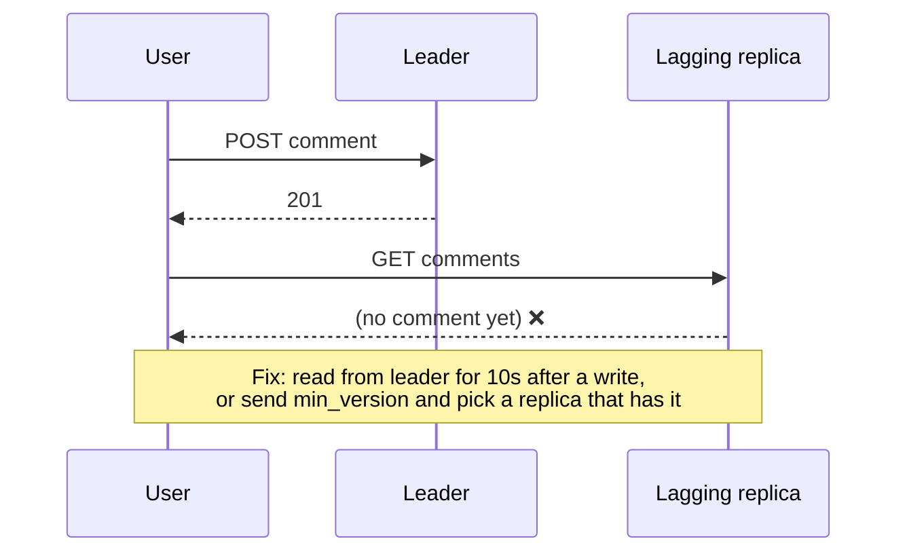

# Consistency Models

## What is it?

A consistency model is a **promise about what reads can return** when data is replicated. Stronger promises are easier to program against but cost latency and availability.

## The spectrum

| Model | Promise | Example need | Cost |
|---|---|---|---|
| **Linearizable (strong)** | Behaves like a single copy; once a write completes, all later reads see it | Leader election, locks, unique usernames, bank balance | Coordination on every op (consensus/quorum), higher latency, unavailable in partitions |
| **Sequential** | Everyone sees ops in the same order (not necessarily real-time) | Rarely discussed in interviews | |
| **Causal** | If A caused B, everyone sees A before B; concurrent ops may differ | Comments/replies, chat ("question before answer") | Track dependencies (vector clocks) |
| **Read-your-writes** | You always see your own writes | Edit profile → refresh shows it | Route user to leader / version tracking |
| **Monotonic reads** | You never see time go backwards | Comment doesn't vanish on refresh | Stick user to a replica |
| **Eventual** | If writes stop, replicas converge | Likes count, view counts, DNS, feeds | Cheapest, most available |

## Strong vs eventual — the classic table

| | Strong | Eventual |
|---|---|---|
| Reads | Always latest | May be stale |
| Latency | Higher (waits for quorum/leader) | Lower |
| Availability under partition | Lower | Higher |
| Programming | Easy | Must handle staleness & conflicts |
| Examples | Spanner, etcd, single-leader reads from leader | Cassandra (ONE), DynamoDB default reads, DNS, CDN |

## Conflict resolution under eventual consistency

When two replicas accept concurrent writes:

| Strategy | How | Risk |
|---|---|---|
| **Last-write-wins (LWW)** | Highest timestamp wins | Silently drops writes; clock skew picks the wrong one |
| Version vectors + app merge | Detect concurrent versions, return siblings, app merges | More complex (Dynamo cart merge) |
| **CRDTs** | Data types that merge automatically and deterministically (counters, sets, text) | Limited types; metadata overhead → [[Real-Time-Collaboration-CRDTs]] |
| Single leader per key | Avoid conflicts entirely | Less availability for writes |

## Choosing per feature (say this in interviews)

| Feature | Model |
|---|---|
| Payment balance | Strong |
| Seat booking | Strong (or strong per seat) |
| Chat messages in a conversation | Causal / per-conversation ordering |
| User's own post after publishing | Read-your-writes |
| Feed of others' posts | Eventual (seconds) |
| Like counts, view counts | Eventual |
| Username uniqueness | Strong (unique constraint / consensus) |

## 📊 Visual model

**Read-your-writes failure and fix:**

## Common mistakes

> [!warning] Traps to avoid
> 1. "Eventual consistency" with no bound — state "typically < 1–2 s".
> 2. LWW for anything where losing an update matters.
> 3. Strong consistency for everything (slow, expensive, less available).
> 4. Forgetting read-your-writes — the most user-visible anomaly.

## Interview understanding

> [!question] What the interviewer is really testing
> - *"Is eventual consistency acceptable here?"* — Answer per feature with user impact.
> - *Tricky:* "How do you give read-your-writes with read replicas?" — Read from leader for a short window after writes, or pass a version/LSN and read from a replica that has caught up.
> - *Tricky:* "Why is LWW dangerous?" — Clock skew + concurrent writes → arbitrary data loss.
> - *Tricky:* "Linearizable vs serializable?" — Linearizable: single-object recency guarantee (real-time). Serializable: multi-object transactions appear in some serial order. "Strict serializable" = both.

## Mini quiz
1. Strongest model in the list?
2. Model that guarantees replies appear after questions?
3. Fix for the "comment disappears on refresh" bug?
4. Conflict resolution that never loses concurrent increments?
5. Linearizable vs serializable?

> [!success]- Answers (click to reveal)
> 1. Linearizability.
> 2. Causal consistency.
> 3. Monotonic reads — pin user to a replica.
> 4. A CRDT counter (e.g., PN-counter).
> 5. Recency for single objects vs isolation for multi-object transactions.

---
**Next:** [[Consensus-and-Leader-Election]] · **Up:** [[Distributed-Systems-MOC]]

## 📚 Resources
- 📄 [Jepsen — Consistency models map](https://jepsen.io/consistency)
- 📖 *DDIA* Ch. 9 — consistency and consensus.
- 📄 [Werner Vogels — Eventually Consistent](https://www.allthingsdistributed.com/2008/12/eventually_consistent.html)

## My notes
-
