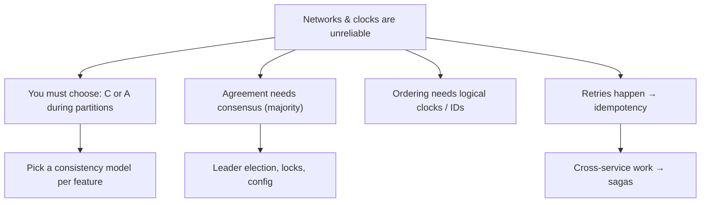

# 🌐 06 · Distributed Systems Thinking MOC

> [!important] The mindset shift
> On one machine, a function call either returns or throws. Across machines, a call can **succeed, fail, or you'll never know** — and that third case is what this whole module is about.

| # | Note | Lecture | You'll be able to |
|---|---|---|---|
| 1 | [[Why-Distributed-Systems-Are-Hard]] | L16 | Partial failures, slow vs dead, the 8 fallacies |
| 2 | [[CAP-and-PACELC]] | L16 | Apply CAP to a specific feature; PACELC for normal operation |
| 3 | [[Consistency-Models]] | L16 | Strong vs eventual vs causal vs read-your-writes |
| 4 | [[Consensus-and-Leader-Election]] | L17 | Raft intuition, split brain, fencing, etcd/ZooKeeper |
| 5 | [[Clocks-and-Ordering]] | L17 | Clock skew, Lamport & vector clocks, hybrid clocks |
| 6 | [[Unique-ID-Generation]] | L17 | Auto-increment vs UUID vs Snowflake vs ULID |
| 7 | [[Distributed-Transactions]] | L18 | 2PC, sagas (choreography/orchestration), outbox |
| 8 | [[Idempotency]] | L18 | Idempotency keys, dedup, effectively-once processing |

**Next module:** [[Production-MOC]] · **Up:** [[System-Design-MOC]]
