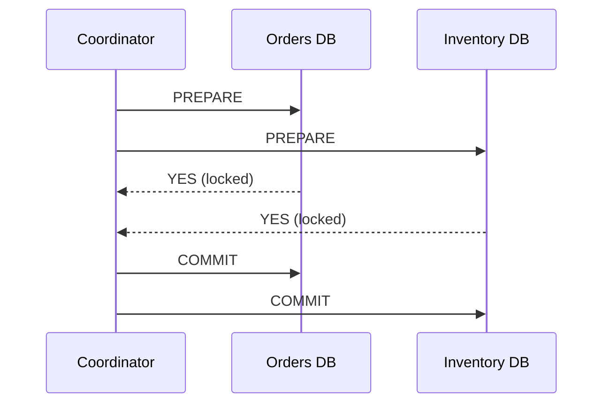
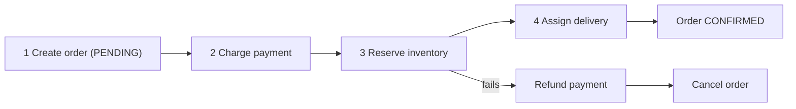
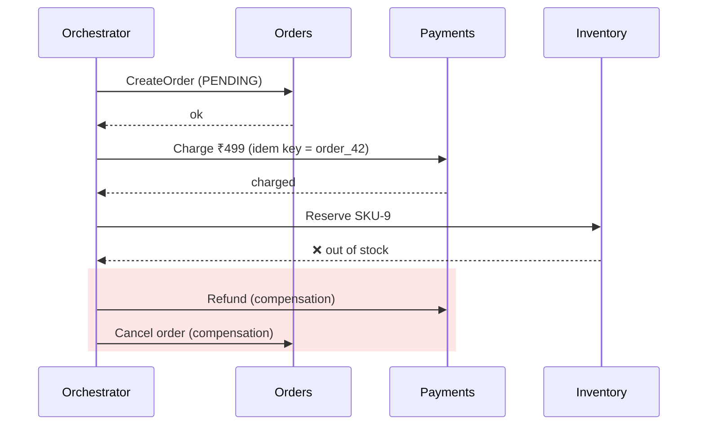
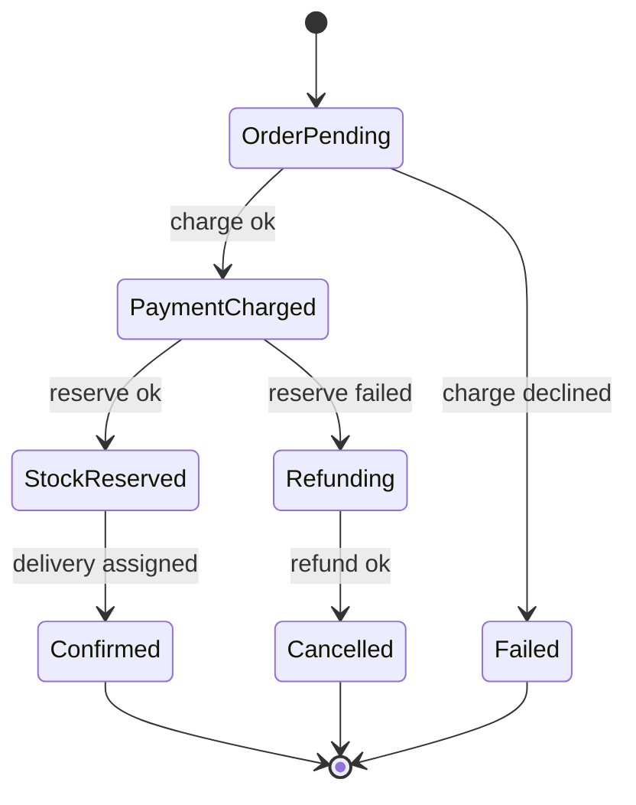
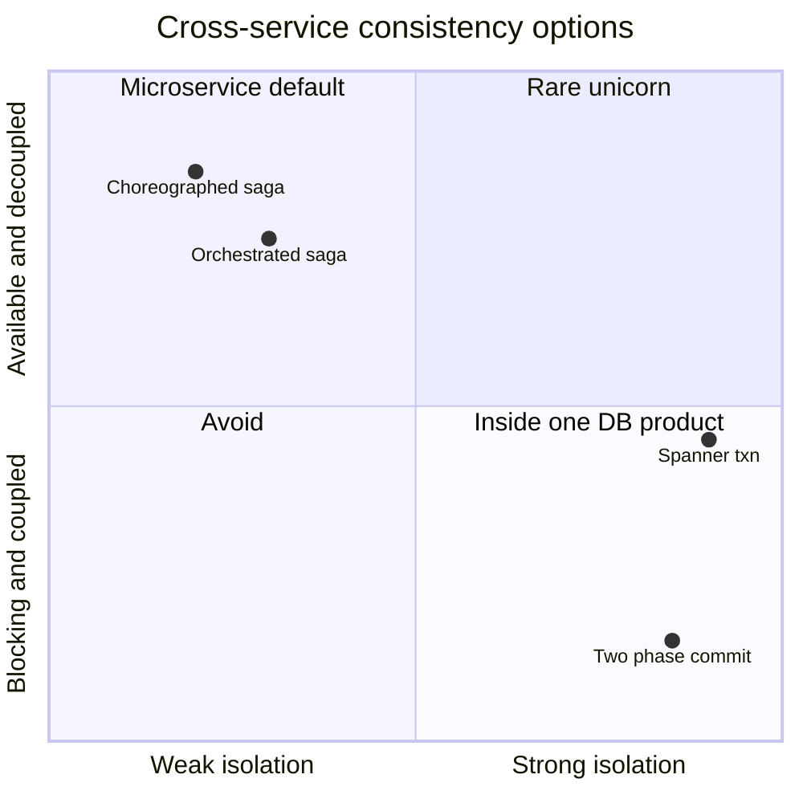

# Distributed Transactions — 2PC, Sagas, Outbox

## The problem

"Place order" touches **Orders DB, Payments service, Inventory service**. In a monolith with one DB, that's one ACID transaction. Across services with separate DBs, there's no single transaction — and any step can fail, time out, or be retried.

## Option 1 — Two-Phase Commit (2PC)

1. **Prepare:** every participant does the work, holds locks, votes yes/no.
2. **Commit/abort:** coordinator decides; everyone follows.

| Pros | Cons |
|---|---|
| Atomic across resources | **Blocking:** coordinator crash after prepare → participants hold locks indefinitely |
| Familiar ACID semantics | Latency (2 round trips, locks held across network) |
| | Every participant must support XA/prepare; poor fit for microservices & third-party APIs |

Used inside some databases (Spanner, CockroachDB use 2PC + consensus so the coordinator is fault-tolerant). **Rarely the answer across microservices.**

## Option 2 — Saga (the usual answer)

A sequence of **local transactions**; each step publishes an event/triggers the next. If a step fails, run **compensating transactions** to semantically undo earlier steps.

### Choreography vs orchestration

| | Choreography | Orchestration |
|---|---|---|
| How | Services react to each other's events | A central orchestrator sends commands, tracks state |
| Coupling | Loose, no central brain | Orchestrator knows the flow |
| Visibility | Hard to see the whole flow; cyclic dependencies risk | Clear state machine, easy to monitor/retry |
| Good for | 2–4 simple steps | Complex, long-running flows (payments, bookings, onboarding) |
| Tools | Kafka events | **Temporal**, AWS Step Functions, Camunda, Netflix Conductor |

### Saga rules

- Each step must be **idempotent** (retries happen). → [[Idempotency]]
- Compensations must be idempotent too, and **can't always truly undo** (an email was sent → send an apology email). Design steps so irreversible ones come **last** ("pivot transaction").
- No isolation: other transactions can see intermediate states (order PENDING). Use **semantic locks** (status fields), commutative updates, or re-check at commit.

## Option 3 — Transactional outbox (pairs with sagas)

Guarantee "DB updated **and** event published" without 2PC: write the event to an outbox table in the same local transaction; a relay/CDC publishes it. → [[Event-Driven-Architecture]]

## Idempotency keys across the chain

Pass a stable key (`order_id` or a request ID) through every step so retries at any layer dedupe. Payment providers (Stripe, Razorpay) accept idempotency keys for exactly this.

## Decision guide

| Situation | Use |
|---|---|
| Same database | Local ACID transaction (just do this when possible!) |
| Multiple services, business workflow | **Saga** (orchestrated if > ~3 steps) + outbox + idempotency |
| Need strict atomic commit across shards of one DB product | DB's built-in distributed txn (Spanner/CockroachDB) |
| Third-party APIs involved | Saga + reconciliation jobs (can't 2PC a bank) |

## 📊 Visual model

**Orchestrated saga with a compensation:**

**Saga state machine (what the orchestrator persists):**

**2PC vs Saga:**

## Common mistakes

> [!warning] Traps to avoid
> 1. Proposing 2PC across microservices and third-party payment gateways.
> 2. Sagas without compensations for each step.
> 3. Non-idempotent steps.
> 4. Forgetting the "unknown outcome" case (timeout from payment gateway) → status `PENDING` + reconciliation.
> 5. Splitting data into services that constantly need transactions together (wrong boundaries).

## Interview understanding

> [!question] What the interviewer is really testing
> - *"How do you make order + payment + inventory consistent?"* — Orchestrated saga, local transactions, outbox, idempotency keys, compensations, reconciliation.
> - *Tricky:* "Why is 2PC called blocking?" — If the coordinator dies after participants vote YES, they can't decide alone and keep locks.
> - *Tricky:* "What if a compensation fails?" — Retry (idempotent) with backoff; after N failures → alert + manual intervention queue.
> - *Tricky:* "Sagas provide which ACID properties?" — A (eventually, via compensation), C (eventually), D; **not I**.

## Mini quiz
1. Two phases of 2PC?
2. What's a compensating transaction?
3. Choreography vs orchestration — which for a 7-step payment flow?
4. What property do sagas lack?
5. Name a saga orchestration tool.

> [!success]- Answers (click to reveal)
> 1. Prepare (vote) and commit/abort.
> 2. A local transaction that semantically undoes a previous step.
> 3. Orchestration.
> 4. Isolation.
> 5. Temporal / AWS Step Functions / Camunda.

---
**Next:** [[Idempotency]] · **Up:** [[Distributed-Systems-MOC]]

## 📚 Resources
- 📄 [microservices.io — Saga pattern](https://microservices.io/patterns/data/saga.html)
- 📄 [Garcia-Molina & Salem — Sagas (1987)](https://www.cs.cornell.edu/andru/cs711/2002fa/reading/sagas.pdf)
- 📄 [Temporal docs](https://docs.temporal.io/)

## My notes
-
