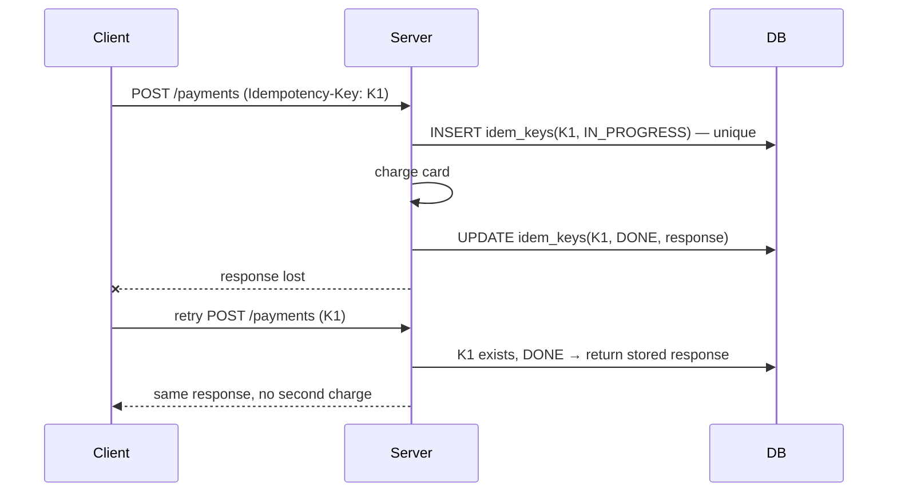
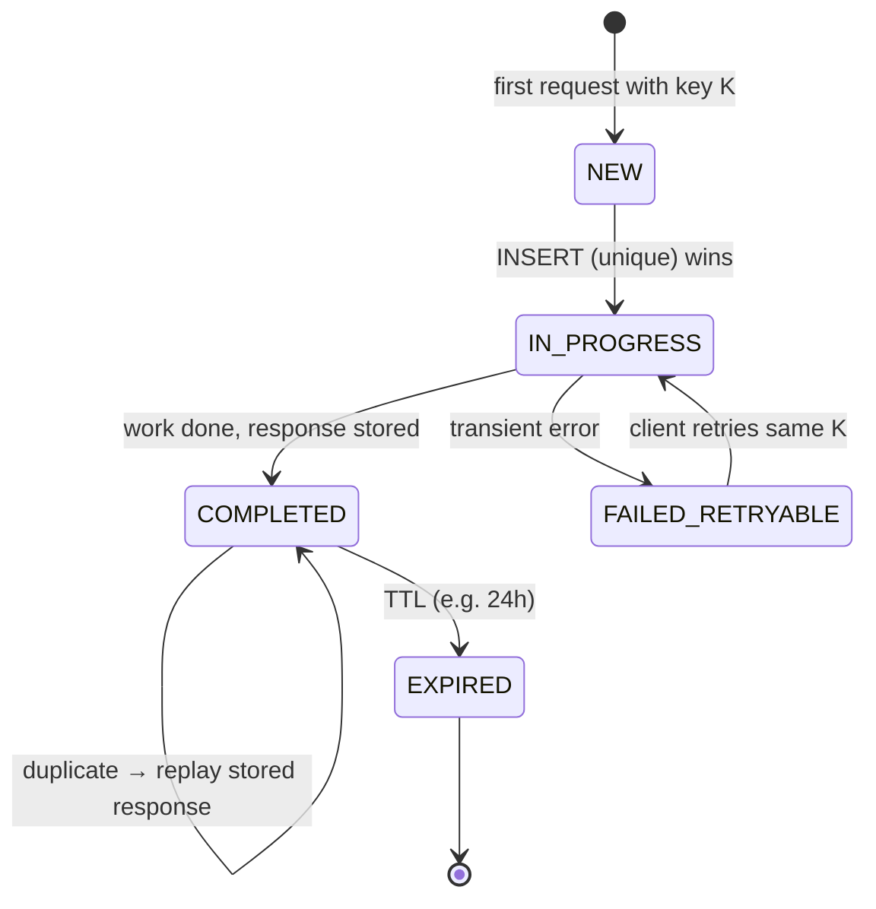
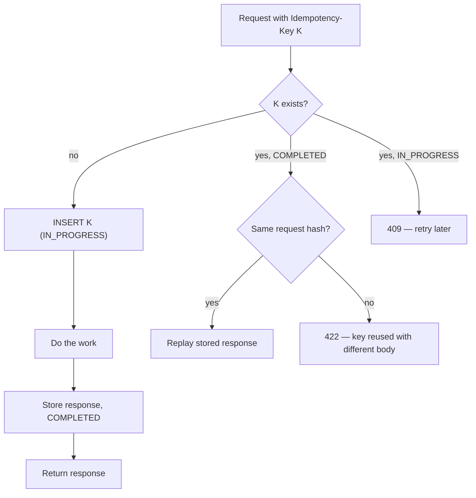

# Idempotency

## What is it?

An operation is **idempotent** if doing it many times has the same effect as doing it once.

- `SET balance = 500` → idempotent. `balance = balance - 100` → not.
- `DELETE /orders/42` → idempotent. `POST /orders` → not (by default).

## Why it's the most important reliability property

In distributed systems, **retries are unavoidable** (timeouts, crashes, at-least-once queues), and a retry may hit an operation that **already succeeded**. Without idempotency: double charges, duplicate orders, two OTP SMSes, inventory decremented twice. → [[Why-Distributed-Systems-Are-Hard]]

**At-least-once delivery + idempotent processing = effectively-once.** That's the industry answer to "exactly-once".

## Analogy

A lift button. Pressing it 10 times calls the lift once. A vending machine without idempotency gives you 10 cans and charges 10 times.

## Technique 1 — Idempotency keys (APIs)

Implementation details that score points:
- Key generated **by the client** per logical operation (UUID), reused on retries.
- Store key with a **unique constraint**, request hash (reject same key + different body → 422), status, response, TTL (e.g., 24h–7d).
- **Concurrent duplicates:** second request sees `IN_PROGRESS` → return 409 / "retry later", don't run twice.
- Make "record key" and "do the work" atomic where possible (same DB transaction for local effects).

## Technique 2 — Natural idempotency via data design

| Pattern | Example |
|---|---|
| Unique constraints | `UNIQUE(order_id)` on payments; `UNIQUE(show_id, seat_id)` on bookings |
| Upserts | `INSERT … ON CONFLICT DO NOTHING/UPDATE` |
| Absolute instead of relative updates | `SET status='SHIPPED'` rather than "advance status" |
| Conditional updates | `UPDATE … WHERE status='PENDING'` → second run updates 0 rows |
| Versioning | Apply event only if `event.version = current + 1` |

## Technique 3 — Consumer dedup (queues)

- Each message carries a unique `message_id`/`event_id`.
- Consumer keeps a **processed-IDs table** (or Redis set with TTL); check-and-insert **in the same transaction** as the side effect.
- Kafka: dedupe by `(partition, offset)` or by event ID; idempotent producer prevents broker-side duplicates.

## Technique 4 — External side effects

Email/SMS/push providers and payment gateways: pass your idempotency key downstream if supported (Stripe, Razorpay support it); otherwise record "sent" with a unique key before/after with careful ordering, and accept a tiny duplicate risk where harmless.

## Where it shows up

| Case study | Idempotency point |
|---|---|
| [[Design-Payment-System]] | Idempotency key per payment attempt; ledger entries unique per txn |
| [[Design-Notification-System]] | Dedup key per (user, notification) to avoid double sends |
| [[Design-Ticket-Booking]] | Unique (show, seat); confirm is idempotent |
| [[Design-Food-Delivery]] | Order creation from flaky mobile networks |
| [[Design-Ad-Click-Aggregator]] | Dedup click IDs to avoid overbilling |

## 📊 Visual model

**Idempotency-key record lifecycle:**

**Server decision tree:**

## Common mistakes

> [!warning] Traps to avoid
> 1. Server-generated idempotency keys (useless — the retry gets a new one).
> 2. Check-then-insert without a unique constraint (race).
> 3. No TTL → table grows forever.
> 4. Same key reused with a different payload silently accepted.
> 5. Thinking GET retries are the problem — it's POSTs and consumers.

## Interview understanding

> [!question] What the interviewer is really testing
> - *"How do you avoid double charging?"* — Client idempotency key + unique constraint + stored response + gateway idempotency + reconciliation.
> - *Tricky:* "Is exactly-once delivery possible?" — Not end-to-end in general; at-least-once + idempotency gives effectively-once.
> - *Tricky:* "Two identical requests arrive at the same millisecond on different servers." — Unique constraint makes one win; the other sees IN_PROGRESS → 409/retry.
> - *Tricky:* "Is PUT always idempotent in practice?" — By spec yes; but if your PUT handler increments a counter or sends an email, you broke it.

## Mini quiz
1. Who generates the idempotency key?
2. What makes the dedup check race-free?
3. Effectively-once = ?
4. Turn "decrement stock" into an idempotent operation.
5. What to do when the same key arrives with a different body?

> [!success]- Answers (click to reveal)
> 1. The client, once per logical operation.
> 2. A unique constraint (atomic insert).
> 3. At-least-once delivery + idempotent processing.
> 4. Record `(order_id)` in a reservations table with a unique constraint and decrement in the same transaction; replays hit the constraint.
> 5. Reject (e.g., 422) — it's a client bug.

---
**Next:** [[Production-MOC]] · **Up:** [[Distributed-Systems-MOC]]

## 📚 Resources
- 📄 [Stripe — Designing robust and predictable APIs with idempotency](https://stripe.com/blog/idempotency)
- 📄 [AWS Builders' Library — Making retries safe with idempotent APIs](https://aws.amazon.com/builders-library/making-retries-safe-with-idempotent-APIs/)

## My notes
-
