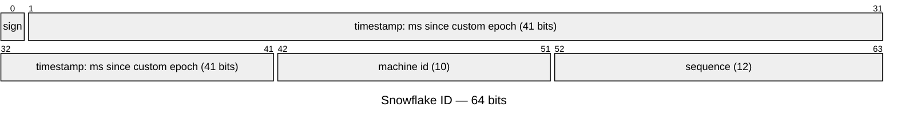
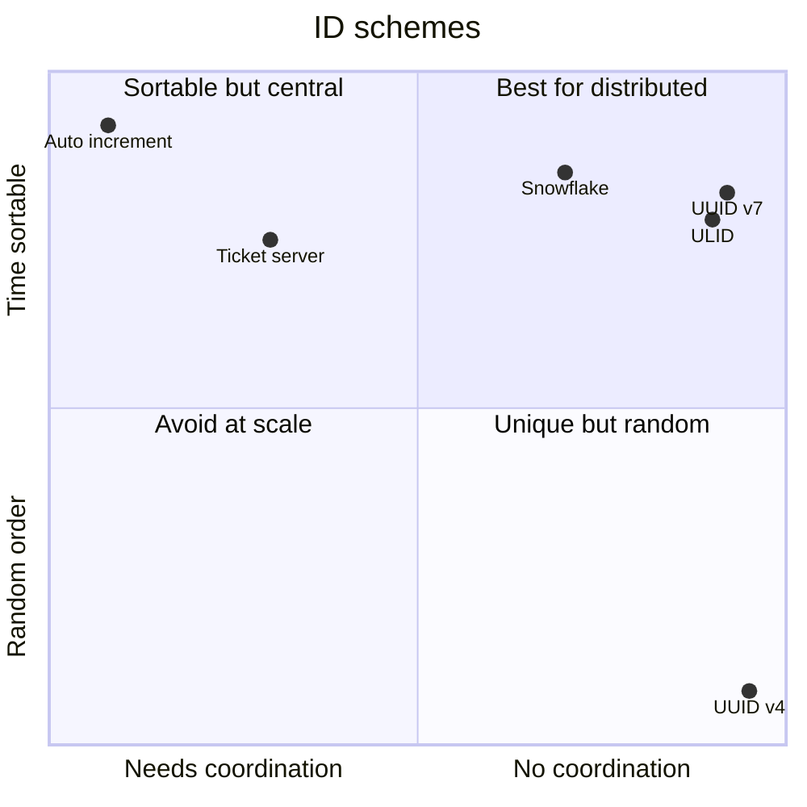

# Unique ID Generation

## The problem

With one database, `AUTO_INCREMENT` works. With many shards/services/regions generating IDs in parallel, you need IDs that are **unique without coordination**, ideally **sortable by time**, **compact**, and **not guessable** where that matters.

## Options

| Approach | Format | Unique w/o coordination | Time-sortable | Size | Notes |
|---|---|---|---|---|---|
| **DB auto-increment** | 1, 2, 3 | ❌ (single point) | ✅ | 8 B | Simple; SPOF; leaks volume; enumerable |
| Auto-increment with offsets | Shard1: 1,3,5; Shard2: 2,4,6 | ✅ | ~ | 8 B | Hard to add shards |
| **Ticket server / range allocation** | Service hands out blocks of 1000 | ✅ (after block fetch) | ~ | 8 B | Flickr ticket servers; block loss on crash = gaps (fine) |
| **UUID v4** | 128-bit random | ✅ | ❌ | 16 B | Random inserts fragment B-tree indexes; big |
| **UUID v7** | 48-bit ms timestamp + random | ✅ | ✅ | 16 B | Standardised (RFC 9562, 2024); great modern default |
| **ULID** | 48-bit time + 80-bit random, Base32 | ✅ | ✅ | 16 B / 26 chars | Like v7, human-friendly string |
| **Snowflake** | 41-bit time + 10-bit machine + 12-bit sequence | ✅ | ✅ | **8 B** | Twitter; compact; needs machine IDs |

## Snowflake layout (memorise)

```text
| 1 bit sign | 41 bits timestamp (ms since custom epoch) | 10 bits machine/worker ID | 12 bits sequence |
     0            ~69 years of ms                              1024 workers                4096 IDs/ms/worker
```

- Per worker: **4,096 IDs per millisecond** (~4M/s).
- IDs sort by time (roughly, across machines — clock skew!).
- Machine IDs assigned via config/ZooKeeper/etcd.
- **Clock moves backwards** → refuse to generate until clock catches up (or use last timestamp + wait).

Variants: Instagram (time + logical shard ID + sequence, generated inside Postgres), Discord, Sonyflake.

## Why sortability matters

- **B-tree locality:** time-ordered keys append to the right side of the index → fewer page splits than random UUIDv4.
- Cursor pagination by ID = by time. → [[API-Design]]
- Rough chronology without an extra column.

## Choosing (say this)

| Need | Pick |
|---|---|
| Single DB, internal | Auto-increment / `bigserial` is fine |
| Distributed, compact 64-bit, time-ordered | **Snowflake** |
| Distributed, no machine-ID management | **UUIDv7 / ULID** |
| Short public codes (URL shortener) | Counter/ranges → **base62** encode, or random + collision check → [[Design-URL-Shortener]] |
| Non-guessable public IDs | Random component (UUIDv4/v7) — don't expose sequential IDs |
| Idempotency keys | UUID generated by the **client** → [[Idempotency]] |

## 📊 Visual model

**Snowflake ID bit layout:**



**Trade-off map:**



$$\text{IDs/sec per worker} = 2^{12} \times 1000 \approx 4.1\text{M} \qquad \text{lifetime} = \frac{2^{41}\ \text{ms}}{3.15\times10^{10}\ \text{ms/yr}} \approx 69\ \text{years}$$

## Common mistakes

> [!warning] Traps to avoid
> 1. UUIDv4 as the clustered primary key in MySQL at scale (index fragmentation).
> 2. Exposing sequential IDs publicly (competitors infer order volume; users enumerate resources).
> 3. Forgetting clock rollback in Snowflake.
> 4. Assuming Snowflake IDs are globally strictly ordered.

## Interview understanding

> [!question] What the interviewer is really testing
> - *"How do you generate IDs across shards?"* — Snowflake (explain bits) or UUIDv7; justify sortability and size.
> - *Tricky:* "What if two Snowflake generators have the same machine ID?" — Duplicates; assign IDs via a coordination service or lease.
> - *Tricky:* "Why not just UUIDv4?" — 16 bytes, random index inserts, not sortable.
> - *Tricky:* "How many IDs per second can one Snowflake worker generate?" — 4,096 per ms ≈ 4M/s.

## Mini quiz
1. Snowflake bit layout?
2. Max IDs/ms per Snowflake worker?
3. UUIDv4 vs v7?
4. Why are sequential public IDs risky?
5. What does a ticket server do?

> [!success]- Answers (click to reveal)
> 1. 1 sign + 41 time + 10 machine + 12 sequence.
> 2. 4,096.
> 3. v4 fully random; v7 time-prefixed → sortable, index-friendly.
> 4. Enumeration attacks and business-volume leakage.
> 5. Hands out ID blocks/ranges from a central counter.

---
**Next:** [[Distributed-Transactions]] · **Up:** [[Distributed-Systems-MOC]]

## 📚 Resources
- 📄 [Twitter — Announcing Snowflake (2010)](https://blog.x.com/engineering/en_us/a/2010/announcing-snowflake)
- 📄 [RFC 9562 — UUIDs (incl. v7)](https://www.rfc-editor.org/rfc/rfc9562)
- 📄 [Instagram — Sharding & IDs](https://instagram-engineering.com/sharding-ids-at-instagram-1cf5a71e5a5c)

## My notes
-
