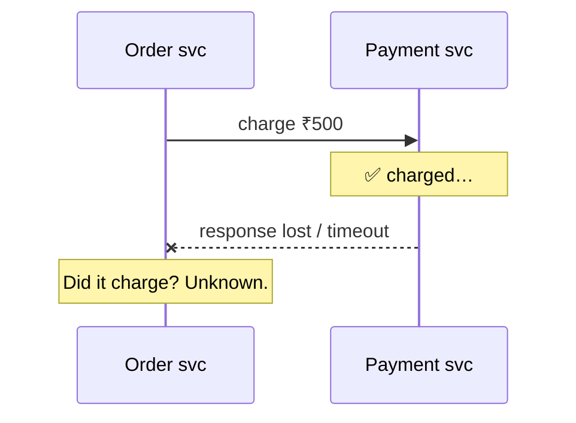
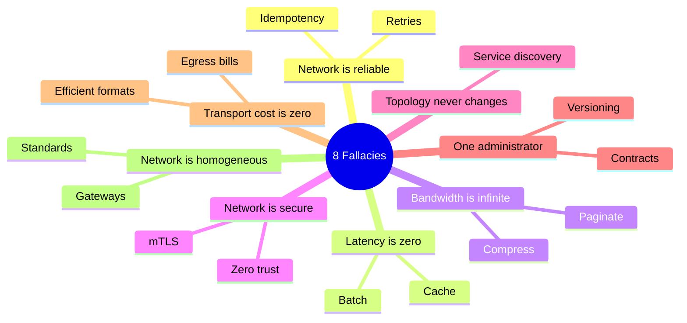
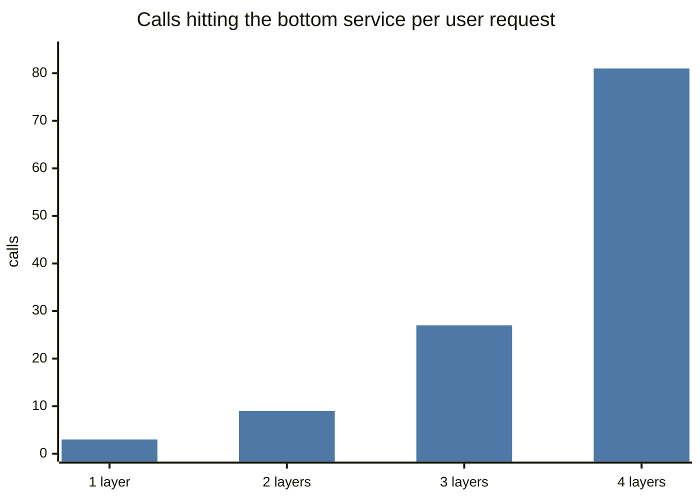

# Why Distributed Systems Are Hard

## What is it?

A distributed system is multiple machines cooperating over a network to appear as one system. The difficulty comes from three facts: **networks are unreliable, clocks disagree, and machines fail independently**.

## The core problem: partial failure

On one machine, things work or crash entirely. In a distributed system, **some parts fail while others keep working**, and you often **can't tell** which.

Three possible truths behind a timeout: request lost, server crashed mid-way, or **it succeeded and the response was lost**. Your design must be correct in all three → **retries + idempotency**. → [[Idempotency]]

## Slow vs dead — you can't tell them apart

A node that's GC-pausing for 10 seconds looks identical to a dead one. Consequences:
- Timeouts are **guesses**. Too short → false failovers & retry storms; too long → slow detection.
- A "dead" leader might wake up and keep acting like a leader → **split brain** → need fencing tokens. → [[Consensus-and-Leader-Election]]

## The 8 fallacies of distributed computing (Deutsch et al.)

| Fallacy | Reality | Design response |
|---|---|---|
| 1. The network is reliable | Packets drop, links fail | Retries, idempotency, acks |
| 2. Latency is zero | Every hop costs ms | Batch, cache, colocate, avoid chatty calls |
| 3. Bandwidth is infinite | Big payloads clog links | Compression, pagination, references to S3 |
| 4. The network is secure | Anyone may listen | TLS/mTLS, zero trust |
| 5. Topology doesn't change | Instances come and go | Service discovery |
| 6. There is one administrator | Many teams/providers | Contracts, versioning |
| 7. Transport cost is zero | Serialisation + egress bills | Efficient formats, regional design |
| 8. The network is homogeneous | Mixed devices/protocols | Standards, gateways |

## Other sources of pain

- **Clocks:** each machine's clock drifts; NTP corrects imperfectly. "Last write wins by timestamp" can drop the actually-later write. → [[Clocks-and-Ordering]]
- **Ordering:** messages can arrive out of order or duplicated.
- **Network partitions:** the cluster splits; both halves alive, can't talk. → [[CAP-and-PACELC]]
- **Cascading failures:** one slow dependency exhausts threads/connections upstream → whole system down. → [[Resilience-Patterns]]
- **Byzantine faults:** nodes lying/corrupt (mostly ignored outside blockchains/high-security; assume crash-stop or crash-recovery faults).

## The toolkit this module builds

| Problem | Tool |
|---|---|
| Unknown outcomes | Idempotency keys, retries with backoff |
| Agreement (who's leader, committed?) | Consensus (Raft/Paxos) |
| Ordering without trusted clocks | Logical clocks, sequence numbers, single-partition ordering |
| Cross-node atomicity | 2PC (rarely), sagas (usually) |
| Choosing behaviour under partition | CAP/PACELC per feature |

## 📊 Visual model

**Retry amplification across layers (3 attempts at each layer):**

$$\text{load multiplier} = r^{d} \quad (r = \text{attempts per layer},\ d = \text{depth})$$

## Common mistakes

> [!warning] Traps to avoid
> 1. Treating a remote call like a local function call.
> 2. Retrying non-idempotent operations.
> 3. Using wall-clock timestamps to order events across machines.
> 4. Infinite timeouts (or none at all).

## Interview understanding

> [!question] What the interviewer is really testing
> - *"What happens if the payment service times out?"* — The outcome is unknown; retry with the same idempotency key; reconcile later if still unknown. This answer alone shows distributed thinking.
> - *Tricky:* "How do you detect a failed node?" — Heartbeats + timeouts (phi-accrual detectors adapt to network conditions) — but detection is always probabilistic.
> - *Tricky:* "Why not just use synchronised clocks?" — Clock skew is unbounded in practice without special hardware (Google TrueTime uses GPS/atomic clocks with explicit uncertainty).

## Mini quiz
1. Three possible causes of a timeout?
2. Why can't a timeout distinguish slow from dead?
3. Name 3 of the 8 fallacies.
4. What makes cascading failures happen?
5. Primary defence against unknown outcomes?

> [!success]- Answers (click to reveal)
> 1. Request lost, server crashed mid-processing, response lost after success.
> 2. Both look like silence; there's no upper bound on network delay or pauses.
> 3. Reliable network, zero latency, infinite bandwidth (also secure, fixed topology, one admin, zero cost, homogeneous).
> 4. Slow dependencies tie up resources upstream (threads, connections), propagating failure.
> 5. Idempotent operations + retries (and reconciliation).

---
**Next:** [[CAP-and-PACELC]] · **Up:** [[Distributed-Systems-MOC]]

## 📚 Resources
- 📖 *DDIA* Ch. 8 — "The Trouble with Distributed Systems".
- 📄 [Fallacies of distributed computing (Wikipedia)](https://en.wikipedia.org/wiki/Fallacies_of_distributed_computing)
- 📄 [AWS Builders' Library — Timeouts, retries, and backoff with jitter](https://aws.amazon.com/builders-library/timeouts-retries-and-backoff-with-jitter/)

## My notes
-
