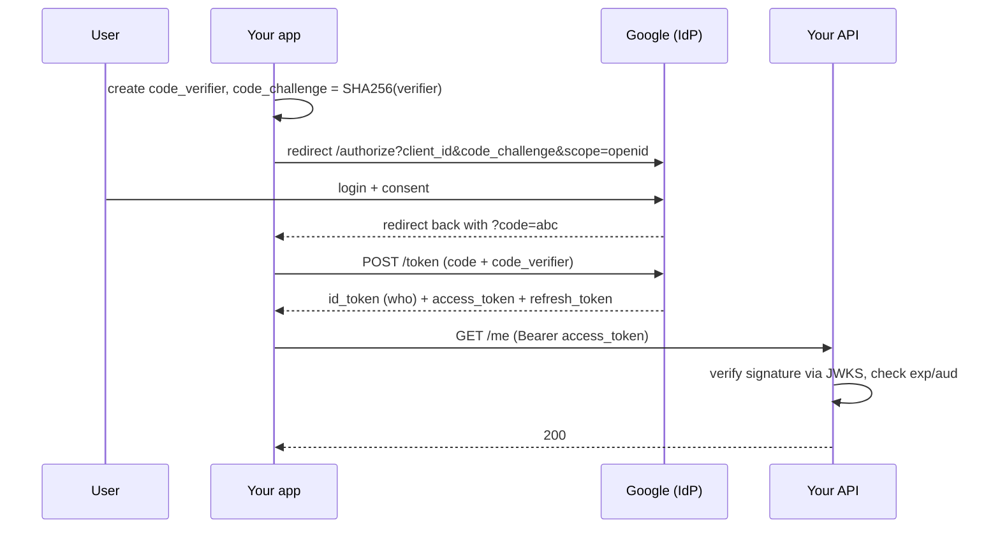
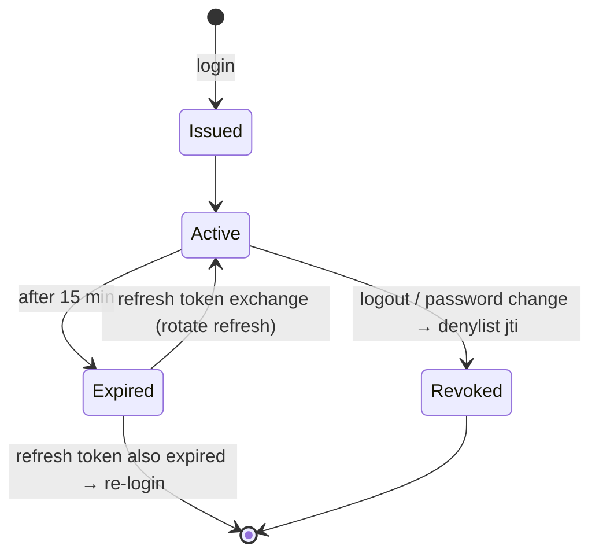
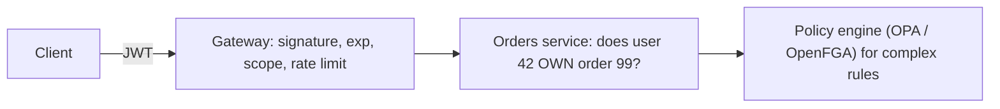

# Authentication and Authorization

## What is it?

- **Authentication (AuthN):** *Who are you?* — proving identity (password, OTP, passkey, SSO).
- **Authorization (AuthZ):** *What are you allowed to do?* — permissions on resources.

401 = authentication failed/missing. 403 = authenticated but not authorised.

## Sessions vs tokens

| | Server-side session | Token (JWT) |
|---|---|---|
| Client holds | Random session ID in a cookie | Signed token with claims |
| Server holds | Session data (Redis) | Nothing per user (just signing keys) |
| Validation | Lookup in session store | Verify signature + expiry locally |
| Revocation | **Easy** — delete session | **Hard** — valid until expiry (needs denylist or short TTL) |
| Scaling | Needs shared store (Redis) | Stateless, great for microservices |
| Size | Tiny cookie | Bigger (claims in every request) |
| Best for | Classic web apps | APIs, mobile, service-to-service |

**Common production combo:** short-lived **access token** (5–15 min JWT) + long-lived **refresh token** (stored server-side, revocable, rotated on use).

## JWT anatomy

```text
header.payload.signature
eyJhbGciOiJSUzI1NiJ9 . eyJzdWIiOiI0MiIsInJvbGUiOiJhZG1pbiIsImV4cCI6MTc5…} . <signature>
{"alg":"RS256","kid":"key-2026-11"}   {"sub":"42","role":"admin","exp":…,"iss":…,"aud":…}
```

- **Signed, not encrypted** (base64url) → never put secrets/PII in it.
- **RS256/ES256** (asymmetric): auth server signs with private key; every service verifies with public key from a **JWKS** endpoint → no shared secret. HS256 (shared secret) only inside one trust boundary.
- Always validate `exp`, `iss`, `aud`, and reject `alg: none`.

## OAuth 2.0 and OpenID Connect

- **OAuth 2.0** = *delegated authorization*: "let this app access my Google Drive" without giving it your password. Issues **access tokens**.
- **OIDC** = identity layer on top of OAuth: adds an **ID token** (who the user is). "Login with Google" = OIDC.
- **Authorization Code + PKCE** = the correct flow for web/mobile apps today. (Implicit flow is deprecated.)
- **Client Credentials** = service-to-service (no user).

## SSO

One login, many apps. Enterprise: SAML or OIDC via an Identity Provider (Okta, Azure AD/Entra ID, Google Workspace, Keycloak).

## Authorization models

| Model | Idea | Example |
|---|---|---|
| **RBAC** | Roles → permissions | `admin`, `editor`, `viewer` |
| **ABAC** | Policies on attributes | "managers can approve expenses < ₹50k in their department" |
| **ReBAC** | Relationships graph | Google Docs sharing: "user is editor of folder that contains doc" → Google **Zanzibar**, OpenFGA, SpiceDB |
| ACLs | Per-resource lists | File permissions |

**Where to enforce:** coarse checks at the gateway (is the token valid? has scope?), **fine-grained checks in the service that owns the resource** (does user 42 own order 99?) — skipping this = **IDOR/BOLA**, the #1 API vulnerability (OWASP API Top 10).

## 📊 Visual model

**OAuth 2.0 Authorization Code + PKCE ("Login with Google"):**



**Token lifecycle:**



**Where each check lives:**



## Common mistakes

> [!warning] Traps to avoid
> 1. Long-lived JWTs with no revocation plan.
> 2. Storing tokens in `localStorage` (XSS-stealable) — prefer `HttpOnly; Secure; SameSite` cookies for web.
> 3. Only checking auth at the gateway (IDOR).
> 4. Rolling your own crypto/password scheme.
> 5. Putting PII/secrets in JWT payloads.

## Interview understanding

> [!question] What the interviewer is really testing
> - *"How does auth work in your design?"* — Gateway validates JWT (RS256 via JWKS), services do resource-level authorization; refresh tokens in Redis for revocation.
> - *Tricky:* "How do you log out a JWT user immediately?" — Short TTL + denylist of `jti` in Redis until expiry, or token versioning per user.
> - *Tricky:* "OAuth vs OIDC?" — Authorization delegation vs authentication identity layer.
> - *Tricky:* "How does Google Docs check sharing permissions at scale?" — ReBAC (Zanzibar): relationship tuples + graph evaluation, heavy caching.

## Mini quiz
1. 401 vs 403?
2. Main JWT weakness vs sessions?
3. Which OAuth flow for a mobile app?
4. What's IDOR?
5. RBAC vs ReBAC?

> [!success]- Answers (click to reveal)
> 1. Not authenticated vs not permitted.
> 2. Revocation before expiry.
> 3. Authorization Code with PKCE.
> 4. Accessing another user's object by changing an ID because the server doesn't check ownership.
> 5. Roles → permissions vs permissions derived from relationships between users and resources.

---
**Next:** [[Security-Essentials]] · **Up:** [[Production-MOC]]

## 📚 Resources
- 📄 [OAuth 2.0 simplified (Aaron Parecki)](https://www.oauth.com/)
- 📄 [OWASP API Security Top 10](https://owasp.org/API-Security/)
- 📄 [Google Zanzibar paper](https://research.google/pubs/zanzibar-googles-consistent-global-authorization-system/)
- 📄 [jwt.io introduction](https://jwt.io/introduction)

## My notes
-
